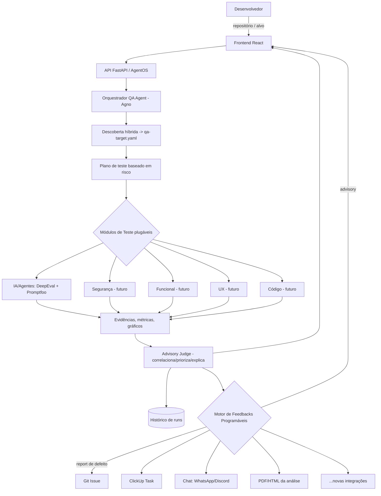

# QA Platform — QA Sênior Autônomo Orientado por IA

> Documento mestre de escopo e projeto. Fase atual: **Idealização** (versão < 1.0.0).
> Este documento é a fonte de verdade da visão; os detalhes por camada são lapidados
> nas sprints de idealização em `docs/ideation/`.

## 1. Visão e Problema

Construímos projetos heterogêneos — APIs (NestJS), frontends (React), agentes de IA
(Agno), infraestrutura AWS. Não existe hoje um QA que valide, de ponta a ponta,
**funcionalidade, usabilidade, vulnerabilidade e segurança**, incluindo o
comportamento de agentes de IA (hallucination, tool use, prompt injection, RAG).
Ferramentas isoladas não cobrem tudo nem centralizam evidências.

A QA Platform é uma **plataforma de QA orientada por IA** — um "QA sênior autônomo":
recebe um repositório, detecta a stack, monta um plano de testes baseado em risco,
executa camadas de validação orquestrando ferramentas especializadas, correlaciona e
prioriza as evidências, e centraliza tudo numa interface para o desenvolvedor decidir.

Não é um "AI Code Reviewer" nem um chatbot que olha código. É uma plataforma que
executa a aplicação, gera e roda testes, ataca superfícies (API/UI/agentes) e produz
evidências acionáveis.

## 2. Objetivos

### Objetivo primário
Ser uma **ferramenta real de trabalho** para validar os projetos do autor. Utilidade
prática é o foco; o aprendizado (Agno, evals, orquestração) é consequência.

### Objetivos específicos
- Avaliar agentes de IA / LLM como capacidade **núcleo** (primeira camada implementada).
- Nascer **extensível**: novas camadas de teste (targets) e novas integrações de
  feedback devem entrar como módulos/plugins, sem alterar o core.
- Centralizar execução, evidências, histórico e configuração numa **interface React**.
- Separar claramente **otimização** (advisory) de **defeito** (report acionável).
- Reusar os padrões de produção do portfólio Agno (guardrails, providers por env,
  observabilidade, secrets com fallback, arquitetura em camadas + SOLID).

### Não-objetivos (fora de escopo nesta fase)
- Não é um gate automático de merge no CI. O poder de decisão de "otimização" é do
  desenvolvedor (a plataforma apresenta dados; ela não sentencia pass/fail).
- Não substitui revisão humana de segurança crítica; reduz falso positivo, não elimina.
- Não implementa todas as 5 camadas de uma vez; começa pela camada de IA/Agentes.

## 3. Papel do Agente (dois modos de saída)

A plataforma opera com um **"advisory judge"**: a IA correlaciona sinais das
ferramentas determinísticas, prioriza e explica — mas o veredito não é automático.

| Modo | Quando | Comportamento |
|------|--------|---------------|
| **Advisory** | Otimização de agente, prompts, qualidade, e itens de melhoria contínua | Apresenta **dados, gráficos e números**. O **desenvolvedor decide**. Sem report automático. |
| **Report** | Defeito objetivo encontrado (frontend, backend, API, etc.) | Deve ser **reportado**. O **modelo e a forma** do report são **dinâmicos**, resolvidos pelo motor de Feedbacks Programáveis, e detalhados durante o desenvolvimento. |

Ambos os modos desembocam no mesmo **motor de feedback plugável** — muda o tipo de
payload e o gatilho, não a mecânica.

## 4. Escopo por Camadas (visão-alvo)

A visão completa cobre 5 camadas de QA (do documento de estudo `STUDY.md`). A camada
de IA/Agentes é o núcleo; as demais entram progressivamente como módulos.

| Camada | O que testa | Ferramentas de referência | Prioridade |
|--------|-------------|---------------------------|------------|
| 🤖 IA/Agentes | hallucination, tool use, RAG, comportamento, segurança do agente | **DeepEval + Promptfoo** | **Núcleo (1ª)** |
| 🔐 Segurança | vulnerabilidades, ataques, dependências, segredos | Semgrep + OWASP ZAP + scanners | Futuro |
| 🧪 Funcional | APIs, fluxos, regras de negócio | Playwright + API tests (OpenAPI) | Futuro |
| 👁️ UX | interface, comportamento, visual, acessibilidade | Playwright + Visual AI | Futuro |
| 🧠 Código | bugs, arquitetura, lógica, qualidade | SAST/AST/lint + IA própria | Futuro |

Princípio transversal: **teste baseado em risco** — a plataforma analisa o alvo,
atribui severidade às superfícies (ex: rota `DELETE` com `RequireAdmin` = alto risco)
e concentra esforço onde importa, em vez de "testar tudo" cegamente.

## 5. Tecnologias

### Backend / Orquestração
- **Python** + **Agno v2** (orquestrador como Agent/Team).
- **FastAPI** + **AgentOS** para expor a plataforma como serviço.
- Padrões do portfólio: guardrails obrigatórios, providers por env, observabilidade
  (OTel), secrets com fallback (env → Secrets Manager), arquitetura ports & adapters.

### Avaliação (camada núcleo)
- **DeepEval** — métricas de agente/LLM: task completion, answer relevancy,
  faithfulness, tool correctness, RAG.
- **Promptfoo** — red teaming: prompt injection, jailbreak, data leakage, excessive
  agency, unsafe tool use, extração de system prompt, PII leakage.

### Frontend
- **React** — centro de interação: disparo de análises, painel de evidências e
  gráficos, histórico e comparação entre runs, configuração de feedbacks.

### Camadas futuras (referência)
- Segurança: Semgrep (SAST), OWASP ZAP (DAST), dependency/secret scanners.
- Funcional/UX: Playwright, Visual AI, OpenAPI/Swagger.

### Persistência e Infra
- Persistência de **histórico de runs** (a definir na sprint de arquitetura).
- Execução isolada do alvo (sandbox/Docker) — a definir na sprint de arquitetura.

## 6. Serviços e Módulos

### Serviços centrais
1. **Orquestrador (QA Agent)** — detecta stack, monta plano de teste baseado em risco,
   dispara módulos de teste, correlaciona resultados.
2. **API de serviço (FastAPI/AgentOS)** — recebe repositório/alvo, expõe runs,
   evidências e histórico.
3. **Frontend React** — interface de interação e centralização.
4. **Motor de Feedbacks Programáveis** — camada plugável de ações/integrações.

### Módulos de Teste (targets) — plugáveis
- IA/Agentes (núcleo), e futuramente Segurança, Funcional, UX, Código.

### Módulos de Feedback / Integração — plugáveis
- Abrir **issue no Git**.
- Criar **task/bug no ClickUp**.
- **Alertas em chat** (WhatsApp, Discord, etc.).
- **Envio de documento** PDF/HTML com detalhes da análise.
- Outras integrações futuras. **Requisito-chave:** adicionar uma integração nova deve
  ser fácil e não invasivo (contrato de plugin estável, registry).

## 7. Descoberta de Alvo (híbrida)

A plataforma **inspeciona o repositório** (detecta Agno/LangGraph, extrai tools,
prompts, RAG) e **gera um rascunho de manifesto** `qa-target.yaml` (como invocar o
agente, tools declaradas, domínio esperado, golden set). O **desenvolvedor revisa e
completa** o manifesto antes da execução. Esse manifesto é o contrato de teste.

## 8. Arquitetura (visão de alto nível)



Camadas do backend (ports & adapters, SOLID):
- **domain** — conceitos de QA (Run, Target, Evidence, Finding, Severity, Feedback).
- **application** — casos de uso (descobrir alvo, planejar, executar, consolidar).
- **infrastructure** — adapters (DeepEval, Promptfoo, DB, integrações de feedback).
- **interface** — API FastAPI/AgentOS + contrato para o frontend.

O domínio nunca depende de framework; tipos da Agno/DeepEval/Promptfoo não vazam para
fora da infraestrutura.

### 8.1 Padrão de orquestração (Workflow-first)

O orquestrador raiz é um **`Workflow` da Agno v2** (determinístico e repetível), não um
`Team` (líder LLM que delega em runtime). QA exige reprodutibilidade — o mesmo repo no
mesmo commit deve gerar o mesmo plano de execução e evidências comparáveis, o que
sustenta o histórico e a comparação entre runs. Regra: **determinístico por fora
(Workflow), inteligente por dentro (Agents/Teams nos steps que exigem julgamento).**

- **`Router`** escolhe quais camadas rodar conforme o `qa-target.yaml` (teste baseado em
  risco); adicionar uma camada nova é adicionar um `Step` ao choice do Router.
- **`Parallel`** roda camadas independentes concorrentemente.
- **`Condition`** pula trabalho caro (ex: red teaming pesado só quando há tools sensíveis).
- **`Team`** é usado **apenas dentro de uma camada** genuinamente aberta (ex: a camada de
  IA decide entre avaliar RAG, tool use ou red team).
- **`executor` (função)** para passos determinísticos (planejamento, consolidação,
  disparo de feedback) — sem custo de token e testáveis sem rede.
- Exploração adaptativa ("aprofundar onde há suspeita") entra como **`Loop` controlado
  dentro de uma camada** (com `end_condition` clara), não como orquestração global.

Decisões detalhadas (todas **Aceitas** e implementadas no esqueleto executável,
confirmadas no fechamento da Sprint 1):
- `docs/ideation/decisions/ADR-001-orquestracao-workflow-first.md` — Workflow-first.
- `docs/ideation/decisions/ADR-002-concorrencia-camadas-executor-proprio.md` — a
  concorrência das camadas usa um **executor próprio** (limite 8 / timeout 300s por
  camada), não o `Parallel` nativo, que não expõe esses limites diretamente.
- `docs/ideation/decisions/ADR-003-persistencia-durable-dynamodb.md` — histórico de
  runs em DynamoDB (+ fallback in-memory).

## 9. Fluxo Previsto (ponta a ponta)

```text
1. Dev aponta um repositório/alvo pela UI.
2. Plataforma inspeciona o repo e gera rascunho de qa-target.yaml.
3. Dev revisa/completa o manifesto.
4. Orquestrador monta plano de teste baseado em risco.
5. Módulos de teste executam (núcleo: IA/Agentes via DeepEval + Promptfoo).
6. Sinais viram evidências, métricas e gráficos.
7. Advisory Judge correlaciona, prioriza e explica (não sentencia).
8. Resultado é persistido no histórico e exibido na UI.
9. Motor de Feedbacks dispara:
   - Otimização  -> advisory (dados/gráficos na UI).
   - Defeito      -> report acionável (issue/ClickUp/chat/PDF conforme configurado).
10. Dev decide as ações a partir das evidências.
```

## 10. Resultado Final Previsto

- Plataforma de serviço (API + frontend React) que recebe um projeto e devolve um
  **painel de evidências de QA** com histórico e comparação entre execuções.
- Camada de **IA/Agentes** funcional como núcleo, com avaliação (DeepEval) e red
  teaming (Promptfoo) apresentados como dados/gráficos.
- **Motor de feedback plugável** operante, com pelo menos as integrações iniciais
  (a definir a ordem no desenvolvimento).
- Arquitetura preparada para **adicionar as demais camadas** (Segurança, Funcional,
  UX, Código) como módulos.
- Um relatório consolidado (conceitual) com severidade, evidência e reprodução por
  achado — inspirado no formato do `STUDY.md` (score por dimensão, contagem por
  severidade), servindo à decisão humana.

## 11. Cronograma — Sprints de Idealização

> Fase atual: idealização (docs em `docs/ideation/`). Cada sprint fecha com um deck
> HTML de review.
>
> **Fluxo adotado (revisado após a Sprint 1):** o plano original previa idealização
> pura, com as specs formais do Kiro (`.kiro/specs/`) só ao final (Sprint 7). Na
> prática, o projeto adotou um fluxo **híbrido — idealização + esqueleto executável
> em paralelo**: as decisões de arquitetura já foram materializadas em specs e código
> testado (bootstrap, orquestrador, persistência). O documento de idealização de cada
> sprint continua sendo o entregável, mas convive com a implementação incremental. O
> backlog de specs da Sprint 7 passa a ser uma **consolidação** do que já existe mais
> o que falta, não o ponto de partida.

| Sprint | Tema | Entregável | Status |
|--------|------|------------|--------|
| 0 | Fundação da idealização & visão de produto | `00-master-vision.md` + deck | ✅ Concluída |
| 1 | Arquitetura de alto nível & modelo de extensibilidade (plugins) | `01-architecture.md` + ADRs + deck | ✅ Concluída (arquitetura implementada) |
| 2 | Camada IA (parte 1): descoberta híbrida & contrato de alvo | `02-ai-layer-discovery.md` + exemplo `qa-target.yaml` + deck | ⏳ Próxima |
| 3 | Camada IA (parte 2): avaliação & evidências (DeepEval/Promptfoo) | `03-ai-layer-eval.md` + mock de painel + deck | Pendente |
| 4 | Motor de Feedbacks & integrações plugáveis | `04-feedback-engine.md` + contrato de plugin + deck | Pendente |
| 5 | Frontend React & experiência (centralização, relatórios, histórico) | `05-frontend-ux.md` + wireframes + deck | Pendente |
| 6 | Roadmap de expansão das demais camadas | `06-expansion-roadmap.md` + deck | Pendente |
| 7 | Consolidação: idealização fechada & ponte para o spec | `00-master-vision.md` final + backlog de specs + deck | Pendente |

Nota: camadas complexas (ex: IA) podem se estender por mais de uma sprint (já
refletido nas Sprints 2 e 3). As Sprints 0 e 1 já têm base de código implementada e
verificada (specs `executable-environment-bootstrap`, `workflow-orchestrator-skeleton`
e `durable-run-state-store`); a Sprint 2 elabora a descoberta híbrida real sobre o
`Target_Discovery` mínimo/determinístico já existente.

## 12. Especificações do Agente (Orquestrador QA)

- **Framework:** Agno v2 (Agent/Team), exposto via FastAPI/AgentOS.
- **Provider/modelo:** configurável por variável de ambiente, com default por ausência
  (padrão do portfólio); nunca hardcoded.
- **Guardrails:** baseline obrigatório (PII, prompt injection, moderação) + guardrail
  de escopo — um agente sem guardrail é considerado incompleto.
- **Responsabilidades:** detectar stack, gerar rascunho de manifesto, planejar por
  risco, orquestrar módulos de teste, correlacionar evidências (advisory), acionar o
  motor de feedback.
- **Restrição de decisão:** em modo advisory, **não decide** pass/fail — apresenta
  dados. Em modo report, **reporta** defeitos objetivos via feedback plugável.
- **Ferramentas (tools) previstas (conceituais):** inspeção de repo, extração de
  tools/prompts, invocação de DeepEval, invocação de Promptfoo, consolidação de
  evidências, disparo de feedback.
- **Observabilidade:** logs estruturados, tracing, métricas (custo/tokens),
  reprodutibilidade das execuções.

## 13. Premissas e Restrições

- **Layout do repositório (regra inviolável): TUDO que é implementado vive em `code/`.**
  A raiz do workspace guarda apenas documentação/metadados (`README.md`, `CHANGELOG.md`,
  `.kiro/`) e o portfólio de estudo isolado em `agents/`. A implementação da QA Platform
  — código-fonte (`code/src/qa_platform/` em `domain`/`application`/`infrastructure`/
  `interface`), IaC (`code/template.yaml`, `code/samconfig.toml`), ambiente local
  (`code/docker-compose.yml` e configs de suporte), dependências (`code/pyproject.toml`,
  `code/uv.lock`), qualidade (`code/importlinter.ini`), testes (`code/tests/`) e
  catálogo de env (`code/.env.example`) — **nunca** fica na raiz do workspace. Ao criar
  qualquer artefato de implementação, crie-o dentro de `code/`. Detalhes de layout nas
  skills `agno-project-architecture-solid` e `agno-project-structure`.
- Backend em Python/Agno; frontend em React. Projeto **separado** do portfólio de
  estudo dos 8 agentes (`agents/`).
- A idealização adota fluxo **híbrido** (ver seção 11): além da documentação e dos
  decks de cada sprint, o projeto **materializa incrementalmente** as decisões de
  arquitetura em código testado sob `code/`. Cada entrega de código segue os padrões
  de produção do portfólio (camadas + SOLID, guardrails, secrets, observabilidade,
  testes e fronteiras verificadas por import-linter).
- Segredos fora do repositório (`.env` + `.env.example`); PII protegida em logs e
  evidências.
- Extensibilidade é requisito arquitetural de primeira classe (plugins de teste e de
  feedback).

## 14. Referências

- `STUDY.md` (raiz do workspace) — estudo original da ideia e stack de referência.
- Skills do portfólio Agno: guardrails, providers, observabilidade, secrets,
  arquitetura + SOLID, AgentOS/eval.
- DeepEval — avaliação de agentes/LLM. Promptfoo — red teaming de IA.
