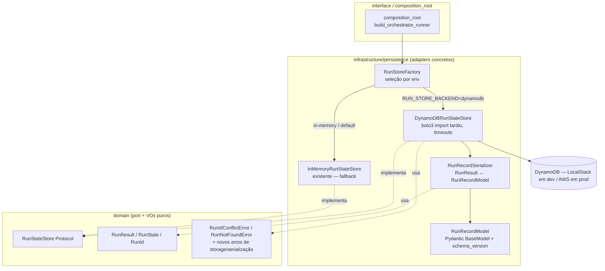

# Documento de Design

## Overview

Este design descreve a **persistência durável do resultado de run** da QA Platform: um
adapter concreto do port `RunStateStore` que sobrevive ao encerramento do processo,
sustentando o histórico de runs (`PROJECT.md`, seções 8 e 10). O escopo é **enxuto**:
persistir e recuperar o `RunResult` final (`save_result`/`get`), com serializer isolado,
seleção de adapter por env e provisionamento da tabela. Listagem consultável de histórico
e persistência durável do estado intermediário ficam para specs futuras.

A feature **estende** o pacote `qa_platform` (em `code/`) reusando o port `RunStateStore`
e os value objects `RunResult`/`RunState`/`RunId` já existentes, e o padrão de adapter AWS
do bootstrap (`AWSSecretsManagerProvider`: import tardio de `boto3`, endpoint por env, sem
vazar segredos). **Nenhuma assinatura do port é alterada**; o domínio permanece puro.

Decisão de tecnologia registrada em
`qa-platform/docs/ideation/decisions/ADR-003-persistencia-durable-dynamodb.md`: **DynamoDB**
como backend durável + **in-memory** como fallback, selecionados por env. O `RunResult`
continua sendo a fonte de verdade do histórico — o `db=` da Agno **não** é usado (ADR-001).

O design entrega:

- Um **model de registro** `RunRecordModel` (Pydantic `BaseModel`) em
  `infrastructure/persistence/`, representando o item persistido, com `schema_version` —
  conforme a steering `12-organizacao-dataclasses` (persistência é fronteira externa →
  Pydantic na infra; o domínio permanece `@dataclass` puro).
- Um **`RunRecordSerializer`** (infra) que faz o round-trip `RunResult` ↔ `RunRecordModel`,
  sem vazar tipos para o domínio.
- Um **adapter durável** `DynamoDBRunStateStore` (infra) que implementa o `RunStateStore`
  sobre DynamoDB, com escrita condicional (anti-sobrescrita/conflito), timeouts explícitos
  e import tardio de `boto3`.
- Uma **`RunStoreFactory`** que seleciona o adapter (durável vs in-memory) por env, com
  fail-fast quando o durável é pedido sem `RUN_TABLE_NAME`.
- **Provisionamento da tabela**: recurso DynamoDB no `template.yaml` (SAM) e criação
  idempotente no init do LocalStack para dev.
- Extensão do **import-linter** para confinar `boto3` também a este adapter, e atualização
  do **`.env.example`**.

### Decisões de design e justificativas

| Decisão | Justificativa | Requisitos |
|---------|---------------|------------|
| Backend durável = DynamoDB; in-memory como fallback | Serverless, já no LocalStack núcleo, alinhado ao bootstrap AWS (ADR-003) | 1.1, 4.1, 4.2 |
| Port `RunStateStore` inalterado; adapter novo na infra | Troca de backend sem tocar no orquestrador nem no domínio (open/closed, DIP) | 1.3, 4.4, 6.1 |
| `RunRecordModel` = Pydantic `BaseModel` em `infrastructure/persistence/` | Persistência é fronteira externa com validação/serialização (steering 12); domínio segue `@dataclass` puro | 3.1, 3.5, 6.1 |
| `RunRecordSerializer` isolado, com `schema_version` | Round-trip sem perda; formato evolui sem afetar o domínio | 3.2, 3.3, 3.4, 3.5 |
| Escrita condicional (`attribute_not_exists(pk)`) | Semântica de conflito e anti-sobrescrita concorrente do port | 2.1, 2.4 |
| `boto3` por import tardio, confinado ao adapter | Pacote importável sem SDK quando só o in-memory é usado; fronteira preservada | 6.2, 6.4 |
| Seleção por env com fail-fast em parâmetro ausente | Nunca cair silenciosamente no in-memory quando o durável foi pedido | 4.2, 4.3 |
| Timeouts explícitos via `botocore.Config` | Falhas de infra sinalizadas, sem travar; sem depender de defaults implícitos | 7.1, 7.2 |
| Tabela provisionada por IaC (SAM) + init LocalStack | Backend durável funciona em AWS e local sem passo manual, com menor privilégio | 5.1, 5.2, 5.3 |
| `start`/`record_failure` implementados sem persistência durável nesta fase | Escopo enxuto: o `RunResult` final é a fonte de verdade; estado intermediário fica in-memory | (fora de escopo) |
| `RunResult` ganha `target_ref` + `target_version` (domínio); `consolidate` os preenche a partir do manifest | Laudos precisam ser atribuíveis/comparáveis por alvo; a identidade (não os detalhes) do alvo torna o registro autossuficiente | 8.1, 8.2, 8.4, 8.5 |

## Architecture

O adapter durável, o model e o serializer vivem em
`code/src/qa_platform/infrastructure/persistence/`, ao lado do in-memory já existente. A
`RunStoreFactory` escolhe o adapter por env; o composition root consome o resultado apenas
pelo port. A dependência aponta sempre para dentro: `infrastructure → domain`.



### Estrutura de diretórios (tudo sob `code/`; arquivos novos marcados)

```
code/
├── importlinter.ini                                     # estendido: boto3 confinado tb ao adapter Dynamo
├── .env.example                                         # estendido: RUN_STORE_BACKEND, RUN_TABLE_NAME
├── pyproject.toml                                       # estendido: moto (dev)
├── template.yaml                                        # estendido: recurso DynamoDB + env + IAM (menor privilégio)
├── localstack/
│   └── init/
│       └── 02-create-run-table.sh                       # novo — cria a tabela no LocalStack (idempotente)
├── src/
│   └── qa_platform/
│       ├── domain/
│       │   └── exceptions.py                            # estendido: RunStorageError, RunRecordSerializationError
│       ├── infrastructure/
│       │   └── persistence/
│       │       ├── in_memory_run_store.py               # (existente)
│       │       ├── run_record_model.py                  # novo — RunRecordModel (Pydantic BaseModel)
│       │       ├── run_record_serializer.py             # novo — RunResult ↔ RunRecordModel
│       │       ├── dynamodb_run_store.py                # novo — DynamoDBRunStateStore (boto3 import tardio)
│       │       └── run_store_factory.py                 # novo — RunStoreFactory (seleção por env)
│       └── composition_root.py                          # estendido: usa a RunStoreFactory
└── tests/
    ├── infrastructure/
    │   └── persistence/
    │       ├── test_in_memory_run_store.py              # (existente)
    │       ├── test_run_record_serializer.py            # novo — Property 1 (round-trip) + schema (Property 4)
    │       ├── test_dynamodb_run_store.py               # novo — moto: round-trip, conflito, ausência (Properties 2,3)
    │       └── test_run_store_factory.py                # novo — seleção por env + fail-fast
    └── architecture/
        └── test_layer_boundaries.py                     # (existente) — boto3 confinado cobre o novo adapter
```

## Components and Interfaces

Os snippets são **ilustrativos** (fixam contratos e fronteiras), não a implementação
final. Todos os caminhos são relativos a `code/`.

### 1. Domain — novos erros (estende a hierarquia existente)

```python
# src/qa_platform/domain/exceptions.py (adições)
class RunStorageError(OrchestrationDomainError):
    """Falha de infraestrutura ao persistir/ler uma run (Req 7.2).

    Nomeia a operação e o Run_Id afetado; nunca carrega credenciais/segredos.
    """
    def __init__(self, operation: str, run_id: str, reason: str) -> None:
        self.operation = operation
        self.run_id = run_id
        super().__init__(f"Falha de storage em '{operation}' para run '{run_id}': {reason}")

class RunRecordSerializationError(OrchestrationDomainError):
    """Registro persistido malformado/incompatível (Req 3.4, 3.5)."""
    def __init__(self, run_id: str, reason: str) -> None:
        self.run_id = run_id
        super().__init__(f"Registro inválido para run '{run_id}': {reason}")
```

`RunIdConflictError` e `RunNotFoundError` já existem e são reusados (Req 2.1, 2.2).

### 1b. Domain / Application — identidade do alvo no RunResult

Para que os laudos sejam atribuíveis e comparáveis por alvo (Req 8), o `RunResult`
(domínio) ganha dois campos obrigatórios e o `Evidence_Consolidator` (application) passa a
preenchê-los a partir do manifest. O `Orchestrator_Workflow` já tem o `manifest` por
closure, então repassa a identidade ao consolidar. **Impacto cruzado:** esta mudança toca
a feature `workflow-orchestrator-skeleton` (o `RunResult`, o `consolidate` e o
`workflow.py`), mas é aditiva e não altera o port `RunStateStore`.

```python
# src/qa_platform/domain/entities/run_result.py (mudança)
@dataclass(frozen=True)
class RunResult:
    run_id: RunId
    target_ref: str          # identidade do alvo avaliado (Req 8.1)
    target_version: str      # versão/commit do alvo avaliado (Req 8.1)
    plan: ExecutionPlan
    evidences: tuple[LayerEvidence, ...] = ()
    prioritized: tuple[LayerEvidence, ...] = ()
    skipped: tuple[SkippedWork, ...] = ()
    failures: tuple[str, ...] = ()

    def __post_init__(self) -> None:
        # Rejeita laudo órfão: sem alvo atribuível não há o que comparar (Req 8.5).
        if not self.target_ref or not str(self.target_ref).strip():
            raise ValueError("RunResult.target_ref obrigatório")
        if not self.target_version or not str(self.target_version).strip():
            raise ValueError("RunResult.target_version obrigatório")
```

```python
# src/qa_platform/application/evidence_consolidator.py (mudança de assinatura)
def consolidate(
    run_id: RunId,
    manifest: QATargetManifest,      # novo: fonte da identidade do alvo (Req 8.2)
    plan: ExecutionPlan,
    evidences: Iterable[LayerEvidence],
) -> RunResult:
    ordered = tuple(sorted(evidences, key=lambda e: e.layer_id.value))
    return RunResult(
        run_id=run_id,
        target_ref=manifest.target_ref,           # Req 8.2
        target_version=manifest.target_version,   # Req 8.2
        plan=plan,
        evidences=ordered,
    )
```

No `workflow.py`, o step de consolidação passa o `manifest` (já disponível por closure)
para `consolidate(run_id, manifest, plan, evidences)`. Os detalhes internos do alvo
(prompts/tools) **não** entram no `RunResult` — apenas a referência e a versão (Req 8.3).

### 2. Infrastructure — RunRecordModel (Pydantic BaseModel)

Model de registro persistido, na infraestrutura (steering `12-organizacao-dataclasses`:
persistência é fronteira externa → Pydantic; o domínio permanece `@dataclass` puro). Não
importa `boto3`: descreve apenas a forma do item.

```python
# src/qa_platform/infrastructure/persistence/run_record_model.py
from pydantic import BaseModel

SCHEMA_VERSION = 1

class FindingRecord(BaseModel):
    code: str
    severity: str          # nome do enum Severity (ex.: "HIGH")
    detail: str

class LayerEvidenceRecord(BaseModel):
    layer_id: str
    metrics: dict[str, float] = {}
    findings: list[FindingRecord] = []
    reduced_mode: bool = False

class PlannedLayerRecord(BaseModel):
    layer_id: str
    priority: int
    reduced_mode: bool = False

class SkippedWorkRecord(BaseModel):
    layer_id: str
    reason: str

class RunRecordModel(BaseModel):
    """Registro persistido do RunResult (Req 3.1, 3.5, 8.4)."""
    schema_version: int = SCHEMA_VERSION
    run_id: str
    target_ref: str        # identidade do alvo avaliado (Req 8.4)
    target_version: str    # versão/commit do alvo avaliado (Req 8.4)
    created_at: str        # ISO-8601
    plan: list[PlannedLayerRecord] = []
    evidences: list[LayerEvidenceRecord] = []
    prioritized: list[LayerEvidenceRecord] = []
    skipped: list[SkippedWorkRecord] = []
    failures: list[str] = []
```

### 3. Infrastructure — RunRecordSerializer (round-trip domínio ↔ model)

Converte `RunResult` (domínio) no `RunRecordModel` e de volta, com validação de
`schema_version`. Não importa `boto3`.

```python
# src/qa_platform/infrastructure/persistence/run_record_serializer.py
from qa_platform.domain.entities.run_result import RunResult
from qa_platform.domain.exceptions import RunRecordSerializationError
from qa_platform.infrastructure.persistence.run_record_model import (
    RunRecordModel, SCHEMA_VERSION,
)

def to_model(run_id: str, result: RunResult, created_at: str) -> RunRecordModel:
    """RunResult -> RunRecordModel (Req 3.2). Severity serializada pelo nome do enum."""
    ...

def to_item(run_id: str, result: RunResult, created_at: str) -> dict:
    """RunRecordModel -> dict persistível (item DynamoDB)."""
    return to_model(run_id, result, created_at).model_dump()

def from_item(item: dict) -> RunResult:
    """item -> RunResult, reconstruindo coleções aninhadas (Req 3.2, 3.3).

    schema_version não suportado ou item malformado (ValidationError do Pydantic)
    -> RunRecordSerializationError nomeando run_id + motivo (Req 3.4, 3.5)."""
    ...
```

Regras: severity persistida pelo **nome** do enum e reconstruída para `Severity`; round-
trip garante `from_item(to_item(x)) == x` para todo `RunResult` válido (Req 3.2);
`schema_version` ausente/desconhecido → erro (Req 3.5); `ValidationError` do Pydantic é
traduzida para `RunRecordSerializationError` nomeando o `run_id` (Req 3.4).

### 4. Infrastructure — DynamoDBRunStateStore (adapter durável)

Implementa o `RunStateStore` sobre DynamoDB, no padrão do adapter de Secrets Manager
(import tardio de `boto3`, endpoint por env). Escrita condicional para conflito e
`botocore.Config` para timeouts. Nesta fase, `start`/`record_failure` são **no-op durável**
(mantêm a compatibilidade do contrato sem persistir estado intermediário — fora de escopo).

```python
# src/qa_platform/infrastructure/persistence/dynamodb_run_store.py
from qa_platform.domain.value_objects.ids import RunId
from qa_platform.domain.entities.run_result import RunResult, RunState
from qa_platform.domain.exceptions import (
    RunIdConflictError, RunNotFoundError, RunStorageError,
)
from qa_platform.infrastructure.persistence.run_record_serializer import to_item, from_item

class DynamoDBRunStateStore:
    """Adapter durável do RunStateStore sobre DynamoDB (Req 1, 2, 7)."""

    def __init__(self, table_name: str, *, endpoint_url=None, region=None, clock=None) -> None:
        self._table_name = table_name          # obrigatório (Req 4.3)
        self._endpoint_url = endpoint_url
        self._region = region
        self._clock = clock or _utcnow_iso
        self._table = None                     # resolvido no 1º uso (import tardio)

    def _get_table(self):
        if self._table is None:
            import boto3                         # import tardio (Req 6.4)
            from botocore.config import Config
            cfg = Config(connect_timeout=3, read_timeout=5,
                         retries={"max_attempts": 3, "mode": "standard"})  # Req 7.1
            resource = boto3.resource("dynamodb", endpoint_url=self._endpoint_url,
                                      region_name=self._region, config=cfg)
            self._table = resource.Table(self._table_name)
        return self._table

    def save_result(self, run_id: RunId, result: RunResult) -> None:
        _require_run_id(run_id)                                    # Req 2.3
        item = {"run_id": run_id.value, **to_item(run_id.value, result, self._clock())}
        try:
            self._get_table().put_item(
                Item=item,
                ConditionExpression="attribute_not_exists(run_id)")  # Req 2.1, 2.4
        except _conditional_check_failed:
            raise RunIdConflictError(run_id.value)                # Req 2.1
        except _client_error as exc:
            raise RunStorageError("save_result", run_id.value, _safe(exc))  # Req 7.2

    def get(self, run_id: RunId) -> RunResult:
        _require_run_id(run_id)
        try:
            resp = self._get_table().get_item(Key={"run_id": run_id.value})
        except _client_error as exc:
            raise RunStorageError("get", run_id.value, _safe(exc))          # Req 7.2
        item = resp.get("Item")
        if item is None:
            raise RunNotFoundError(run_id.value)                            # Req 2.2
        return from_item(item)                                              # Req 3.3

    def start(self, run_id: RunId, state: RunState) -> None:
        """No-op durável nesta fase (estado intermediário fora de escopo)."""
        _require_run_id(run_id)

    def record_failure(self, run_id: RunId, step: str, cause: str) -> None:
        """No-op durável nesta fase (estado intermediário fora de escopo)."""
        _require_run_id(run_id)
```

Notas: chave de partição = `run_id`; erros de infra viram `RunStorageError` nomeando
operação e `run_id`, distintos de conflito/ausência (Req 7.2, 7.3), sem vazar credenciais.

### 5. Infrastructure — RunStoreFactory (seleção por env)

```python
# src/qa_platform/infrastructure/persistence/run_store_factory.py
import os
from qa_platform.domain.ports.run_state_store import RunStateStore
from qa_platform.infrastructure.persistence.in_memory_run_store import InMemoryRunStateStore

BACKEND_ENV = "RUN_STORE_BACKEND"      # "dynamodb" | "in_memory" (default)
TABLE_ENV = "RUN_TABLE_NAME"
DEFAULT_BACKEND = "in_memory"

class RunStoreConfigError(Exception):
    """Backend durável selecionado sem parâmetros obrigatórios (Req 4.3)."""

def build_run_store() -> RunStateStore:
    backend = (os.environ.get(BACKEND_ENV) or DEFAULT_BACKEND).strip().lower()
    if backend == "dynamodb":
        if not os.environ.get(TABLE_ENV):
            raise RunStoreConfigError(f"backend 'dynamodb' exige: {TABLE_ENV}")  # Req 4.3
        from qa_platform.infrastructure.persistence.dynamodb_run_store import (
            DynamoDBRunStateStore,
        )
        return DynamoDBRunStateStore(
            table_name=os.environ[TABLE_ENV],
            endpoint_url=os.environ.get("AWS_ENDPOINT_URL") or None,
            region=os.environ.get("AWS_REGION") or None,
        )
    return InMemoryRunStateStore()                                    # default (Req 4.1)
```

- Seleção por env, default explícito `in_memory` (Req 4.1, 4.2).
- Backend durável sem `RUN_TABLE_NAME` → `RunStoreConfigError` nomeando o parâmetro, sem
  cair no in-memory (Req 4.3).
- O composition root chama `build_run_store()` e injeta o resultado pelo port (Req 4.4).

### 6. Interface — composition_root (wiring)

`build_orchestrator_runner` troca `InMemoryRunStateStore()` por `build_run_store()`,
consumindo o resultado apenas como `RunStateStore` (Req 4.4). Nenhuma outra mudança de
fronteira.

### 7. Infraestrutura como código — tabela DynamoDB

- **SAM (`code/template.yaml`)**: um `AWS::DynamoDB::Table` com `PartitionKey=run_id (S)`,
  `BillingMode=PAY_PER_REQUEST`, `SSESpecification` habilitado; o nome da tabela é passado
  ao serviço por env (`RUN_TABLE_NAME`) e a função recebe uma policy de menor privilégio
  (apenas `GetItem`/`PutItem` na tabela) (Req 5.1, 5.3).
- **LocalStack (`code/localstack/init/02-create-run-table.sh`)**: cria a mesma tabela de
  forma idempotente quando o LocalStack fica pronto, no mesmo padrão do script de bootstrap
  existente (Req 5.2).

## Data Models

### Item DynamoDB — resultado de run (chave de partição `run_id`)

| Atributo | Tipo | Descrição |
|----------|------|-----------|
| `run_id` | `str` (PK) | Identidade da run |
| `target_ref` | `str` | Identidade do alvo avaliado (Req 8.4) |
| `target_version` | `str` | Versão/commit do alvo avaliado (Req 8.4) |
| `schema_version` | `int` | Versão do formato do registro (Req 3.5) |
| `created_at` | `str` | Instante ISO-8601 de criação |
| `plan` | `list` | Plano serializado (camadas + prioridade + reduced_mode) |
| `evidences` | `list` | Evidências (layer_id, metrics, findings[severity nome], reduced_mode) |
| `prioritized` | `list` | Ordem do Advisory_Judge (mesma forma de `evidences`) |
| `skipped` | `list` | Trabalho pulado (layer_id, reason) |
| `failures` | `list[str]` | Falhas de camada/step |

### Config (env) — novas variáveis

| Variável | Obrigatória | Default | Uso |
|----------|-------------|---------|-----|
| `RUN_STORE_BACKEND` | Não | `in_memory` | Seleciona o adapter: `dynamodb` \| `in_memory` (Req 4.2) |
| `RUN_TABLE_NAME` | Sim* | — | Nome da tabela DynamoDB (*obrigatória quando backend=`dynamodb`; Req 4.3) |
| `AWS_ENDPOINT_URL` | Não | — | Reusada do bootstrap (LocalStack em dev) |
| `AWS_REGION` | Não | — | Região do cliente DynamoDB |

## Correctness Properties

### Property 1: Round-trip do serializer sem perda

*Para qualquer* `RunResult` válido, `from_item(to_item(run_id, result, created_at))` deve
produzir um `RunResult` igual em valor ao original, com a identidade do alvo (`target_ref`,
`target_version`) e todas as coleções aninhadas (plano, evidências, achados, trabalho
pulado, falhas) preservadas em ordem e identidade.

**Validates: Requirements 3.2, 3.3, 8.4**

### Property 2: Round-trip persistir → recuperar no adapter durável

*Para qualquer* `Run_Id` válido e `RunResult`, após `save_result(run_id, result)` uma
chamada `get(run_id)` deve retornar um `RunResult` igual em valor ao persistido (verificado
com DynamoDB simulado por `moto`).

**Validates: Requirements 1.1, 1.2**

### Property 3: Conflito de Run_Id não sobrescreve

*Para qualquer* `Run_Id` já persistido, um segundo `save_result` com o mesmo id deve
levantar `RunIdConflictError` e `get` posterior deve retornar o `RunResult` original,
inalterado.

**Validates: Requirements 2.1, 2.4**

### Property 4: Schema_version incompatível é recusado

*Para qualquer* item persistido cujo `schema_version` não seja suportado, `from_item` deve
levantar `RunRecordSerializationError` nomeando o `run_id` e o motivo, sem retornar um
`RunResult` parcial.

**Validates: Requirements 3.4, 3.5**

## Error Handling

| Cenário | Camada | Comportamento | Requisitos |
|---------|--------|---------------|------------|
| Run_Id já persistido em `save_result` | infra (`dynamodb_run_store`) | Escrita condicional falha → `RunIdConflictError`; não sobrescreve | 2.1, 2.4 |
| Run_Id inexistente em `get` | infra | `RunNotFoundError` nomeando o id | 2.2 |
| Run_Id ausente/nulo/vazio | infra/domain | Erro de Run_Id inválido; sem persistir/retornar | 2.3 |
| Item malformado / schema desconhecido | infra (`serializer`) | `RunRecordSerializationError` nomeando run_id + motivo | 3.4, 3.5 |
| Falha de infraestrutura (timeout/indisponível) | infra (`dynamodb_run_store`) | `RunStorageError` nomeando operação + run_id; sem vazar segredo | 7.2, 7.3 |
| Backend durável sem `RUN_TABLE_NAME` | infra (`factory`) | `RunStoreConfigError` nomeando o parâmetro; sem cair no in-memory | 4.3 |
| SDK ausente com backend in-memory | infra | Pacote importável (boto3 só no ponto de uso do adapter durável) | 6.4 |

Princípios: erros de domínio permanecem puros (nomeiam operação/id/motivo, nunca
segredos); erros de infra são distinguíveis de conflito e ausência (Req 7.3).

## Testing Strategy

### Abordagem

- **Testes de propriedade (Hypothesis)**: Property 1 (round-trip do serializer) e Property
  2 (round-trip persistir→recuperar com `moto`), sobre `RunResult` gerados.
- **Testes por exemplo/integração**: conflito (Property 3), ausência, schema incompatível
  (Property 4), timeouts/erro de storage (com `moto`/cliente fake), seleção por env +
  fail-fast da factory, e importabilidade sem boto3 para o caminho in-memory.
- **Fronteiras**: o teste de arquitetura existente já confina `boto3` fora de
  `domain`/`interface`; o import-linter é estendido para reconhecer o novo adapter como
  ponto legítimo de import de `boto3`.

### Ferramentas

- **`moto`** (novo, dev group) para simular DynamoDB em memória, sem rede — padrão do
  steering `03-sam-python`.
- **Hypothesis** (já em uso) para as propriedades de round-trip.
- **import-linter** (já em uso) para as fronteiras.

### Mapa propriedade → teste

| Propriedade | Alvo | Ferramenta |
|-------------|------|------------|
| Property 1 | `run_record_serializer.to_item/from_item` | Hypothesis |
| Property 2 | `DynamoDBRunStateStore.save_result/get` | Hypothesis + moto |
| Property 3 | `DynamoDBRunStateStore` (conflito) | moto (exemplo) |
| Property 4 | `run_record_serializer.from_item` | exemplo |

### Extensão do import-linter

O contrato `boto3-confinado` no `code/importlinter.ini` passa a listar
`qa_platform.infrastructure.persistence.dynamodb_run_store` como origem autorizada a
importar `boto3` (além do adapter de Secrets Manager), mantendo `domain`/`interface`
proibidos (Req 6.2, 6.3).

## Rastreabilidade Requisitos → Design

| Requisito | Onde é atendido |
|-----------|-----------------|
| 1. Persistência durável | `dynamodb_run_store.save_result/get`; Property 2 |
| 2. Conflito/ausência/Run_Id inválido | escrita condicional + `RunIdConflictError`/`RunNotFoundError`; Properties 2, 3 |
| 3. Model + serialização ↔ domínio | `run_record_model` (Pydantic) + `run_record_serializer` + `schema_version`; Properties 1, 4 |
| 4. Seleção por env | `run_store_factory` + fail-fast; wiring no composition_root |
| 5. Provisionamento da tabela | `template.yaml` (SAM) + `localstack/init/02-create-run-table.sh` |
| 6. Fronteiras de arquitetura | `boto3` confinado (import-linter estendido); import tardio; model na infra |
| 7. Resiliência e timeouts | `botocore.Config` + `RunStorageError` distinto de conflito/ausência |
| 8. Identidade do alvo no RunResult | `RunResult` +`target_ref`/`target_version` (domínio); `consolidate` preenche; `RunRecordModel`/serializer persistem; Property 1 |
```

