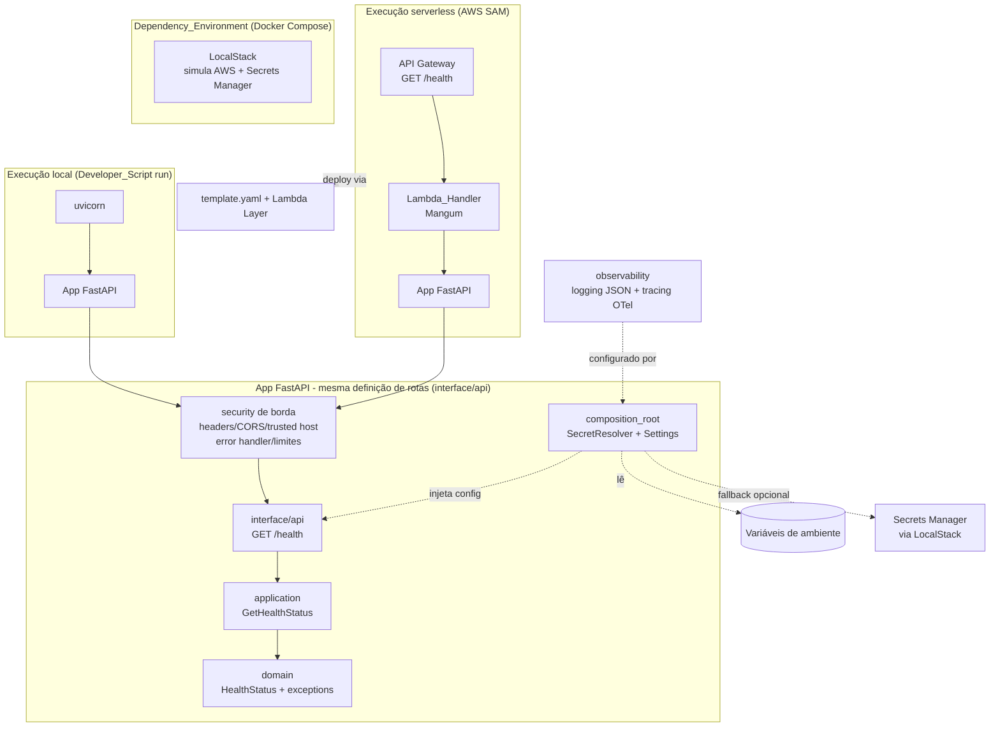

# Documento de Design

## Overview

Este design descreve o **bootstrap do ambiente executável** da QA Platform: um
esqueleto backend **rodável localmente e implantável em serverless**, expondo uma
única rota HTTP de saúde (`GET /health`). Nenhuma regra de negócio de QA é
implementada nesta fase (sem orquestração, agentes, avaliação ou Agno).

O objetivo é estabelecer a **fundação arquitetural e operacional** sobre a qual as
camadas de QA entrarão como módulos em marcos futuros, sem violar a separação de
responsabilidades. O design entrega:

- Uma aplicação **FastAPI** com a rota `GET /health` na camada `interface` (sob
  `interface/api/`), com os controles de segurança de borda aplicados na montagem.
- Um **Config_Resolver** que lê configuração por um **pipe de fallback**
  (`env → Secrets Manager`) com **falha rápida** e **agregação** de todas as
  variáveis obrigatórias ausentes. A dependência de **Secrets Manager** já existe
  na estrutura (porta + adapters), opcional no bootstrap.
- Um **Lambda_Handler** (`interface/api/main.py`) que adapta a mesma app FastAPI
  para o AWS Lambda via **Mangum** (adapter ASGI).
- Um **ponto de entrada CLI** (`interface/cli/main.py`) fino, que sobe o serviço
  local ou imprime o health status via composition_root.
- Scaffolding de **observabilidade** (logging estruturado JSON funcional + tracing
  OpenTelemetry ligado/desligado por env) em `infrastructure/observability/`.
- Scaffolding de **segurança** em `infrastructure/security/` e
  `interface/api/security.py`, com controles baratos já funcionais (headers, CORS,
  trusted host, error handler, limites de payload) e controles dependentes de
  identidade como **stubs seguros** ligados/desligados por env (jwt, rate limit,
  https redirect, authn) — nunca "aprova tudo" silenciosamente.
- Erros de domínio puros em `domain/exceptions.py`.
- Um **SAM_Template** (`template.yaml`) descrevendo uma função Lambda + API Gateway,
  com dependências de runtime empacotadas em uma **Lambda Layer** separada.
- Um **Docker Compose** minimalista para o ambiente local de dependências
  (LocalStack, simulando a AWS — incluindo o Secrets Manager para o pipe de
  configuração), com portas por variável de ambiente e healthchecks.
- **Scripts de desenvolvedor** para setup, execução local, build e deploy.
- Estrutura de projeto em **ports & adapters** (domain / application / infrastructure
  / interface) com ambiente e dependências gerenciados por **uv**, versões fixas.

### Decisões de design e justificativas

| Decisão | Justificativa | Requisitos |
|---------|---------------|------------|
| FastAPI + Mangum (não AgentOS, não handler cru) | Padrão do portfólio para API serverless; a mesma app roda local (uvicorn) e na Lambda (Mangum), sem duplicar rotas | 3.1, 3.4 |
| Health handler puro, sem dependências externas | O marco é um esqueleto; a rota de saúde deve provar liveness sem depender de LLM/DB/AWS | 1.5 |
| Config por pipe `env → Secrets Manager`, fail-fast agregado | Nunca subir meio-configurado; env vence e permite override local/CI; erro único lista todas as ausentes; Secrets Manager já cabeado, opcional no bootstrap | 7.1, 7.2, 7.3 |
| Secrets como porta + adapters (AWS/InMemory) desde o bootstrap | A estrutura já existe para os marcos de QA; import tardio do boto3 mantém o módulo testável sem SDK/rede | 7.1, 7.2 |
| Dependências de runtime em Lambda Layer separada | Deploy de código rápido sem reempacotar libs; artefato da função contém só o app | 4.4 |
| Docker Compose mínimo (só LocalStack) | Sem regra de negócio, só o que o fluxo serverless/AWS genuinamente exige; Ollama/observabilidade completa ficam para marcos futuros | 2.1, 2.4 |
| Layout `src/` em quatro camadas + import-linter | Garante fisicamente a separação; futuras camadas de QA entram como módulos sem tocar no domínio | 5.1, 5.2, 5.3 |
| Segurança de borda como scaffolding com stubs seguros | A skill `agno-security` define a "Estrutura de arquivos de segurança"; controles baratos (headers/CORS/trusted host/error handler/limites) já funcionam no `/health`; identidade (jwt/rate limit/https redirect/authn) fica stub ligado/desligado por env, sempre negando por padrão | 1.1, 1.2, 1.5 |
| Observabilidade em `infrastructure/observability/` | Log JSON funcional + tracing OTel no-op quando desligado; segue `agno-observability`; sem custo em runtime quando off | 1.2, 1.3 |
| HTTP consolidado sob `interface/api/` (`api.py` + `main.py`) | Casa com a nomenclatura da skill `agno-lambda-apigateway`; a rota `/health` e a segurança de borda vivem na interface, nunca no domínio | 3.1, 3.4, 5.5 |

## Architecture

### Visão de alto nível

A mesma aplicação FastAPI é servida por **dois adapters de entrada** (interface):
`uvicorn` no desenvolvimento local e `Mangum` sob o AWS Lambda. A dependência aponta
sempre para dentro: `interface → application → domain`; a `infrastructure` implementa
portas definidas por dentro.



### Camadas (ports & adapters)

```
domain          Regras/valores puros de saúde (HealthStatus) e erros de domínio
                (exceptions). Sem framework web, sem infraestrutura, sem boto3,
                sem importar outras camadas.
application      Caso de uso GetHealthStatus: monta o HealthStatus a partir de
                config já resolvida (recebida por injeção).
infrastructure   Config (Settings) consumindo o SecretResolver (pipe env →
                Secrets Manager, fail-fast agregado); secrets (ports + adapters);
                observability (logging JSON funcional + tracing OTel por env);
                security de borda (headers/CORS/trusted host/error handler/
                limites funcionais + jwt/rate limit/https redirect como stubs).
interface        App FastAPI (api/api.py), rota GET /health (api/health_routes.py),
                Lambda_Handler Mangum (api/main.py), dependency de authn
                (api/security.py, stub seguro), CLI (cli/main.py) e
                composition_root (montagem/injeção).
```

Regra de ouro: `domain` não importa framework web, bibliotecas de infraestrutura
nem `boto3`; a rota de saúde e a segurança de transporte vivem na `interface`/
`infrastructure`. O `boto3` não vaza para `domain` nem `interface` (só é usado no
adapter de Secrets Manager, com import tardio). Isso é verificado automaticamente
por **import-linter** (Requisitos 5.2, 5.3, 5.5).

### Estrutura de diretórios concreta

O backend vive em `qa-platform/` (dentro do repositório), pacote `qa_platform`.

```
qa-platform/
├── pyproject.toml              # deps declaradas com uv, versões exatas fixadas
├── uv.lock                     # lock reproduzível (versionado)
├── README.md
├── template.yaml               # infra SAM (fora de src/)
├── samconfig.toml              # config de deploy do SAM
├── docker-compose.yml          # Dependency_Environment (LocalStack)
├── .env.example                # catálogo de todas as variáveis de config
├── .gitignore                  # exclui .env e segredos locais do VCS
├── importlinter.ini            # contrato de camadas (domain isolado)
├── scripts/
│   ├── setup.sh                # Developer_Script: instala deps + prepara ambiente
│   ├── run-local.sh            # Developer_Script: sobe o serviço local
│   ├── build.sh                # Developer_Script: sam build
│   └── deploy.sh               # Developer_Script: sam deploy
├── layers/
│   └── runtime-deps/
│       └── requirements.txt    # dependências de runtime -> vira a Lambda Layer
├── events/
│   └── health-get.json         # evento API Gateway p/ sam local invoke
├── src/
│   └── qa_platform/
│       ├── __init__.py
│       ├── domain/
│       │   ├── __init__.py
│       │   ├── health.py       # HealthStatus (value object puro)
│       │   └── exceptions.py   # DomainError (base) + erros de domínio puros
│       ├── application/
│       │   ├── __init__.py
│       │   └── get_health_status.py   # caso de uso
│       ├── infrastructure/
│       │   ├── __init__.py
│       │   ├── config.py       # Settings + load_settings (consome SecretResolver)
│       │   ├── secrets/
│       │   │   ├── __init__.py
│       │   │   ├── ports.py            # SecretsProvider (Protocol)
│       │   │   ├── aws_secrets_manager.py  # adapter AWS (import tardio de boto3)
│       │   │   ├── in_memory.py        # InMemorySecretsProvider (testes)
│       │   │   └── resolver.py         # SecretResolver + MissingSecretError
│       │   ├── observability/
│       │   │   ├── __init__.py
│       │   │   ├── logging.py          # build_json_logger (JSON de uma linha)
│       │   │   └── tracing.py          # setup OTel; no-op quando desligado por env
│       │   └── security/
│       │       ├── __init__.py
│       │       ├── headers.py          # security headers (nosniff/HSTS/X-Frame/CSP) - FUNCIONAL
│       │       ├── cors.py             # CORS restritivo por env (sem "*") - FUNCIONAL
│       │       ├── trusted_host.py     # allowed hosts (TrustedHostMiddleware) - FUNCIONAL
│       │       ├── https_redirect.py   # redirect HTTP->HTTPS (HTTPS_REDIRECT_ENABLED, off) - STUB
│       │       ├── rate_limit.py       # rate limit por principal/IP (RATE_LIMIT_ENABLED, off) - STUB
│       │       ├── error_handlers.py   # handler global: resposta neutra, sem stack - FUNCIONAL
│       │       ├── input_limits.py     # limites de payload/Content-Type - FUNCIONAL
│       │       └── jwt.py              # validação real de JWT (assinatura/exp/aud/iss) - STUB
│       ├── interface/
│       │   ├── __init__.py
│       │   ├── api/
│       │   │   ├── __init__.py
│       │   │   ├── api.py       # create_app: FastAPI + rotas + apply_security
│       │   │   ├── health_routes.py   # GET /health
│       │   │   ├── security.py  # dependency get_current_principal (stub seguro, AUTH_ENABLED)
│       │   │   └── main.py      # handler = Mangum(app)  (ponto de entrada Lambda)
│       │   └── cli/
│       │       ├── __init__.py
│       │       └── main.py      # CLI fino: sobe o serviço local ou imprime health
│       └── composition_root.py # monta SecretResolver/Settings, observability e injeta na app
└── tests/
    ├── domain/
    │   ├── test_health.py
    │   └── test_exceptions.py         # hierarquia de erros de domínio
    ├── application/
    │   └── test_get_health_status.py
    ├── infrastructure/
    │   ├── test_config.py             # Settings + SecretResolver (3 ramos, InMemory)
    │   ├── observability/
    │   │   ├── test_logging.py         # log JSON de uma linha, sem PII/segredo
    │   │   └── test_tracing.py         # tracing no-op quando desligado por env
    │   └── security/
    │       ├── test_headers.py         # security headers presentes na resposta
    │       ├── test_error_handlers.py  # erro não vaza stack trace
    │       └── test_jwt.py             # stub levanta NotImplementedError/nega até AUTH_ENABLED
    ├── interface/
    │   ├── test_health_routes.py       # GET /health 200 + corpo + headers; 404
    │   └── test_cli.py                 # CLI imprime/retorna health, exit code 0
    └── architecture/
        └── test_layer_boundaries.py    # import-linter/AST: domain sem web/infra; sem boto3 fora do adapter
```

## Components and Interfaces

### 1. Domain — `HealthStatus`

Value object puro que representa a resposta de saúde. Sem dependências externas.

```python
# domain/health.py
from dataclasses import dataclass

STATUS_OK = "ok"

@dataclass(frozen=True)
class HealthStatus:
    status: str      # sempre "ok" quando o serviço está de pé
    version: str     # versão do serviço, vinda da configuração

    @classmethod
    def healthy(cls, version: str) -> "HealthStatus":
        return cls(status=STATUS_OK, version=version)
```

### 1b. Domain — `exceptions` (erros de domínio puros)

Hierarquia de erros de domínio, **sem framework web nem infraestrutura**. É a raiz
que as camadas de QA futuras estenderão; a `interface` traduz esses erros para HTTP
(o `domain` nunca conhece códigos HTTP). Alinha com `agno-project-architecture-solid`
(que lista `domain/exceptions.py`).

```python
# domain/exceptions.py
class DomainError(Exception):
    """Base de todos os erros de domínio da QA Platform.

    Erros de domínio são puros: não carregam status HTTP nem detalhes de
    infraestrutura. A camada interface os traduz para a resposta apropriada.
    """


class ConfigurationDomainError(DomainError):
    """Estado de configuração inválido para o domínio operar.

    Ex.: uma versão de serviço ausente/vazia quando o domínio a exige. NÃO nomeia
    valores de segredo; apenas descreve a condição de domínio violada.
    """
```

Nota: a **falha rápida de configuração/segredo** na inicialização é de
infraestrutura (`MissingConfigError`/`MissingSecretError` em
`infrastructure/`), não de domínio. `ConfigurationDomainError` cobre apenas
invariantes de domínio (ex.: construir um `HealthStatus` com versão vazia).

### 2. Application — `GetHealthStatus`

Caso de uso que produz o `HealthStatus`. Recebe a versão já resolvida por injeção;
não lê env var nem conhece FastAPI (Requisitos 5.2).

```python
# application/get_health_status.py
from qa_platform.domain.health import HealthStatus

class GetHealthStatus:
    def __init__(self, service_version: str) -> None:
        self._service_version = service_version

    def execute(self) -> HealthStatus:
        return HealthStatus.healthy(version=self._service_version)
```

### 3. Infrastructure — Secrets (porta + adapters + resolver)

Segue a skill `agno-secrets`: a fonte de segredos é uma **porta** com adapters
concretos, e o `SecretResolver` implementa o **pipe de fallback `env → Secrets
Manager`** com falha rápida. Isso mantém o resolver **testável sem rede** (via
`InMemorySecretsProvider`) e o `boto3` isolado por **import tardio**. No bootstrap o
Secrets Manager é **opcional** (liga só quando há uso de AWS / `AWS_ENDPOINT_URL`),
mas a estrutura já existe para os marcos de QA.

```python
# infrastructure/secrets/ports.py
from __future__ import annotations
from typing import Optional, Protocol

class SecretsProvider(Protocol):
    """Fonte secundária de segredos. Retorna o valor pela chave ou None.
    Implementações NUNCA logam o valor retornado."""
    def get(self, key: str) -> Optional[str]: ...
```

```python
# infrastructure/secrets/aws_secrets_manager.py
from __future__ import annotations
import json, os
from typing import Dict, Optional

class AWSSecretsManagerProvider:
    """Lê um segredo JSON do AWS Secrets Manager e resolve chaves por nome.
    Import tardio do boto3: o módulo permanece importável/testável sem o SDK."""
    SECRET_NAME_ENV = "SECRET_NAME"
    DEFAULT_SECRET_NAME = "qa-platform-secrets"

    def __init__(self, secret_name: Optional[str] = None) -> None:
        self._secret_name = (
            secret_name or os.environ.get(self.SECRET_NAME_ENV) or self.DEFAULT_SECRET_NAME
        )
        self._cache: Optional[Dict[str, str]] = None

    def _load(self) -> Dict[str, str]:
        if self._cache is not None:
            return self._cache
        import boto3  # import tardio: sem SDK, só falha se a fonte for usada
        client = boto3.client(
            "secretsmanager", endpoint_url=os.environ.get("AWS_ENDPOINT_URL") or None
        )
        raw = client.get_secret_value(SecretId=self._secret_name).get("SecretString") or "{}"
        try:
            data = json.loads(raw)
        except json.JSONDecodeError:
            data = {}  # segredo não-JSON: trate como vazio, sem vazar conteúdo
        self._cache = {k: str(v) for k, v in data.items() if isinstance(v, str)}
        return self._cache

    def get(self, key: str) -> Optional[str]:
        return self._load().get(key) or None   # "" vira None (vazio == ausente)
```

```python
# infrastructure/secrets/in_memory.py  (para testes; sem rede)
from __future__ import annotations
from typing import Dict, Optional

class InMemorySecretsProvider:
    def __init__(self, secrets: Optional[Dict[str, str]] = None) -> None:
        self._secrets = dict(secrets or {})
    def get(self, key: str) -> Optional[str]:
        return self._secrets.get(key) or None
```

```python
# infrastructure/secrets/resolver.py
from __future__ import annotations
import os
from typing import Optional
from qa_platform.infrastructure.secrets.ports import SecretsProvider

class MissingSecretError(RuntimeError):
    """Segredo/config obrigatório ausente em TODAS as fontes. Impede a app de subir.
    Nomeia SOMENTE o nome da env — nunca o valor de qualquer segredo."""

class SecretResolver:
    """Resolve config/segredos por pipe de fallback: env -> Secrets Manager.
    `secrets_provider` opcional: sem ele, usa apenas a env. Env sempre vence."""
    def __init__(self, secrets_provider: Optional[SecretsProvider] = None) -> None:
        self._secrets = secrets_provider

    def resolve(self, env_name: str, *, required: bool = True,
                default: Optional[str] = None) -> Optional[str]:
        raw = os.environ.get(env_name)                 # fonte 1: env (vence sempre)
        if raw is not None and raw.strip() != "":
            return raw
        if self._secrets is not None:                  # fonte 2: Secrets Manager
            from_sm = self._secrets.get(env_name)
            if from_sm is not None and from_sm.strip() != "":
                return from_sm
        if required and default is None:               # fail fast: nomeia a env
            raise MissingSecretError(
                f"Configuração obrigatória ausente: '{env_name}' não foi encontrada "
                f"nem nas variáveis de ambiente nem no Secrets Manager."
            )
        return default
```

Regras do contrato (skill `agno-secrets`):
- Ordem fixa **env primeiro, Secrets Manager depois** — env vence (override local/CI).
- Valor **vazio/só-whitespace** conta como ausente.
- A exceção sobe **na montagem** (`load_settings`/`composition_root`), nunca no meio.
- A mensagem de erro **nomeia** a env, **nunca** o valor de segredo.
- **Import tardio do boto3**: o módulo é importável/testável sem o SDK.
- **Cache**: o adapter lê o segredo uma vez por processo (uma chamada de rede na montagem).

### 3b. Infrastructure — `Config` (Settings) consumindo o `SecretResolver`

`load_settings` **consome o `SecretResolver`** para obter cada valor pelo pipe de
fallback e mantém a **falha rápida agregada**: coleta *todas* as variáveis
obrigatórias ausentes/vazias e levanta um único `MissingConfigError` nomeando cada
uma (Requisitos 7.2, 7.3). Variáveis opcionais recebem o default predefinido e ficam
inspecionáveis (Requisito 7.4). `SERVICE_VERSION` permanece **obrigatória**.

```python
# infrastructure/config.py
from __future__ import annotations
from dataclasses import dataclass
from typing import Optional
from qa_platform.infrastructure.secrets.resolver import SecretResolver, MissingSecretError

class MissingConfigError(RuntimeError):
    """Uma ou mais variáveis obrigatórias ausentes/vazias em TODAS as fontes.
    Impede o serviço de subir. Nomeia TODAS as variáveis com problema em uma única
    emissão (nunca valores)."""

@dataclass(frozen=True)
class Settings:
    service_version: str          # obrigatória (Req 1.3, 1.4)
    log_level: str                # opcional, default "INFO" (Req 7.4)
    environment: str              # opcional, default "local"

_REQUIRED = ("SERVICE_VERSION",)
_OPTIONAL = {"LOG_LEVEL": "INFO", "ENVIRONMENT": "local"}

def load_settings(resolver: Optional[SecretResolver] = None) -> Settings:
    resolver = resolver or SecretResolver()   # sem provider: usa só env

    # Fail-fast agregado: coleta TODAS as obrigatórias ausentes em uma passada.
    missing: list[str] = []
    values: dict[str, str] = {}
    for name in _REQUIRED:
        try:
            values[name] = resolver.resolve(name, required=True)  # type: ignore[assignment]
        except MissingSecretError:
            missing.append(name)
    if missing:
        joined = ", ".join(sorted(missing))    # nomes, nunca valores (Req 7.3)
        raise MissingConfigError(
            f"Configuração obrigatória ausente ou vazia: {joined}. "
            f"Defina cada variável e reinicie o serviço."
        )

    return Settings(
        service_version=values["SERVICE_VERSION"],
        log_level=resolver.resolve("LOG_LEVEL", required=False, default=_OPTIONAL["LOG_LEVEL"]),   # type: ignore[arg-type]
        environment=resolver.resolve("ENVIRONMENT", required=False, default=_OPTIONAL["ENVIRONMENT"]),  # type: ignore[arg-type]
    )
```

Regras do contrato:
- Valor **vazio ou só whitespace** conta como ausente (Requisito 7.2).
- A resolução ocorre **na montagem**, antes de aceitar requisições (Requisito 7.1).
- A mensagem de erro **nomeia** cada variável ausente, **nunca** valores (Req 7.2).
- Erro obrigatório ausente lista **todas** de uma vez, não só a primeira (Req 7.3).

### 3c. Infrastructure — Observability (`logging` + `tracing`)

Segue a skill `agno-observability`. Observabilidade é preocupação de
**infraestrutura**, cabeada no `composition_root` — o domínio não a conhece.

**`observability/logging.py` — funcional (JSON de uma linha):**

```python
# infrastructure/observability/logging.py
import json, logging

def build_json_logger(name: str = "qa-platform", level: str = "INFO") -> logging.Logger:
    logger = logging.getLogger(name)
    logger.handlers.clear()
    handler = logging.StreamHandler()             # stdout -> CloudWatch em Lambda
    handler.setFormatter(logging.Formatter("%(message)s"))  # a msg já é JSON
    logger.addHandler(handler)
    logger.setLevel(level)
    logger.propagate = False
    return logger

def log_event(logger: logging.Logger, event: str, **fields) -> None:
    # Uma linha por evento; NUNCA logue PII/segredo — só metadados.
    logger.info(json.dumps({"event": event, **fields}, ensure_ascii=False))
```

**`observability/tracing.py` — tracing OTel ligado/desligado por env (no-op quando off):**

```python
# infrastructure/observability/tracing.py
import os

def _tracing_enabled() -> bool:
    # Liga por env: TRACING_ENABLED=true OU OTEL_EXPORTER_OTLP_ENDPOINT definido.
    return (
        os.environ.get("TRACING_ENABLED", "false").lower() == "true"
        or bool(os.environ.get("OTEL_EXPORTER_OTLP_ENDPOINT"))
    )

def configure_tracing(service_name: str = "qa-platform") -> bool:
    """Configura o tracing OTel se habilitado por env; caso contrário é NO-OP.
    Retorna True se ligou. Sem custo em runtime quando desligado."""
    if not _tracing_enabled():
        return False   # no-op: nenhum exporter, nenhum overhead
    # Import tardio: dependências de OTel só carregam quando o tracing está ligado.
    from opentelemetry import trace
    from opentelemetry.sdk.resources import Resource
    from opentelemetry.sdk.trace import TracerProvider
    from opentelemetry.sdk.trace.export import BatchSpanProcessor
    from opentelemetry.exporter.otlp.proto.grpc.trace_exporter import OTLPSpanExporter
    provider = TracerProvider(resource=Resource.create({"service.name": service_name}))
    provider.add_span_processor(BatchSpanProcessor(OTLPSpanExporter()))
    trace.set_tracer_provider(provider)
    return True
```

Regras: uma linha JSON por evento; **nunca** PII/segredo em log; tracing é
**no-op** quando desligado (sem exporter e sem overhead em runtime), ligado apenas
por `TRACING_ENABLED`/`OTEL_EXPORTER_OTLP_ENDPOINT`.

### 3d. Infrastructure — Security (borda HTTP: funcionais + stubs)

Segue a skill `agno-security`, seção **"Estrutura de arquivos de segurança"**, que
documenta este layout. Consolida os controles de **borda HTTP** reusáveis em
`infrastructure/security/`. Controles baratos já são **funcionais** e aplicáveis ao
`/health`; controles dependentes de identidade entram como **stub seguro**
(negando por padrão / desligado por env), **nunca** "aprova tudo".

Funcionais (baratos, aplicados a qualquer rota, inclusive `/health`):

```python
# infrastructure/security/headers.py  (FUNCIONAL)
from starlette.middleware.base import BaseHTTPMiddleware

class SecurityHeadersMiddleware(BaseHTTPMiddleware):
    async def dispatch(self, request, call_next):
        resp = await call_next(request)
        resp.headers["X-Content-Type-Options"] = "nosniff"
        resp.headers["X-Frame-Options"] = "DENY"
        resp.headers["Strict-Transport-Security"] = "max-age=63072000; includeSubDomains"
        resp.headers["Content-Security-Policy"] = "default-src 'none'"
        return resp

def add_security_headers(app) -> None:
    app.add_middleware(SecurityHeadersMiddleware)
```

```python
# infrastructure/security/cors.py  (FUNCIONAL — restritivo, sem "*")
from fastapi.middleware.cors import CORSMiddleware

def add_cors(app, allowed_origins: list[str]) -> None:
    origins = [o for o in allowed_origins if o and o != "*"]  # nunca "*"
    app.add_middleware(
        CORSMiddleware, allow_origins=origins, allow_credentials=True,
        allow_methods=["GET"], allow_headers=["Authorization", "Content-Type"],
    )
```

```python
# infrastructure/security/trusted_host.py  (FUNCIONAL)
from starlette.middleware.trustedhost import TrustedHostMiddleware

def add_trusted_host(app, allowed_hosts: list[str]) -> None:
    app.add_middleware(TrustedHostMiddleware, allowed_hosts=allowed_hosts or ["*"])
```

```python
# infrastructure/security/error_handlers.py  (FUNCIONAL — resposta neutra)
from fastapi import Request
from fastapi.responses import JSONResponse

def register_error_handlers(app) -> None:
    @app.exception_handler(Exception)
    async def unhandled(_: Request, exc: Exception):
        # logue exc internamente (sem PII/segredo); NUNCA devolva stack trace.
        return JSONResponse(status_code=500, content={"detail": "erro interno"})
```

```python
# infrastructure/security/input_limits.py  (FUNCIONAL/base)
MAX_BODY_BYTES = 1 * 1024 * 1024  # 1 MiB por padrão

def enforce_body_limit(content_length: int | None) -> None:
    if content_length is not None and content_length > MAX_BODY_BYTES:
        raise ValueError("payload excede o tamanho máximo permitido")
```

Stubs seguros (dependentes de identidade — ligados/desligados por env, nunca "aprova tudo"):

```python
# infrastructure/security/jwt.py  (STUB explícito)
def verify_jwt(token: str) -> dict:
    # TODO: quando AUTH_ENABLED=true, validar assinatura, exp, aud e iss de verdade.
    raise NotImplementedError("validação de JWT ainda não configurada (AUTH_ENABLED)")
```

```python
# infrastructure/security/rate_limit.py  (STUB por env, default OFF)
import os
_RATE_LIMIT_ENABLED = os.environ.get("RATE_LIMIT_ENABLED", "false").lower() == "true"

def add_rate_limit(app) -> None:
    if not _RATE_LIMIT_ENABLED:
        return  # bootstrap: desligado EXPLICITAMENTE por env
    # TODO: cabear rate limit por principal/IP (ex.: slowapi) quando houver auth.
    raise NotImplementedError("rate limit habilitado por env, mas ainda não configurado")
```

```python
# infrastructure/security/https_redirect.py  (STUB por env, default OFF)
import os
from starlette.middleware.httpsredirect import HTTPSRedirectMiddleware
_HTTPS_REDIRECT_ENABLED = os.environ.get("HTTPS_REDIRECT_ENABLED", "false").lower() == "true"

def add_https_redirect(app) -> None:
    if not _HTTPS_REDIRECT_ENABLED:
        return  # bootstrap: TLS terminado no API Gateway/ALB; redirect off por default
    app.add_middleware(HTTPSRedirectMiddleware)
```

Regra de stub (skill `agno-security`): comportamento **seguro por default**;
`jwt`/`rate_limit`/`https_redirect`/authn ficam como stub explícito ligado/desligado
por env com default seguro; **nunca** um mock que aprova tudo silenciosamente.

### 4. Interface — App FastAPI e rota de saúde

```python
# interface/api/health_routes.py
from fastapi import APIRouter
from pydantic import BaseModel
from qa_platform.application.get_health_status import GetHealthStatus

class HealthResponse(BaseModel):
    status: str
    version: str

def build_health_router(use_case: GetHealthStatus) -> APIRouter:
    router = APIRouter()

    @router.get("/health", response_model=HealthResponse)
    def health() -> HealthResponse:
        result = use_case.execute()
        return HealthResponse(status=result.status, version=result.version)

    return router
```

```python
# interface/api/api.py  (factory da app FastAPI + segurança de borda)
from fastapi import FastAPI
from qa_platform.application.get_health_status import GetHealthStatus
from qa_platform.interface.api.health_routes import build_health_router
from qa_platform.infrastructure.security.headers import add_security_headers
from qa_platform.infrastructure.security.cors import add_cors
from qa_platform.infrastructure.security.trusted_host import add_trusted_host
from qa_platform.infrastructure.security.error_handlers import register_error_handlers
from qa_platform.infrastructure.security.rate_limit import add_rate_limit
from qa_platform.infrastructure.security.https_redirect import add_https_redirect

def apply_security(app, *, allowed_hosts: list[str], cors_origins: list[str]) -> None:
    add_trusted_host(app, allowed_hosts)      # allowed hosts (funcional)
    add_cors(app, cors_origins)               # CORS restritivo, sem "*" (funcional)
    add_security_headers(app)                 # nosniff/HSTS/X-Frame/CSP (funcional)
    register_error_handlers(app)              # erro neutro, sem stack (funcional)
    add_rate_limit(app)                       # stub: no-op enquanto RATE_LIMIT_ENABLED=false
    add_https_redirect(app)                   # stub: no-op enquanto HTTPS_REDIRECT_ENABLED=false

def create_app(*, service_version: str, allowed_hosts: list[str],
               cors_origins: list[str]) -> FastAPI:
    # docs públicas desabilitadas por padrão (skill agno-security).
    app = FastAPI(title="QA Platform", version=service_version, docs_url=None, redoc_url=None)
    apply_security(app, allowed_hosts=allowed_hosts, cors_origins=cors_origins)
    use_case = GetHealthStatus(service_version=service_version)
    app.include_router(build_health_router(use_case))
    return app
```

### 5. Interface — Dependency de authn (`api/security.py`, stub seguro)

Dependency FastAPI de autenticação. No bootstrap `AUTH_ENABLED` tem default
`false`: retorna `None` (sem auth) **explicitamente por configuração**. Se
`AUTH_ENABLED=true` mas ainda não há validação de JWT configurada, **nega** (401).
Nunca "aprova tudo" silenciosamente (skill `agno-security`).

```python
# interface/api/security.py  (stub seguro)
import os
from fastapi import Depends, HTTPException, status
from fastapi.security import HTTPBearer, HTTPAuthorizationCredentials
from qa_platform.infrastructure.security.jwt import verify_jwt

bearer = HTTPBearer(auto_error=False)
_AUTH_ENABLED = os.environ.get("AUTH_ENABLED", "false").lower() == "true"

def get_current_principal(cred: HTTPAuthorizationCredentials | None = Depends(bearer)):
    if not _AUTH_ENABLED:
        return None   # bootstrap: authn desligada EXPLICITAMENTE por env (documentado)
    if cred is None:
        raise HTTPException(status.HTTP_401_UNAUTHORIZED, "credencial ausente")
    try:
        return verify_jwt(cred.credentials)   # STUB: NotImplementedError até configurar
    except NotImplementedError:
        # AUTH_ENABLED ligado mas JWT ainda não implementado: NEGA (nunca aprova).
        raise HTTPException(status.HTTP_401_UNAUTHORIZED, "autenticação ainda não configurada")
```

### 6. Interface — Composition Root

Único lugar que monta o `SecretResolver`, resolve a configuração, configura a
observabilidade e monta a app. A `MissingConfigError`/`MissingSecretError` sobe
aqui, antes de qualquer requisição.

```python
# composition_root.py
import os
from qa_platform.infrastructure.config import load_settings
from qa_platform.infrastructure.secrets.resolver import SecretResolver
from qa_platform.infrastructure.secrets.aws_secrets_manager import AWSSecretsManagerProvider
from qa_platform.infrastructure.observability.logging import build_json_logger
from qa_platform.infrastructure.observability.tracing import configure_tracing
from qa_platform.interface.api.api import create_app

def _build_secret_resolver() -> SecretResolver:
    # Secrets Manager é opcional no bootstrap: liga só quando há uso de AWS.
    provider = AWSSecretsManagerProvider() if os.environ.get("AWS_ENDPOINT_URL") else None
    return SecretResolver(secrets_provider=provider)

def build_app():
    settings = load_settings(_build_secret_resolver())   # fail-fast na inicialização
    build_json_logger("qa-platform", level=settings.log_level)
    configure_tracing("qa-platform")                     # no-op se desligado por env
    return create_app(
        service_version=settings.service_version,
        allowed_hosts=os.environ.get("ALLOWED_HOSTS", "*").split(","),
        cors_origins=[o for o in os.environ.get("CORS_ALLOWED_ORIGINS", "").split(",") if o],
    )
```

### 7. Interface — Lambda Handler (`api/main.py`, Mangum)

Adapta a mesma app FastAPI para o modelo de invocação do Lambda. Se a montagem
falhar (ex.: `MissingConfigError`), a exceção sobe no import do módulo e a
invocação encerra com erro — nunca retorna 200 (Requisito 3.3).

```python
# interface/api/main.py
from mangum import Mangum
from qa_platform.composition_root import build_app

app = build_app()          # se a config faltar, levanta aqui (falha a init)
handler = Mangum(app)      # traduz evento API Gateway <-> ASGI
```

O `Handler` do SAM aponta para `qa_platform.interface.api.main.handler`. Como a app
é a mesma da execução local, rotas e comportamento de "não encontrado" (404) são
idênticos (Requisitos 3.2, 3.4, 3.5).

### 8. Interface — CLI (`cli/main.py`, handler fino)

Ponto de entrada CLI mínimo que sobe o serviço localmente (uvicorn) ou imprime o
health status. É fino: só chama o caso de uso via `composition_root` e formata a
saída; nenhuma regra de negócio (skill `agno-project-architecture-solid`).

```python
# interface/cli/main.py
import json, sys
from qa_platform.composition_root import build_app
from qa_platform.infrastructure.config import load_settings
from qa_platform.infrastructure.secrets.resolver import SecretResolver
from qa_platform.application.get_health_status import GetHealthStatus

def main(argv: list[str] | None = None) -> int:
    argv = argv if argv is not None else sys.argv[1:]
    command = argv[0] if argv else "health"
    if command == "serve":
        import uvicorn
        uvicorn.run(build_app(), host="0.0.0.0", port=8000)  # sobe local
        return 0
    # "health": imprime o status atual (mesma lógica da rota), exit code 0.
    settings = load_settings(SecretResolver())
    status = GetHealthStatus(service_version=settings.service_version).execute()
    print(json.dumps({"status": status.status, "version": status.version}, ensure_ascii=False))
    return 0

if __name__ == "__main__":
    raise SystemExit(main())
```

### 7. Contrato do Health_Endpoint

| Item | Valor |
|------|-------|
| Método / caminho | `GET /health` |
| Status de sucesso | `200` |
| Corpo (JSON) | `{"status": "ok", "version": "<SERVICE_VERSION>"}` |
| Dependências externas | Nenhuma (sem DB, LLM, AWS) — Requisito 1.5 |
| Latência alvo | ≤ 1s (Requisito 1.1) |
| Caminho/método não definido | `404` (mesmo comportamento local e Lambda) — Req 3.5 |

## Data Models

O marco não possui persistência. Os únicos modelos são de saúde/configuração,
todos em memória.

### HealthStatus (domain)

| Campo | Tipo | Descrição |
|-------|------|-----------|
| `status` | `str` | Sempre `"ok"` quando o serviço responde (Req 1.2) |
| `version` | `str` | Versão do serviço, da configuração (Req 1.3) |

### HealthResponse (interface / contrato HTTP)

Espelha o `HealthStatus` como corpo JSON serializado pelo FastAPI/Pydantic.

```json
{ "status": "ok", "version": "0.1.0" }
```

### Settings (infrastructure) — catálogo de configuração deste marco

| Variável | Obrigatória | Default | Uso |
|----------|-------------|---------|-----|
| `SERVICE_VERSION` | Sim | — | Campo `version` da resposta de saúde (Req 1.3, 1.4) |
| `LOG_LEVEL` | Não | `INFO` | Nível do logging estruturado (Req 7.4) |
| `ENVIRONMENT` | Não | `local` | Rótulo do ambiente (local/dev/prod) (Req 7.4) |
| `AWS_ENDPOINT_URL` | Não | (vazio) | Endpoint do LocalStack; liga o Secrets Manager quando presente (Req 2.7) |
| `LOCALSTACK_PORT` | Não | `4566` | Porta do LocalStack no host (Req 2.5) |
| `SECRET_NAME` | Não | `qa-platform-secrets` | Nome lógico do segredo JSON no Secrets Manager (Req 7.1) |
| `CORS_ALLOWED_ORIGINS` | Não | (vazio) | Origens CORS permitidas (CSV, sem `*`); vazio = nenhuma origem cross-site (Req 1.5) |
| `ALLOWED_HOSTS` | Não | `*` | Hosts confiáveis (CSV) para o TrustedHostMiddleware (Req 1.5) |
| `HTTPS_REDIRECT_ENABLED` | Não | `false` | Liga o redirect HTTP→HTTPS (stub); TLS termina no API Gateway por padrão (Req 1.5) |
| `RATE_LIMIT_ENABLED` | Não | `false` | Liga o rate limit por principal/IP (stub) (Req 1.5) |
| `AUTH_ENABLED` | Não | `false` | Liga a autenticação por request (stub seguro; nega até JWT configurado) (Req 1.5) |
| `TRACING_ENABLED` | Não | `false` | Liga o tracing OTel; no-op quando `false` (Req 1.2, 1.3) |
| `OTEL_EXPORTER_OTLP_ENDPOINT` | Não | (vazio) | Endpoint OTLP; quando presente também liga o tracing (Req 1.2, 1.3) |

Todas as novas variáveis são **opcionais com default seguro**: o bootstrap sobe com
a borda mínima e cada camada sensível (auth/rate limit/https redirect/tracing) é
ativada por env sem reescrever a estrutura.

`.env.example` contém uma entrada para **cada** variável acima, com segredos (quando
existirem em marcos futuros) representados por marcadores, não valores reais
(Requisitos 7.5, 7.6).

## Correctness Properties

*Uma propriedade é uma característica ou comportamento que deve valer para todas as
execuções válidas do sistema — essencialmente, uma afirmação formal sobre o que o
sistema deve fazer. Propriedades servem de ponte entre especificações legíveis por
humanos e garantias de correção verificáveis por máquina.*

A maior parte deste marco é infraestrutura (SAM, Docker Compose, scripts) e
configuração estrutural, onde PBT **não** se aplica (ver Testing Strategy). As
propriedades abaixo cobrem exclusivamente a **lógica pura** com quantificação
universal significativa: o fluxo config → resposta de saúde, o comportamento do
Config_Resolver e o **pipe de fallback** do `SecretResolver`.

### Property 1: Versão da configuração flui íntegra para a resposta de saúde

*Para qualquer* string de versão de serviço não-vazia, ao construir o caso de uso
`GetHealthStatus` com essa versão e executá-lo, o `HealthStatus` resultante deve ter
`status == "ok"` e `version` exatamente igual à versão fornecida.

**Validates: Requirements 1.2, 1.3**

### Property 2: Falha rápida agregada de variáveis obrigatórias

*Para qualquer* ambiente em que um subconjunto não-vazio das variáveis obrigatórias
esteja ausente ou tenha valor vazio/só-whitespace, `load_settings` deve levantar
`MissingConfigError` (impedindo a inicialização), e a mensagem do erro deve conter o
nome de **cada** variável obrigatória ausente desse subconjunto.

**Validates: Requirements 1.4, 7.2, 7.3**

### Property 3: Defaults de variáveis opcionais

*Para qualquer* ambiente em que todas as variáveis obrigatórias estejam presentes e
válidas, o `Settings` resultante deve, para cada variável opcional, expor o valor
fornecido quando presente e não-vazio, e o default predefinido quando a variável
estiver ausente ou vazia.

**Validates: Requirements 7.4**

### Property 4: Pipe de fallback do SecretResolver (env vence; ausente em ambos → erro nomeando a variável)

*Para qualquer* nome de variável e qualquer distribuição de valores entre a variável
de ambiente e um `SecretsProvider`, ao chamar `SecretResolver.resolve(nome,
required=True)`: (a) se a env tiver valor não-vazio, o retorno é exatamente o valor
da env (vence sobre o Secrets Manager); (b) se a env estiver ausente/vazia e o
provider tiver valor não-vazio, o retorno é o valor do provider; (c) se ambas as
fontes estiverem ausentes/vazias, deve levantar `MissingSecretError` cuja mensagem
contém o nome da variável e **nunca** o valor de qualquer segredo.

**Validates: Requirements 7.1, 7.2**

## Error Handling

| Cenário | Camada | Comportamento | Requisitos |
|---------|--------|---------------|------------|
| Variável obrigatória ausente/vazia em todas as fontes na init | infrastructure (`load_settings` via `SecretResolver`) | Coleta todas as ausentes; levanta `MissingConfigError` nomeando **todas**; serviço não sobe | 7.2, 7.3 |
| Segredo/config obrigatório ausente em env + Secrets Manager | infrastructure (`SecretResolver.resolve`) | Levanta `MissingSecretError` nomeando a variável, **nunca** o valor | 7.1, 7.2 |
| `SERVICE_VERSION` ausente | infrastructure | Caso específico do acima; a init aborta e a versão ausente é nomeada | 1.4 |
| Falha na init do Lambda_Handler | interface (import de `api/main.py`) | A exceção sobe no import; a invocação encerra com erro, **sem** retornar 200 | 3.3 |
| Exceção não tratada em runtime | infrastructure/security (`error_handlers`) | Resposta neutra `{"detail":"erro interno"}`, **sem** stack trace/valores; detalhe logado internamente | 1.5 |
| Requisição com auth ligada mas JWT não configurado | interface (`api/security.py` + `jwt` stub) | Stub levanta `NotImplementedError`; a dependency traduz para `401`, **nunca** aprova | 1.5 |
| Tracing desligado por env | infrastructure/observability (`tracing`) | `configure_tracing` é no-op (sem exporter, sem overhead), retorna `False` | 1.2, 1.3 |
| Caminho/método não definido (app) | interface (FastAPI) | Retorna `404`, idêntico em local e Lambda | 3.5 |
| Caminho/método não declarado (borda) | API Gateway | Rejeita sem invocar a Lambda, retornando "não encontrado" | 4.3 |
| Serviço do Compose não fica healthy em 120s | Dependency_Environment | Comando falha, indica os serviços e preserva logs | 2.3 |
| Porta do host em conflito na subida | Dependency_Environment | Comando falha nomeando serviço/porta, sem subida parcial | 2.6 |
| Dependência de sistema ausente em um script | scripts | Exit code ≠ 0, mensagem nomeando a dependência, sem mudanças parciais | 6.5 |
| Outra falha em um script | scripts | Exit code ≠ 0 com mensagem da causa | 6.6 |
| Validação do template falha no build | SAM CLI | Exit code ≠ 0, sem artefato, mensagem da causa | 4.7 |

Princípios:
- `MissingConfigError`/`MissingSecretError` **nunca** incluem valores de
  configuração/segredos, apenas nomes de variáveis (Requisitos 7.2, 7.6).
- Erros de domínio (`domain/exceptions.py`) são traduzidos para HTTP na interface; o
  `domain` não conhece códigos HTTP (Requisito 5.2).
- O error handler global devolve resposta **neutra**, sem stack trace nem valores
  internos ao cliente; o detalhe é logado internamente (skill `agno-security`).
- Controles de identidade em stub **negam** por padrão; nunca aprovam silenciosamente.
- Logging estruturado registra falhas com nível configurável, sem PII/segredos.

## Testing Strategy

### Abordagem dupla

- **Testes unitários e por exemplo**: comportamento concreto, casos de borda e
  integração fina (rota `/health`, handler Mangum, catálogo de config).
- **Testes de propriedade (PBT)**: propriedades universais da lógica pura de saúde
  e de configuração (as 3 propriedades acima).
- **Testes de integração / smoke**: infraestrutura e ferramentas externas (Docker
  Compose, SAM CLI, import-linter, scripts).

### Onde PBT se aplica (e onde não)

PBT é adequado **apenas** para a lógica pura: `GetHealthStatus`/`HealthStatus` (fluxo
da versão), `load_settings` (fail-fast e defaults) e `SecretResolver.resolve` (pipe
de fallback). Essas funções são puras, variam com o input e têm afirmações "for all"
significativas, com custo baixo por iteração (o Secrets Manager é substituído pelo
`InMemorySecretsProvider`, sem rede).

PBT **não** se aplica ao restante deste marco:
- **IaC** (`template.yaml`, `docker-compose.yml`): validação de template e
  verificação de campos (snapshot/parse), não propriedades.
- **Ferramentas externas** (SAM CLI, Docker, import-linter, uv): testes de
  integração/smoke; o comportamento é da ferramenta, não do nosso código.
- **Rota `/health`** (status 200, corpo `"ok"`, headers de segurança): resposta não
  varia com input (sem payload); exemplo determinístico via `TestClient`.
- **Observabilidade** (logging JSON, tracing on/off): comportamento determinístico;
  testes por exemplo (formato do log; no-op quando desligado).
- **Security de borda** (headers presentes, error handler neutro, jwt stub): não
  varia com input relevante; testes por exemplo.
- **CLI**: handler fino; teste por exemplo (imprime health, exit code 0).
- **Adapter de Secrets Manager (boto3)**: comportamento de serviço externo; import
  tardio verificado por teste de importabilidade sem SDK, não por PBT.
- **Scripts de desenvolvedor**: comportamento de shell; testes por exemplo (exit
  code e mensagem) e integração.

### Biblioteca e configuração de PBT

- Biblioteca: **Hypothesis** (padrão do portfólio para Python). Não implementar PBT
  do zero.
- Cada teste de propriedade roda no mínimo **100 iterações** (`@settings(max_examples=100)`).
- Cada teste de propriedade referencia sua propriedade de design via comentário no
  formato: `# Feature: executable-environment-bootstrap, Property {n}: {texto}`.
- Cada propriedade de correção é implementada por **um único** teste de propriedade.

Mapa propriedade → teste:

| Propriedade | Alvo | Geradores |
|-------------|------|-----------|
| Property 1 | `GetHealthStatus.execute()` | strings de versão não-vazias (`st.text` filtrando vazio/whitespace) |
| Property 2 | `load_settings(resolver)` | env com subconjunto de obrigatórias ausentes ou vazias/whitespace |
| Property 3 | `load_settings(resolver)` | env com obrigatórias válidas + opcionais ora ausentes ora com valor |
| Property 4 | `SecretResolver.resolve()` | nome de var + distribuição de valores entre env e `InMemorySecretsProvider` (env presente / só no provider / ausente em ambos) |

### Testes unitários / por exemplo (foco)

- **`tests/domain/test_exceptions.py`**: `DomainError` é base de
  `ConfigurationDomainError`; hierarquia de erros de domínio (sem framework).
- **`tests/interface/test_health_routes.py`**: `GET /health` via `TestClient` →
  status `200`, corpo `{"status":"ok","version":...}`, ausência de dependências
  externas e **headers de segurança presentes** (nosniff/X-Frame/HSTS/CSP);
  caminho/método não definido → `404` (Requisitos 1.1, 1.2, 1.5, 3.5).
- **`tests/interface/test_cli.py`**: o CLI mínimo imprime/retorna o health status
  com exit code `0` (handler fino via composition_root).
- Lambda_Handler (`api/main.py`): invocar com evento API Gateway de `GET /health`
  retorna `200`; init com config ausente falha sem `200` (Requisitos 3.1, 3.2, 3.3).
- Equivalência de rotas entre execução local e handler (mesma factory) (Req 3.4).
- **`tests/infrastructure/observability/test_logging.py`**: `log_event` emite JSON
  de **uma linha** e não vaza PII/segredo.
- **`tests/infrastructure/observability/test_tracing.py`**: `configure_tracing`
  retorna `False` e é **no-op** quando o tracing está desligado por env.
- **`tests/infrastructure/security/test_headers.py`**: os security headers aparecem
  na resposta.
- **`tests/infrastructure/security/test_error_handlers.py`**: exceção não tratada
  produz resposta neutra, **sem** stack trace/valores.
- **`tests/infrastructure/security/test_jwt.py`**: o stub `verify_jwt` levanta
  `NotImplementedError` e a dependency `get_current_principal` **nega** quando
  `AUTH_ENABLED=true` sem JWT (nunca aprova); retorna `None` quando desligado.
- **`tests/infrastructure/test_config.py`**: estende para o `SecretResolver` — três
  ramos com `InMemorySecretsProvider` (env presente vence; só no Secrets Manager;
  ausente em ambos → `MissingSecretError`/`MissingConfigError` agregado). Verifica
  também que o **módulo é importável sem boto3** (import tardio).
- `.env.example` contém entrada para cada variável do catálogo do resolver, com
  segredos como marcadores (Requisitos 7.5, 7.6).

### Testes de integração / smoke

- **Docker Compose**: `docker compose config` valida o arquivo; subida sobe o
  LocalStack e o considera healthy dentro de 120s (Requisitos 2.1–2.4).
- **SAM**: parse de `template.yaml` confirma uma função Lambda com handler correto,
  `Timeout: 30`, `MemorySize: 512`, evento `GET /health`, Layer separada e env vars
  obrigatórias declaradas (Requisitos 4.1, 4.2, 4.4, 4.5); `sam build` em CI valida
  o empacotamento (Requisito 4.6).
- **Arquitetura** (`tests/architecture/test_layer_boundaries.py`): `import-linter`
  (ou verificação AST) garante que `domain` não importa framework web,
  infraestrutura nem outras camadas, e que **`boto3` não vaza** para `domain` nem
  `interface` (só é usado no adapter de Secrets Manager) (Requisitos 5.2, 5.3, 5.5).
- **uv / versões**: verificação de que os specifiers estão pinados em versão exata
  (Requisito 5.4) e `.gitignore` exclui `.env` (Requisito 7.6).
- **Scripts**: execução em CI verificando exit code e mensagens de erro em
  dependência ausente (Requisitos 6.1–6.6).

## Rastreabilidade Requisitos → Design

| Requisito | Onde é atendido |
|-----------|-----------------|
| 1. Endpoint de Saúde | `api/health_routes.py`, `GetHealthStatus`, `HealthStatus`, `domain/exceptions.py`; security de borda (`infrastructure/security/`) e observability (`infrastructure/observability/`); Property 1 |
| 2. Ambiente Local (Compose) | `docker-compose.yml` (LocalStack + Secrets Manager), Data Models (portas por env) |
| 3. Ponto de Entrada Lambda | `api/main.py` (Mangum), `api/api.py` `create_app` compartilhada, `cli/main.py` |
| 4. Empacotamento/Deploy SAM | `template.yaml`, `layers/runtime-deps/` |
| 5. Estrutura e uv | layout `src/` em 4 camadas, `importlinter.ini` (domain isolado + boto3 confinado), `pyproject.toml`; `tests/architecture/` |
| 6. Scripts de Desenvolvedor | `scripts/setup.sh|run-local.sh|build.sh|deploy.sh` |
| 7. Config e Segredos | `config.py` (`load_settings`) + `infrastructure/secrets/` (ports/adapters/`SecretResolver`), `.env.example`, `.gitignore`; Properties 2, 3, 4 |
