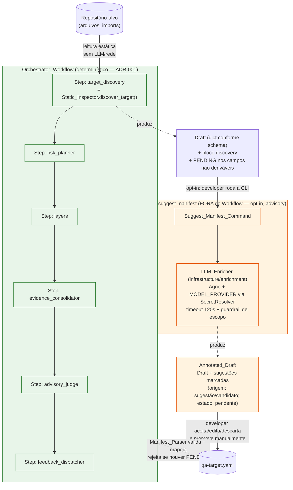

# Design Document — Descoberta Híbrida de Alvo

## Overview

Esta feature materializa o **ADR-004 — "Descoberta híbrida de alvo:
determinístico no fluxo, LLM advisory fora dele"**, estendendo o ADR-001
(Workflow-first). O `Target_Discovery` mínimo da Sprint 1 (hoje em
`code/src/qa_platform/infrastructure/manifest/target_discovery.py`) evolui para
uma descoberta em **duas fases com fronteira dura entre elas**:

- **Fase 1 — `Static_Inspector`** (determinística, dentro do
  `Orchestrator_Workflow`): passa a inspecionar o repositório-alvo sem LLM e sem
  rede, detectar o framework de agente (Agno/LangGraph) por heurísticas de
  import/arquivo e extrair ferramentas, prompts e RAG declarados, enriquecendo o
  rascunho num novo bloco `discovery`. **Preserva integralmente** a interface
  pública (`discover_target`, `is_pending`, `has_pending_fields`), a sentinela
  `PENDING` e o `TargetResolutionError` (Req 1).
- **Fase 2 — `LLM_Enricher`** (não-determinística, **fora** do Workflow, opt-in,
  advisory): acionada pela CLI `suggest-manifest`, recebe o `Draft`
  determinístico e **sugere** os campos de julgamento (`expected_domain`,
  `golden_set` candidato) como um `Annotated_Draft` — cada sugestão marcada como
  sugestão/candidato, que o desenvolvedor aceita, edita ou descarta (Req 6, 7).

O princípio-guia: **determinístico por dentro do fluxo, inteligente e advisory
por fora dele — e o desenvolvedor é quem promove sugestão a contrato**. A
fronteira é garantida fisicamente por import-linter (Req 10): o caminho do
`Orchestrator_Workflow` **nunca** alcança o `LLM_Enricher` nem o framework
`agno` na descoberta.

Toda a implementação vive sob `code/`, respeitando a arquitetura em camadas
(`domain` → `application` → `infrastructure` → `interface`) já vigente.

### Princípios de design herdados do código existente

- **Interface preservada, corpo trocado.** O módulo `target_discovery.py`
  mantém seu `__all__` (`PENDING`, `discover_target`, `has_pending_fields`,
  `is_pending`) e sua semântica de erro; o `Static_Inspector` passa a ser o
  novo corpo desse módulo (Req 1.1).
- **Domínio puro.** Novos VOs (`DiscoveryInfo`, `GoldenCase`) são
  `@dataclass(frozen=True)` em `domain/value_objects/`, sem Pydantic e sem
  import de infra/interface/agno (steering 12; Req 10.5).
- **YAML/Pydantic/agno confinados à infraestrutura.** O parser YAML não vaza; o
  `agno` só aparece no novo adapter `infrastructure/enrichment/` (Req 5.5, 10).
- **CLI fino.** `suggest-manifest` segue o padrão de `serve`/`health`: parse de
  args + import tardio + delegação, sem regra de negócio (Req 6).

### Fora de escopo (do requirements.md)

Consumo de `expected_domain`/`golden_set` pela avaliação (Sprints 3+),
heurísticas além de Agno/LangGraph, provider dedicado
(`DISCOVERY_MODEL_PROVIDER`), e edição interativa na CLI.

---

## Architecture

### As duas fases e a fronteira dura



**Leitura da fronteira (Req 10):**

- A caixa verde (Workflow) roda dentro do processo determinístico. O
  `target_discovery` Step invoca `Static_Inspector.discover_target()` — sem
  LLM, sem rede, sem `MODEL_PROVIDER`, sem `agno`.
- A caixa laranja (CLI) roda **fora** do Workflow, só quando o desenvolvedor
  pede (`zero tokens` no caminho padrão, Req 6.2). É o **único** lugar novo onde
  `agno` é importado (Fase 2).
- O único ponto de reentrada no Workflow é o `qa-target.yaml` **promovido
  manualmente** pelo desenvolvedor — sugestão não vira contrato sozinha (Req 8).

### Mapa de módulos (tudo sob `code/src/qa_platform/`)

| Módulo | Camada | Papel | Estado |
|---|---|---|---|
| `infrastructure/manifest/target_discovery.py` | infra | `Static_Inspector` (novo corpo, interface preservada) | **estende** |
| `infrastructure/manifest/discovery_heuristics.py` | infra | Heurísticas de detecção (framework/tools/prompts/RAG) | **novo** |
| `infrastructure/manifest/repo_reader.py` | infra | Leitura estática total do repo-alvo (sem rede) | **novo** |
| `infrastructure/manifest/schema.py` | infra | Validador de schema | inalterado (usa schema estendido) |
| `schemas/qa-target.schema.json` | — | JSON Schema 2020-12 | **estende** (3 campos opcionais) |
| `infrastructure/manifest/parser.py` | infra | `Manifest_Parser` (`_to_domain`) | **estende** (mapeia novos VOs) |
| `domain/value_objects/discovery.py` | domain | `DiscoveryInfo`, `DetectedItem`, `Framework` | **novo** |
| `domain/value_objects/golden_case.py` | domain | `GoldenCase` | **novo** |
| `infrastructure/enrichment/llm_enricher.py` | infra | `LLM_Enricher` (Agno; **único** import novo de `agno`) | **novo** |
| `infrastructure/enrichment/annotated_draft.py` | infra | `AnnotatedDraft`/`Suggestion` (Pydantic na borda) | **novo** |
| `application/suggest_manifest.py` | application | Caso de uso `suggest_manifest` (orquestra Fase 2) | **novo** |
| `interface/cli/main.py` | interface | Subcomando `suggest-manifest` (thin) | **estende** |
| `composition_root.py` | — | Wiring do `LLM_Enricher` (indirect import de agno) | **estende** |
| `importlinter.ini` | — | Contratos de fronteira | **estende** |

`repo_reader.py` e `discovery_heuristics.py` são módulos auxiliares do
`Static_Inspector`; ficam em `infrastructure/manifest/` porque são detalhe de
implementação da mesma fase e do mesmo adapter.

### Decisão de posicionamento do `LLM_Enricher`

O `LLM_Enricher` reside em **`infrastructure/enrichment/`** (novo pacote), não
em `infrastructure/orchestration/`. Motivo: `orchestration.*` é uma origem
permitida a importar `agno` no contrato `agno-confinado` **e** é o caminho do
Workflow. Colocar o enricher ali tornaria impossível expressar, por
import-linter, "o Workflow não importa o enricher" sem separar submódulos. Um
pacote dedicado `enrichment/` permite: (a) estender `agno-confinado` para
incluí-lo como fonte permitida; (b) criar um contrato `forbidden` novo em que a
origem `orchestration` (Workflow) não importa `enrichment` (Req 10.1).

---

## Components and Interfaces

### 1. `Static_Inspector` (novo corpo de `target_discovery.py`)

Preserva a interface pública e o `__all__` da Sprint 1. `discover_target`
mantém a assinatura `(target_ref: str | None) -> dict[str, Any]` e continua
sendo o executor do Step `target_discovery` do Workflow (Req 1.1, 1.5).

```python
# infrastructure/manifest/target_discovery.py  (interface preservada)
PENDING = "PENDING"

def discover_target(target_ref: str | None) -> dict[str, Any]: ...
def is_pending(value: Any) -> bool: ...
def has_pending_fields(draft: dict[str, Any]) -> bool: ...

__all__ = ["PENDING", "discover_target", "has_pending_fields", "is_pending"]
```

**Fluxo interno de `discover_target` (determinístico):**

1. `_resolve_ref(target_ref)` — inalterado: ausente/vazia/só-espaços →
   `TargetResolutionError` nomeando a ref, **sem** produzir Draft (Req 1.4, 7 da
   lista de propriedades).
2. `repo_reader.read_target(resolved_ref)` — lê o repositório-alvo por completo,
   **sem rede** (apenas filesystem local do artefato resolvido). Se algum
   arquivo/conteúdo for inacessível, aborta **sem Draft parcial**, sinalizando
   falha de leitura íntegra (Req 2.6). Qualquer tentativa de I/O de rede ou de
   invocar LLM é bloqueada por design (o módulo não importa `agno`, `boto3` nem
   clientes HTTP) e, se detectada em runtime, aborta sinalizando violação de
   determinismo (Req 2.5).
3. `discovery_heuristics.detect(repo_view)` — produz o `DiscoveryInfo` a partir
   de uma visão **imutável e ordenada** do repositório:
   - **Framework** (Req 3): varre imports/arquivos por heurísticas de Agno e de
     LangGraph. `agno` detectado → `Framework.AGNO`; `langgraph` →
     `Framework.LANGGRAPH`; ambos → registra os dois + `ambiguous=True` (exige
     revisão, Req 3.3); nenhum → `Framework.NOT_DETECTED`, prossegue até concluir
     o Draft (Req 3.4).
   - **Tools/Prompts/RAG** (Req 4): cada item vira um `DetectedItem`
     `(identifier, source_path)`. Nenhum encontrado → coleções vazias, sem erro
     (Req 4.4).
   - **Fragilidade** (Req 3.5): `DiscoveryInfo.fragility_note` carrega texto
     fixo marcando que heurísticas podem gerar falso positivo/negativo e exigem
     revisão do Developer.
4. Monta o Draft preservando a forma da Sprint 1 e adicionando o bloco
   `discovery` (serialização determinística do `DiscoveryInfo`):

```python
draft = {
    "target": {"ref": resolved_ref, "version": PENDING},
    "applicable_layers": ["ai"],
    "risk_parameters": {"ai": {"weight": PENDING}},
    "discovery": {                       # NOVO — documental/derivado (Req 4.6)
        "framework": "agno" | "langgraph" | None,
        "frameworks_detected": [...],    # >1 quando ambíguo (Req 3.3)
        "ambiguous": False,
        "tools":   [{"identifier": ..., "source": ...}, ...],  # ordenado
        "prompts": [{"identifier": ..., "source": ...}, ...],
        "rag":     [{"identifier": ..., "source": ...}, ...],
        "fragility_note": "Heurísticas frágeis; exigem revisão.",
    },
}
```

**Ordenação total e estável (Req 2.4):** todo `DetectedItem` é ordenado por
`(source_path, identifier)` (ASCII, case-sensitive) — critério explícito e
independente da ordem de leitura do filesystem. `frameworks_detected` é ordenado
alfabeticamente. Isso garante determinismo byte-a-byte (Req 2.1) e é a base da
Propriedade 1.

**Limites documentados da heurística:** a detecção é sintática (import/arquivo),
não semântica. Um agente que constrói o framework dinamicamente, importa via
alias exótico, ou declara tools por metaprogramação pode não ser detectado
(falso negativo); um arquivo de exemplo/teste com import de Agno pode gerar
falso positivo. Por isso `discovery` é **documental/derivado** e **não** altera
o roteamento do `Layer_Router` (Req 4.6) — serve para o desenvolvedor revisar.

### 2. `Manifest_Parser` estendido (`parser.py`)

`_to_domain(raw)` passa a mapear os três campos opcionais para VOs puros,
**sem** vazar tipos do parser YAML (Req 5.5). Quando ausentes, constrói VOs
vazios/default e conclui com sucesso (Req 5.6). Campo presente porém malformado
já é barrado por `validate_manifest` (schema estendido) que nomeia o campo
(Req 5.7) — o parser não produz VO parcial.

```python
def _to_domain(raw: dict[str, Any]) -> QATargetManifest:
    # ... target/applicable_layers/risk_parameters/cost_parameters (inalterado) ...
    discovery = _to_discovery(raw.get("discovery"))          # DiscoveryInfo (vazio se ausente)
    expected_domain = raw.get("expected_domain")             # str | None
    golden_set = tuple(_to_golden_case(c) for c in raw.get("golden_set", []))
    return QATargetManifest(
        ...,
        discovery=discovery,
        expected_domain=expected_domain,
        golden_set=golden_set,
    )
```

`QATargetManifest` ganha três campos novos **com defaults** (retrocompat de
código): `discovery: DiscoveryInfo = DiscoveryInfo.empty()`,
`expected_domain: str | None = None`, `golden_set: tuple[GoldenCase, ...] = ()`.
Como todos têm default, manifestos e testes existentes que constroem o VO sem
esses campos continuam válidos.

### 3. `LLM_Enricher` (`infrastructure/enrichment/llm_enricher.py`)

Adapter de infraestrutura Agno-based, **fora** do Workflow. É o único módulo
novo autorizado a importar `agno`.

```python
class LLMEnricher:
    def __init__(self, resolver: SecretResolver, *, timeout_s: float = 120.0) -> None: ...

    def enrich(self, draft: dict[str, Any]) -> AnnotatedDraft:
        """Recebe o Draft determinístico e produz um AnnotatedDraft com sugestões.

        - Resolve MODEL_PROVIDER via SecretResolver ANTES de qualquer chamada
          (fail-fast ~5s se ausente/blank/fonte indisponível — Req 9.1–9.3;
          MissingSecretError nomeia só a env, nunca o valor).
        - Monta um Agent Agno (provider por env) com guardrail de escopo mínimo
          (baseline do portfólio, skill agno-guardrails): rejeita conteúdo fora
          do escopo de "sugerir expected_domain/golden_set" (Req 9.5).
        - Timeout duro de 120s; estouro → EnrichmentTimeoutError (Req 6.6).
        - Nunca sobrescreve campos do Draft: copia base_fields inalterados e
          anexa sugestões marcadas (Req 7.3, 7.4).
        """
```

**Guardrail de escopo (Req 9.5):** conforme a skill `agno-guardrails`, o enricher
aplica a stack mínima do baseline (PII + prompt-injection + moderação) e um
**guardrail customizado de escopo** que bloqueia qualquer conteúdo fora do
domínio "descoberta de alvo de QA". Chamada fora do escopo é rejeitada sem
consumir o resultado. Provider por env via `SecretResolver` (nunca fixado no
código), seguindo o baseline do portfólio (skills `agno-providers`/`agno-secrets`).

**Sugestões marcadas (Req 7):** o enricher **nunca** grava valor direto em
`expected_domain`/`golden_set` do Draft. Cada saída do LLM vira uma `Suggestion`
com `origin` (`"sugestão"` para `expected_domain`, `"candidato"` para cada
`GoldenCase`) e `state="pendente"`. Se o Draft já traz valor não vazio para um
campo, o valor existente é mantido e a sugestão entra como entrada separada
(Req 7.4). Resolução (aceitar/editar/descartar) transiciona o `state`; enquanto
`pendente`, o valor não é aplicado (Req 7.5, 7.6).

### 4. `application/suggest_manifest.py` (caso de uso)

Orquestra a Fase 2 sem conhecer a CLI nem o Agno concreto — recebe o enricher
por injeção (port estrutural), lê/valida o Draft e devolve o `AnnotatedDraft` ou
um erro tipado. Fica em `application/` para manter a CLI fina e testável.

```python
def suggest_manifest(draft_path: str, enricher: EnricherPort) -> AnnotatedDraft:
    # 1. Lê o Draft do path; ausente/ilegível -> InvalidDraftError (Req 6.5).
    # 2. Valida que corresponde à estrutura de um Draft determinístico
    #    (chaves target/applicable_layers/risk_parameters); senão InvalidDraftError,
    #    SEM invocar o enricher, preservando o Draft (Req 6.5).
    # 3. enricher.enrich(draft) -> AnnotatedDraft (falha/timeout propagam — Req 6.6).
```

`EnricherPort` é um `Protocol` estrutural (em `application/`, sem import de infra)
com `enrich(draft) -> AnnotatedDraft`. Isso mantém `application` livre de `agno`.

### 5. Subcomando CLI `suggest-manifest` (`interface/cli/main.py`)

Segue o padrão thin de `serve`/`health`: parse de args, import tardio,
delegação, exit codes.

```python
def _suggest_manifest(argv: list[str]) -> int:
    from qa_platform.composition_root import build_enricher   # import tardio
    from qa_platform.application.suggest_manifest import (
        suggest_manifest, InvalidDraftError, EnrichmentError,
    )
    draft_path = _parse_draft_path(argv)
    try:
        annotated = suggest_manifest(draft_path, build_enricher())
    except InvalidDraftError as exc:
        print(json.dumps({"error": str(exc)}), file=sys.stderr); return 2   # Req 6.5
    except EnrichmentError as exc:      # inclui timeout/provider ausente (Req 6.6, 9.2)
        print(json.dumps({"error": str(exc)}), file=sys.stderr); return 3
    print(annotated.to_json())          # emite o Annotated_Draft
    return 0                            # Req 6.4

def main(argv=None) -> int:
    ...
    if command == "suggest-manifest":
        return _suggest_manifest(argv[1:])
    ...
```

A CLI está em `interface/`, **proibida** de importar `agno` diretamente
(`agno-confinado`). O `LLM_Enricher` (infra, pode importar `agno`) é alcançado
via `composition_root.build_enricher()` — mesma cadeia de wiring do
`build_orchestrator_runner` (`allow_indirect_imports=True`).

### 6. Wiring no `composition_root.py`

```python
def build_enricher() -> LLMEnricher:
    """Monta o LLM_Enricher com o SecretResolver (fail-fast do MODEL_PROVIDER)."""
    return LLMEnricher(resolver=_build_secret_resolver())
```

Reusa `_build_secret_resolver()` já existente. É o único ponto que "cola" a
interface (CLI) ao adapter Agno, mantendo a fronteira import-linter intacta.

---

## Data Models

### Domínio — VOs puros (`domain/value_objects/`, steering 12)

```python
# domain/value_objects/discovery.py
from dataclasses import dataclass, field
from enum import Enum

class Framework(str, Enum):
    AGNO = "agno"
    LANGGRAPH = "langgraph"
    NOT_DETECTED = "not_detected"

@dataclass(frozen=True)
class DetectedItem:
    """Item detectado (tool/prompt/indício de RAG) com origem (Req 4.1–4.3)."""
    identifier: str
    source: str          # caminho de arquivo que fundamentou a detecção

@dataclass(frozen=True)
class DiscoveryInfo:
    """O que a inspeção estática detectou. Documental/derivado (Req 4.5, 4.6)."""
    framework: Framework = Framework.NOT_DETECTED
    frameworks_detected: tuple[Framework, ...] = ()   # >1 quando ambíguo
    ambiguous: bool = False                            # Req 3.3
    tools: tuple[DetectedItem, ...] = ()
    prompts: tuple[DetectedItem, ...] = ()
    rag: tuple[DetectedItem, ...] = ()
    fragility_note: str = ""                           # Req 3.5

    @classmethod
    def empty(cls) -> "DiscoveryInfo":
        return cls()
```

```python
# domain/value_objects/golden_case.py
@dataclass(frozen=True)
class GoldenCase:
    """Caso candidato do golden set (Req 5.3). VO puro, imutável."""
    input: str
    expected: str
    note: str = ""
```

Ambos: `frozen=True`, comparáveis por valor, **sem** Pydantic e **sem** import
de `infrastructure`/`interface`/`agno` (Req 10.5, steering 12).

### Borda de enriquecimento — Pydantic (`infrastructure/enrichment/`)

O `Annotated_Draft` é saída da Fase 2 (borda externa/serialização), então
Pydantic é apropriado aqui (steering 12: "Pydantic na fronteira"), **não** no
domínio.

```python
# infrastructure/enrichment/annotated_draft.py
from typing import Literal
from pydantic import BaseModel

class Suggestion(BaseModel):
    field: Literal["expected_domain", "golden_set"]
    value: object                               # str ou dict do GoldenCase
    origin: Literal["sugestão", "candidato"]    # Req 7.1, 7.2
    state: Literal["pendente", "aceito", "editado", "descartado"] = "pendente"

class AnnotatedDraft(BaseModel):
    base_fields: dict[str, object]              # cópia FIEL do Draft (Req 7.3)
    suggestions: list[Suggestion] = []
    def to_json(self) -> str: ...
```

`base_fields` é uma cópia byte-fiel do Draft de entrada; o enricher nunca o
altera (invariante da Propriedade 4).

### Schema — extensão retrocompatível (`schemas/qa-target.schema.json`)

**Crítico:** o root tem `additionalProperties: false`. Para adicionar os campos
opcionais **sem** quebrar a validação de manifestos enriquecidos, eles precisam
ser declarados como `properties` explícitas e **ficar fora** de `required`.
Manifestos antigos (sem os três campos) permanecem válidos (Req 5.4).

Adicionar dentro de `properties` (root), mantendo `required` inalterado:

```json
"expected_domain": {
  "description": "Domínio esperado do alvo (campo de julgamento). Opcional (Req 5.2).",
  "type": "string",
  "minLength": 1
},
"golden_set": {
  "description": "Casos candidatos do golden set. Opcional (Req 5.3).",
  "type": "array",
  "items": {
    "type": "object",
    "additionalProperties": false,
    "required": ["input", "expected"],
    "properties": {
      "input":    {"type": "string", "minLength": 1},
      "expected": {"type": "string", "minLength": 1},
      "note":     {"type": "string"}
    }
  }
},
"discovery": {
  "description": "Resultado documental/derivado da inspeção estática (Fase 1). Opcional (Req 5.1). Heurísticas frágeis: exigem revisão do Developer.",
  "type": "object",
  "additionalProperties": false,
  "properties": {
    "framework": {
      "description": "Framework detectado; null quando não detectado (Req 3.4).",
      "type": ["string", "null"],
      "enum": ["agno", "langgraph", null]
    },
    "frameworks_detected": {
      "description": "Frameworks detectados; mais de um indica ambiguidade (Req 3.3).",
      "type": "array",
      "items": {"type": "string", "enum": ["agno", "langgraph"]},
      "uniqueItems": true
    },
    "ambiguous": {"type": "boolean"},
    "tools":   {"$ref": "#/$defs/detectedItemList"},
    "prompts": {"$ref": "#/$defs/detectedItemList"},
    "rag":     {"$ref": "#/$defs/detectedItemList"},
    "fragility_note": {"type": "string"}
  }
},
```

E um `$defs` para o item detectado (identificador + caminho de origem, Req 4.1–4.3):

```json
"$defs": {
  "detectedItemList": {
    "type": "array",
    "items": {
      "type": "object",
      "additionalProperties": false,
      "required": ["identifier", "source"],
      "properties": {
        "identifier": {"type": "string", "minLength": 1},
        "source":     {"type": "string", "minLength": 1}
      }
    }
  }
}
```

O validador em `schema.py` já suporta `enum`? Não — hoje ele valida
`type`/`required`/`minLength`/`minimum`/`minItems`/`uniqueItems`/
`additionalProperties`. Será preciso **estender `_validate_scalar`** para
suportar `enum` (valor fora do conjunto → nomeia o campo, Req 5.7) e
`_validate_node` para aceitar `type` como lista (`["string","null"]`). Essa é
uma extensão pequena e localizada; a Propriedade 2 (retrocompat) e a 7 (campo
malformado nomeado) cobrem o comportamento.

---

## Correctness Properties

*Uma propriedade é uma característica ou comportamento que deve valer para todas
as execuções válidas do sistema — uma afirmação formal sobre o que o sistema deve
fazer. Propriedades são a ponte entre a especificação legível por humanos e as
garantias de correção verificáveis por máquina.*

Estas propriedades cobrem a **lógica pura e as invariantes estruturais** da
feature. Aplicabilidade de PBT: o `Static_Inspector` é uma transformação pura
(repo → Draft), o `Manifest_Parser` é um parser/serializer (round-trip), e a
invariante de não-sobrescrita do `LLM_Enricher` é testável com o provider de LLM
**mockado**. Fronteiras de import são invariantes de grafo verificadas por
import-linter como teste determinístico (não são PBT). Caminhos de erro de I/O,
timeout e comportamento de CLI são testados por exemplo/integração.

Após a análise de prework, propriedades redundantes foram consolidadas: as
quatro cláusulas de detecção de framework (3.1–3.4) viram uma única propriedade
abrangente; as extrações de tools/prompts/RAG (4.1–4.4, incluindo o caso vazio)
viram uma; as cláusulas de PENDING (1.2, 1.3, 8.1) convergem numa; e as cláusulas
de não-sobrescrita de sugestões (7.1–7.4, 7.6, 8.4) convergem noutra.

### Property 1: Determinismo da Fase 1 (idempotência de saída)

*Para toda* visão de repositório-alvo sintética (mesma versão), executar o
`Static_Inspector` duas vezes produz Drafts iguais byte-a-byte, e a ordem dos
elementos ordenáveis (tools/prompts/rag/frameworks) segue o critério explícito
`(source, identifier)` independentemente da ordem de leitura do filesystem.

**Validates: Requirements 2.1, 2.4**

### Property 2: Retrocompatibilidade do schema

*Para todo* manifesto válido segundo o schema anterior a esta feature (sem
`discovery`, `expected_domain`, `golden_set`), a validação contra o schema
estendido também é bem-sucedida.

**Validates: Requirements 5.4**

### Property 3: Detecção de framework por heurística

*Para toda* visão de repositório sintética: se contém apenas indícios de Agno →
`framework == agno`; se apenas de LangGraph → `framework == langgraph`; se de
ambos → `ambiguous == True` e `frameworks_detected` contém os dois; se de nenhum
→ `framework == not_detected` e o Draft ainda é concluído sem erro.

**Validates: Requirements 3.1, 3.2, 3.3, 3.4**

### Property 4: Extração de tools/prompts/RAG com origem

*Para toda* visão de repositório sintética que declara um conjunto de N tools
(resp. prompts, indícios de RAG) identificáveis por heurística, o bloco
`discovery` contém exatamente esses N itens, cada um com `identifier` e `source`
corretos; quando N = 0, a coleção correspondente é vazia e nenhuma exceção é
levantada.

**Validates: Requirements 4.1, 4.2, 4.3, 4.4**

### Property 5: Preservação da sentinela PENDING

*Para todo* Draft com um subconjunto arbitrário de campos obrigatórios marcados
com `PENDING`, `has_pending_fields(draft)` é verdadeiro se e somente se existe ao
menos um `PENDING`, `is_pending` é coerente por campo, e o `Manifest_Parser`
rejeita o manifesto com um erro que nomeia **cada** campo pendente, sem promovê-lo
ao `Orchestrator_Workflow`.

**Validates: Requirements 1.2, 1.3, 8.1**

### Property 6: Sugestões nunca sobrescrevem silenciosamente

*Para todo* par (Draft de entrada, sugestões do LLM mockado), o `AnnotatedDraft`
resultante satisfaz `annotated.base_fields == draft` (mesmos campos, mesmos
valores, mesma ordem — nada removido/alterado/reordenado); cada sugestão de
`expected_domain` aparece marcada com `origin == "sugestão"` e cada `GoldenCase`
com `origin == "candidato"`, todos com `state == "pendente"`; e nenhuma sugestão
`pendente` é aplicada como valor efetivo — inclusive quando o Draft já traz valor
não vazio para o campo (a sugestão entra como entrada separada).

**Validates: Requirements 7.1, 7.2, 7.3, 7.4, 7.6, 8.4**

### Property 7: Máquina de estados da resolução de sugestão

*Para toda* `Suggestion` no estado `pendente` e *para toda* ação em
`{aceitar, editar, descartar}`, aplicar exatamente uma ação transiciona o estado
para o correspondente (`aceito`/`editado`/`descartado`) e nenhuma outra ação é
aplicada simultaneamente; ações inválidas não alteram o estado.

**Validates: Requirements 7.5**

### Property 8: Round-trip do parser do manifesto

*Para todo* `QATargetManifest` válido contendo os campos opcionais
(`discovery`, `expected_domain`, `golden_set`), `parse(serialize(m))` produz um
manifesto equivalente, incluindo os três campos mapeados como VOs de domínio
(`DiscoveryInfo`, `GoldenCase`); quando os campos estão ausentes, o parser produz
VOs vazios/default (`DiscoveryInfo.empty()`, `None`, `()`) e conclui com sucesso.

**Validates: Requirements 5.5, 5.6**

### Property 9: Campo opcional malformado é rejeitado nomeando o campo

*Para todo* manifesto sem `PENDING` porém com um campo opcional presente e
malformado segundo o schema (ou com um campo obrigatório inválido), o
`Manifest_Parser` rejeita com `InvalidManifestError` cujo conjunto de campos
inclui o campo ofensor, sem produzir um VO parcial e preservando o manifesto de
entrada.

**Validates: Requirements 5.7, 8.2**

### Property 10: Erro em referência de alvo ruim

*Para toda* referência de alvo ausente (`None`), vazia (`""`) ou composta apenas
de espaços em branco, o `Static_Inspector` levanta `TargetResolutionError` cuja
mensagem nomeia a referência afetada, sem produzir Draft.

**Validates: Requirements 1.4**

### Property 11: `discovery` é documental e não altera o roteamento

*Para todo* manifesto `M`, a seleção de camadas do `Layer_Router`
(`select_layers(plan_by_risk(M))`) é idêntica independentemente de o bloco
`discovery` estar vazio ou preenchido com conteúdo arbitrário.

**Validates: Requirements 4.6**

---

## Error Handling

Todos os erros de domínio herdam de `OrchestrationDomainError`/`DomainError`
(já existentes) e nomeiam campos/refs sem carregar valores de segredo. A interface
(CLI) traduz para exit codes; nunca vaza stack trace.

| Condição | Erro / Sinal | Origem | Comportamento | Req |
|---|---|---|---|---|
| Ref ausente/vazia/irresolvível | `TargetResolutionError` (existente) nomeando a ref | Static_Inspector | Aborta, sem Draft | 1.4 |
| Repo não lido integralmente | Erro de leitura (aborta) | repo_reader | Sem Draft parcial; sinaliza leitura incompleta | 2.6 |
| Tentativa de LLM/rede na Fase 1 | Erro de violação de determinismo (aborta) | Static_Inspector | Sem Draft parcial | 2.5 |
| Campo opcional malformado / obrigatório inválido | `InvalidManifestError` (existente) agregando campos | schema.py | Rejeita nomeando cada campo; sem VO parcial | 5.7, 8.2 |
| Draft com `PENDING` | `InvalidManifestError` nomeando cada campo pendente | Manifest_Parser | Não promove ao Workflow | 8.1 |
| Draft ausente/ilegível/estrutura inesperada | `InvalidDraftError` (novo, em `application/`) | suggest_manifest | Rejeita sem invocar enricher; Draft intacto; exit `2` | 6.5 |
| `MODEL_PROVIDER` ausente/blank | `MissingSecretError` (existente) nomeando só a env | SecretResolver via enricher | Fail-fast ~5s; sem valor de segredo; Draft intacto; exit `3` | 9.2 |
| Fonte de segredo indisponível | `MissingSecretError`/erro de resolução | SecretResolver | Fail-fast ~5s; sem valor de segredo | 9.3 |
| Enricher falha ou timeout 120s | `EnrichmentError`/`EnrichmentTimeoutError` (novos, `application/`) | suggest_manifest | Aborta; Draft intacto; exit `3` | 6.6 |
| Conteúdo fora do escopo do guardrail | Rejeição do guardrail (Agno) | LLM_Enricher | Chamada rejeitada, sem aplicar sugestão | 9.5 |
| Annotated_Draft não promovido submetido ao Workflow | Erro de revisão obrigatória | gate de promoção | Impede entrada no fluxo | 8.3, 8.4 |

**Exit codes da CLI `suggest-manifest`:** `0` sucesso (Req 6.4); `2`
Draft inválido (Req 6.5); `3` falha/timeout/provider do enricher (Req 6.6, 9.2,
9.3). Sempre não-zero em falha, preservando o Draft de entrada inalterado.

---

## Testing Strategy

Segue steering 11 (pytest, Hypothesis), steering 03 (moto quando houver AWS) e a
skill `agno-testing-strategy` (três camadas: transporte determinístico,
comportamento do agente, sistema real; import-linter como assertção determinística).

### Abordagem dual

- **Property-based (Hypothesis)** para a lógica pura e invariantes universais:
  Static_Inspector, parser/serializer, invariante de não-sobrescrita (LLM
  mockado). Mínimo **100 iterações** por teste de propriedade.
- **Exemplo/unit** para casos concretos, contratos de interface e caminhos de
  erro pontuais (I/O, timeout, CLI).
- **Integração** para o Step no Workflow e para o guardrail/fluxo com o provider
  (LLM mockado; provider real fica para eval fora do CI rápido).
- **import-linter** como **teste determinístico** de fronteira (Propriedade 6 de
  requirements / Req 10).

Cada teste de propriedade referencia a propriedade do design no formato:
`# Feature: hybrid-target-discovery, Property {N}: {texto}`.

### Mapa Correctness Property → teste

| Propriedade do design | Tipo | Ferramenta | Estratégia |
|---|---|---|---|
| P1 Determinismo/ordenação da Fase 1 | Property | Hypothesis | Gera árvore de repo sintética em memória; `discover(x)==discover(x)` byte-a-byte; permuta ordem de leitura e afirma saída ordenada por `(source, identifier)` (Req 2.1, 2.4) |
| P2 Retrocompat do schema | Property | Hypothesis | Gera manifestos válidos pelo schema antigo; `validate_manifest` passa no schema estendido (Req 5.4) |
| P3 Detecção de framework | Property | Hypothesis | Gera repos com indícios {só Agno, só LangGraph, ambos, nenhum}; afirma framework/ambiguous (Req 3.1–3.4) |
| P4 Extração tools/prompts/RAG | Property | Hypothesis | Injeta N declarações (N≥0); afirma coleção com identifier+source e caso vazio sem erro (Req 4.1–4.4) |
| P5 Preservação de PENDING | Property | Hypothesis | Gera drafts com subconjuntos de PENDING; `has_pending_fields`/`is_pending` coerentes; parser rejeita nomeando cada campo (Req 1.2, 1.3, 8.1) |
| P6 Sugestões nunca sobrescrevem | Property | Hypothesis + **LLM mockado** | Gera (Draft, sugestões); `base_fields==draft`, marcação origem/estado, não-aplicação de pendentes, valor pré-existente preservado (Req 7.1–7.4, 7.6, 8.4) |
| P7 Máquina de estados da resolução | Property | Hypothesis | Gera (Suggestion pendente, ação); transição correta; exatamente uma ação (Req 7.5) |
| P8 Round-trip do parser | Property | Hypothesis | Gera `QATargetManifest` com campos opcionais; `parse(serialize(m))==m`; ausência → VOs default (Req 5.5, 5.6) |
| P9 Campo malformado nomeado | Property | Hypothesis | Gera malformações em campos opcionais/obrigatórios; `InvalidManifestError` inclui o campo ofensor (Req 5.7, 8.2) |
| P10 TargetResolutionError | Property | Hypothesis | Gera refs None/""/só-espaços; afirma `TargetResolutionError` nomeando a ref (Req 1.4) |
| P11 `discovery` não altera roteamento | Property | Hypothesis | Gera manifesto; `select_layers` igual com discovery vazio vs. arbitrário (Req 4.6) |

### Exemplos/integração (não-PBT)

| Cenário | Tipo | Estratégia | Req |
|---|---|---|---|
| Interface pública preservada | Exemplo | Import + assinaturas + `__all__` da Sprint 1 | 1.1 |
| Step válido no Workflow | Integração | Roda `target_discovery` via engine e confere formato consumido | 1.5 |
| Sem LLM/sem rede na Fase 1 | Exemplo | Espião de LLM + bloqueio de socket (pytest-socket) durante `discover_target` | 2.2, 2.3 |
| Aborto em LLM/rede/leitura incompleta | Edge | Leitor injetado que tenta rede/LLM; arquivo inacessível → aborta sem Draft parcial | 2.5, 2.6 |
| Nota de fragilidade presente | Exemplo | `discovery.fragility_note` não vazio | 3.5 |
| Schema declara os 3 campos opcionais fora de `required` | Exemplo | Inspeciona o JSON Schema | 5.1, 5.2, 5.3 |
| Fluxo `suggest-manifest` feliz | Exemplo | `main(["suggest-manifest", draft])` com enricher mock → imprime AnnotatedDraft, exit 0 | 6.1, 6.4 |
| CLI: Draft inválido / falha / timeout | Edge | Enricher mock que levanta/estoura; arquivo intacto; exit `2`/`3` | 6.5, 6.6 |
| Fail-fast do MODEL_PROVIDER | Edge | env unset e só-espaços; provider indisponível; `MissingSecretError` nomeia só a env, sem valor; ~5s | 9.2, 9.3 |
| Ordem: resolve provider antes de invocar | Exemplo | Espião de ordem no `SecretResolver` | 9.1 |
| Static_Inspector não toca SecretResolver | Exemplo | Espião: `discover_target` não lê `MODEL_PROVIDER` nem chama resolver | 9.4 |
| Guardrail de escopo | Exemplo | Conteúdo fora do escopo rejeitado; dentro passa (Agno mockado) | 9.5 |
| Gate de promoção humana | Exemplo | Annotated_Draft não promovido → bloqueio com erro de revisão | 8.3 |
| Fronteira import-linter | Integração/determinístico | Roda import-linter; afirma PASS dos contratos; fixture com violação afirma exit≠0 e ofensor origem→destino | 10.1–10.6 |

### AWS

Só o `LLM_Enricher` toca segredos, via `SecretResolver` (env → Secrets Manager).
Os testes usam env local (a env sempre vence) e, quando exercitam o caminho do
Secrets Manager, mockam com **moto** (`mock_aws`) conforme steering 03 — sem
chamadas reais à AWS. O caminho padrão da Fase 1 não toca AWS.

### PBT NÃO aplicado a

Configuração de CI (Req 10.7 — smoke/estrutural), comportamento do import-linter
(determinístico, não por variação de input), e a chamada real ao provider de LLM
(custo/variância — vai para eval fora do CI rápido, com o provider mockado no CI).

---

## Import-Linter Contracts (Req 10)

Estende `code/importlinter.ini`. Os contratos existentes (`camadas`,
`domain-puro`, `boto3-confinado`, `agno-confinado`) permanecem; abaixo as
mudanças.

### (1) `agno-confinado` — incluir o pacote de enriquecimento como fonte permitida

O `LLM_Enricher` é o único **novo** lugar autorizado a importar `agno` (Fase 2).
`domain` e `interface` continuam proibidos de importar `agno` diretamente
(`allow_indirect_imports=True` mantém o wiring via composition_root). Nenhuma
mudança de estrutura é necessária no stanza atual — `domain`/`interface` seguem
como `source_modules` proibidas. O que muda é **documental**: o conjunto de
adapters que legitimamente importam `agno` passa a incluir
`qa_platform.infrastructure.enrichment.*` (além de `orchestration.*` e
`layers.*`). Como o contrato é `forbidden` sobre `domain`/`interface`, o enricher
em `infrastructure/` já é permitido; o contrato de camadas garante que
`interface` não o importa diretamente.

### (2) NOVO contrato `forbidden` — Workflow não importa o enricher (Req 10.1)

```ini
# Contrato 5 — Fronteira ADR-004: o caminho do Orchestrator_Workflow (Fase 1,
# determinística) NÃO pode importar o LLM_Enricher (Fase 2, advisory). Sem
# allow_indirect_imports: aqui a proibição é dura — nenhuma cadeia de import do
# módulo de orquestração pode alcançar o pacote de enriquecimento (Req 10.1).
[importlinter:contract:workflow-nao-importa-enricher]
name = Orchestrator_Workflow nao importa o LLM_Enricher (fronteira ADR-004)
type = forbidden
source_modules =
    qa_platform.infrastructure.orchestration
forbidden_modules =
    qa_platform.infrastructure.enrichment
```

### (3) NOVO contrato `forbidden` — enricher fora do caminho da Fase 1

```ini
# Contrato 6 — Reforço da fronteira: o módulo de descoberta determinística
# (Static_Inspector) e seus auxiliares NÃO importam agno nem o enricher, e o
# enricher não reimporta o caminho da Fase 1 (evita ciclo/vazamento). Mantém a
# Fase 1 livre de LLM (Req 2.2, 10.2).
[importlinter:contract:fase1-sem-llm]
name = Fase 1 (Static_Inspector) livre de agno e do enricher
type = forbidden
source_modules =
    qa_platform.infrastructure.manifest.target_discovery
    qa_platform.infrastructure.manifest.discovery_heuristics
    qa_platform.infrastructure.manifest.repo_reader
forbidden_modules =
    agno
    qa_platform.infrastructure.enrichment
```

### (4) `domain-puro` — cobre os novos VOs automaticamente (Req 10.5)

`DiscoveryInfo`/`GoldenCase` ficam em `qa_platform.domain.value_objects.*`, já
sob a `source_modules = qa_platform.domain` do contrato `domain-puro`, que proíbe
importar `application`/`infrastructure`/`interface`/`agno`/`yaml`/`pydantic`.
Nenhuma alteração no stanza é necessária — a pureza dos novos VOs é verificada
pelo contrato existente. (Por isso os VOs usam `@dataclass`, não Pydantic.)

### CI (Req 10.7)

O job de arquitetura do CI executa `import-linter --config code/importlinter.ini`
(via `lint-imports`). Qualquer contrato em FAIL identifica o import ofensor
(origem → destino) e encerra com código ≠ 0 (Req 10.6), **bloqueando** o
merge/deploy. Isso torna a fronteira do ADR-004 uma barreira física, não uma
convenção.

---

## Backward Compatibility & Migration

- **Manifestos existentes** (sem `discovery`/`expected_domain`/`golden_set`)
  permanecem válidos: os campos são opcionais e ficam fora de `required`
  (Req 5.4). A suíte de testes atual do parser/schema continua passando.
- **Código existente**: `QATargetManifest` ganha três campos com defaults; toda
  construção atual do VO (sem esses campos) segue válida. `discover_target`
  mantém assinatura e `__all__`; consumidores da Sprint 1 não mudam (Req 1.1).
- **Validador de schema**: a extensão para `enum` e `type` como lista é aditiva
  — schemas/manifestos que não usam esses recursos não são afetados.
- **SemVer**: evolução **MINOR** pré-1.0 (adição retrocompatível de campos
  opcionais e de um subcomando de CLI; nenhuma quebra de contrato público).
- **Rollout**: a Fase 2 (`suggest-manifest`) é opt-in; ativá-la não exige
  mudança nos alvos existentes. O `MODEL_PROVIDER` só é exigido quando o
  desenvolvedor roda a CLI (fail-fast, Req 9).
