# Implementation Plan

Plano de Implementação — Descoberta Híbrida de Alvo

## Overview

Este plano converte o design da **Descoberta Híbrida de Alvo** (ADR-004) numa
sequência incremental de tarefas de codificação. Cada tarefa constrói sobre as
anteriores e termina integrando o código ao fluxo — sem código órfão. A ordem
respeita a direção de dependência das camadas (`domain` → `application` →
`infrastructure` → `interface`) e garante que nenhuma tarefa referencie código
ainda inexistente:

1. VOs puros do domínio (`DiscoveryInfo`/`DetectedItem`/`Framework`, `GoldenCase`);
2. extensão do JSON Schema + suporte a `enum`/`type`-como-lista no validador;
3. mapeamento dos novos campos no `Manifest_Parser` (`_to_domain`);
4. leitura estática do repo (`repo_reader`) + heurísticas (`discovery_heuristics`);
5. novo corpo do `Static_Inspector` (interface preservada);
6. modelos de enriquecimento (`AnnotatedDraft`/`Suggestion`) + `LLM_Enricher` (Agno);
7. caso de uso `suggest_manifest` + `EnricherPort`;
8. subcomando CLI `suggest-manifest` + wiring no `composition_root`;
9. contratos de fronteira no `import-linter`;
10. verificação final (build/lint/mypy/import-linter/testes).

**Convenções (TUDO sob `code/`):** toda implementação e todos os testes vivem
sob `code/`. Testes de propriedade usam **pytest + Hypothesis** com **mínimo de
100 iterações** (`@settings(max_examples=100)`), qualquer caminho AWS usa **moto**
(`mock_aws`), e cada teste de propriedade referencia a propriedade do design com o
marcador `# Feature: hybrid-target-discovery, Property {N}`. O `import-linter` é
usado como **teste determinístico de fronteira**.

---

## Tasks

- [ ] 1. Value objects puros do domínio (`DiscoveryInfo`, `GoldenCase`)
  - [ ] 1.1 Criar `domain/value_objects/discovery.py` com `Framework`, `DetectedItem`, `DiscoveryInfo`
    - Definir `Framework(str, Enum)` com `AGNO`/`LANGGRAPH`/`NOT_DETECTED`
    - Definir `@dataclass(frozen=True) DetectedItem(identifier: str, source: str)`
    - Definir `@dataclass(frozen=True) DiscoveryInfo` com `framework`, `frameworks_detected`, `ambiguous`, `tools`, `prompts`, `rag` (tuplas), `fragility_note`, e `@classmethod empty()`
    - Sem Pydantic e sem import de `infrastructure`/`interface`/`agno` (VO puro)
    - _Requirements: 4.5, 5.1, 10.5_

  - [ ] 1.2 Criar `domain/value_objects/golden_case.py` com `GoldenCase`
    - Definir `@dataclass(frozen=True) GoldenCase(input: str, expected: str, note: str = "")`
    - Comparável por valor, imutável, sem Pydantic e sem import de infra/interface/agno
    - _Requirements: 5.3, 10.5_

  - [ ]* 1.3 Escrever testes unitários dos VOs de domínio
    - Verificar imutabilidade (`frozen`), igualdade por valor e `DiscoveryInfo.empty()` retornando VO vazio/default
    - _Requirements: 4.5, 5.3, 10.5_

- [ ] 2. Estender o JSON Schema e o validador (`schema.py`)
  - [ ] 2.1 Estender `schemas/qa-target.schema.json` com `discovery`, `expected_domain`, `golden_set` opcionais
    - Adicionar as 3 `properties` no root **fora** de `required` (mantendo `required` inalterado)
    - `expected_domain`: string `minLength: 1`; `golden_set`: array de objetos `{input, expected, note?}`
    - `discovery`: objeto com `framework` (enum `agno`/`langgraph`/`null`), `frameworks_detected` (array `uniqueItems`), `ambiguous`, `tools`/`prompts`/`rag` via `$ref: #/$defs/detectedItemList`, `fragility_note`
    - Adicionar `$defs.detectedItemList` (array de `{identifier, source}` obrigatórios, `additionalProperties: false`)
    - _Requirements: 5.1, 5.2, 5.3_

  - [ ] 2.2 Estender o validador para suportar `enum` e `type` como lista
    - Em `_validate_scalar`: validar `enum` (valor fora do conjunto → erro nomeando o campo)
    - Em `_validate_node`/`_matches_type`: aceitar `type` como lista (ex.: `["string", "null"]`), casando se qualquer tipo bater
    - Extensão aditiva: schemas sem `enum`/`type`-lista não são afetados
    - _Requirements: 5.7_

  - [ ]* 2.3 Teste de propriedade — retrocompatibilidade do schema
    - **Property 2: Retrocompatibilidade do schema**
    - **Validates: Requirements 5.4**
    - Hypothesis gera manifestos válidos pelo schema anterior (sem os 3 campos); afirmar `validate_manifest` passa no schema estendido; `# Feature: hybrid-target-discovery, Property 2`

  - [ ]* 2.4 Teste de propriedade — campo opcional malformado é rejeitado nomeando o campo
    - **Property 9: Campo opcional malformado é rejeitado nomeando o campo**
    - **Validates: Requirements 5.7, 8.2**
    - Hypothesis gera malformações em campos opcionais/obrigatórios; afirmar `InvalidManifestError` inclui o campo ofensor, sem VO parcial; `# Feature: hybrid-target-discovery, Property 9`

  - [ ]* 2.5 Teste por exemplo — schema declara os 3 campos fora de `required`
    - Inspecionar o JSON Schema carregado: os 3 campos existem em `properties` e nenhum está em `required`
    - _Requirements: 5.1, 5.2, 5.3_

- [ ] 3. Estender o `Manifest_Parser` (`parser.py`) para mapear os novos campos
  - [ ] 3.1 Adicionar campos com default ao `QATargetManifest` e helpers de mapeamento
    - Em `domain/entities/manifest.py`: `discovery: DiscoveryInfo = DiscoveryInfo.empty()`, `expected_domain: str | None = None`, `golden_set: tuple[GoldenCase, ...] = ()` (todos com default → retrocompat de código)
    - Em `parser.py`: `_to_discovery(raw.get("discovery"))` (VO vazio se ausente) e `_to_golden_case(...)`; mapear `expected_domain`
    - `_to_domain` retorna o VO com os 3 campos; tipos do parser YAML não vazam (Req 5.5)
    - _Requirements: 5.5, 5.6_

  - [ ]* 3.2 Teste de propriedade — round-trip do parser do manifesto
    - **Property 8: Round-trip do parser do manifesto**
    - **Validates: Requirements 5.5, 5.6**
    - Hypothesis gera `QATargetManifest` com os campos opcionais; afirmar `parse(serialize(m))` equivalente e ausência → VOs default; `# Feature: hybrid-target-discovery, Property 8`

  - [ ]* 3.3 Teste de propriedade — preservação da sentinela PENDING no parser
    - **Property 5: Preservação da sentinela PENDING**
    - **Validates: Requirements 1.2, 1.3, 8.1**
    - Hypothesis gera drafts com subconjuntos de campos `PENDING`; afirmar `has_pending_fields`/`is_pending` coerentes e parser rejeita nomeando cada campo pendente; `# Feature: hybrid-target-discovery, Property 5`

- [ ] 4. Checkpoint — domínio, schema e parser
  - Ensure all tests pass, ask the user if questions arise.

- [ ] 5. Leitura estática e heurísticas da Fase 1
  - [ ] 5.1 Criar `infrastructure/manifest/repo_reader.py` (leitura estática total, sem rede)
    - `read_target(resolved_ref) -> RepoView`: lê o artefato resolvido no filesystem local, produzindo uma visão **imutável e ordenada** dos arquivos/conteúdos
    - Arquivo/conteúdo inacessível → aborta sem visão parcial, sinalizando leitura incompleta (Req 2.6)
    - Não importa `agno`, `boto3` nem clientes HTTP (determinismo por design; Req 2.2, 2.3)
    - _Requirements: 2.3, 2.6_

  - [ ] 5.2 Criar `infrastructure/manifest/discovery_heuristics.py` (detecção)
    - `detect(repo_view) -> DiscoveryInfo`: heurísticas de import/arquivo para Agno e LangGraph (framework), e para tools/prompts/RAG (cada item vira `DetectedItem(identifier, source)`)
    - Ambos frameworks → `ambiguous=True` + `frameworks_detected` com os dois; nenhum → `Framework.NOT_DETECTED`
    - Ordenação total e estável: `DetectedItem` por `(source, identifier)` (ASCII, case-sensitive); `frameworks_detected` alfabético
    - `fragility_note` com texto fixo de fragilidade/revisão (Req 3.5)
    - _Requirements: 2.4, 3.1, 3.2, 3.3, 3.4, 3.5, 4.1, 4.2, 4.3, 4.4_

  - [ ]* 5.3 Teste de propriedade — detecção de framework por heurística
    - **Property 3: Detecção de framework por heurística**
    - **Validates: Requirements 3.1, 3.2, 3.3, 3.4**
    - Hypothesis gera repos sintéticos {só Agno, só LangGraph, ambos, nenhum}; afirmar `framework`/`ambiguous`/`frameworks_detected` e conclusão sem erro no caso "nenhum"; `# Feature: hybrid-target-discovery, Property 3`

  - [ ]* 5.4 Teste de propriedade — extração de tools/prompts/RAG com origem
    - **Property 4: Extração de tools/prompts/RAG com origem**
    - **Validates: Requirements 4.1, 4.2, 4.3, 4.4**
    - Hypothesis injeta N declarações (N≥0); afirmar coleção com `identifier`+`source` corretos e caso vazio sem exceção; `# Feature: hybrid-target-discovery, Property 4`

- [ ] 6. Novo corpo do `Static_Inspector` (`target_discovery.py`, interface preservada)
  - [ ] 6.1 Reimplementar `discover_target` compondo `repo_reader` + `discovery_heuristics`
    - Preservar `PENDING`, `is_pending`, `has_pending_fields`, `TargetResolutionError` e `__all__` exatamente como na Sprint 1
    - Fluxo: `_resolve_ref` → `repo_reader.read_target` → `discovery_heuristics.detect` → montar Draft com forma da Sprint 1 + bloco `discovery` (serialização determinística do `DiscoveryInfo`)
    - Campos não deriváveis permanecem `PENDING`; assinatura `(target_ref: str | None) -> dict[str, Any]` inalterada (Req 1.1, 1.5)
    - Abortar sem Draft parcial em leitura incompleta / tentativa de rede-LLM (Req 2.5, 2.6)
    - _Requirements: 1.1, 1.2, 1.4, 1.5, 2.2, 2.3, 2.5, 2.6, 4.6_

  - [ ]* 6.2 Teste de propriedade — determinismo/ordenação da Fase 1
    - **Property 1: Determinismo da Fase 1 (idempotência de saída)**
    - **Validates: Requirements 2.1, 2.4**
    - Hypothesis gera árvore de repo sintética em memória; `discover(x) == discover(x)` byte-a-byte; permutar ordem de leitura e afirmar saída ordenada por `(source, identifier)`; `# Feature: hybrid-target-discovery, Property 1`

  - [ ]* 6.3 Teste de propriedade — erro em referência de alvo ruim
    - **Property 10: Erro em referência de alvo ruim**
    - **Validates: Requirements 1.4**
    - Hypothesis gera refs `None`/`""`/só-espaços; afirmar `TargetResolutionError` nomeando a ref, sem Draft; `# Feature: hybrid-target-discovery, Property 10`

  - [ ]* 6.4 Testes por exemplo/edge — interface preservada e Fase 1 sem LLM/rede
    - Import + assinaturas + `__all__` idênticos à Sprint 1 (Req 1.1)
    - Espião de LLM + bloqueio de socket (pytest-socket) durante `discover_target` (Req 2.2, 2.3)
    - Leitor injetado que tenta rede/LLM e arquivo inacessível → aborta sem Draft parcial (Req 2.5, 2.6)
    - `discovery.fragility_note` não vazio (Req 3.5)
    - _Requirements: 1.1, 2.2, 2.3, 2.5, 2.6, 3.5_

  - [ ]* 6.5 Teste de integração — `target_discovery` como Step válido do Workflow
    - Rodar o Step via engine de orquestração e conferir o formato de saída consumido pelo fluxo
    - _Requirements: 1.5_

  - [ ]* 6.6 Teste de propriedade — `discovery` é documental e não altera roteamento
    - **Property 11: `discovery` é documental e não altera o roteamento**
    - **Validates: Requirements 4.6**
    - Hypothesis gera manifesto; `select_layers(plan_by_risk(M))` idêntico com `discovery` vazio vs. arbitrário; `# Feature: hybrid-target-discovery, Property 11`

- [ ] 7. Checkpoint — Fase 1 completa (determinística, sem LLM/rede)
  - Ensure all tests pass, ask the user if questions arise.

- [ ] 8. Modelos de enriquecimento e `LLM_Enricher` (Fase 2)
  - [ ] 8.1 Criar `infrastructure/enrichment/annotated_draft.py` (Pydantic na borda)
    - `Suggestion(BaseModel)`: `field` (`Literal["expected_domain","golden_set"]`), `value`, `origin` (`Literal["sugestão","candidato"]`), `state` (`Literal["pendente","aceito","editado","descartado"] = "pendente"`)
    - `AnnotatedDraft(BaseModel)`: `base_fields: dict`, `suggestions: list[Suggestion] = []`, método `to_json()`
    - Método de resolução que transiciona `state` de `pendente` para a ação escolhida (aceitar/editar/descartar), aplicando exatamente uma ação
    - _Requirements: 7.1, 7.2, 7.5_

  - [ ]* 8.2 Teste de propriedade — máquina de estados da resolução de sugestão
    - **Property 7: Máquina de estados da resolução de sugestão**
    - **Validates: Requirements 7.5**
    - Hypothesis gera (Suggestion pendente, ação em `{aceitar, editar, descartar}`); afirmar transição correta e exatamente uma ação; ações inválidas não alteram estado; `# Feature: hybrid-target-discovery, Property 7`

  - [ ] 8.3 Criar `infrastructure/enrichment/llm_enricher.py` (`LLMEnricher`, único novo import de `agno`)
    - `__init__(self, resolver, *, timeout_s=120.0)`; `enrich(draft) -> AnnotatedDraft`
    - Resolver `MODEL_PROVIDER` via `SecretResolver` **antes** de qualquer chamada; ausente/blank/fonte indisponível → fail-fast ~5s com `MissingSecretError` nomeando só a env (Req 9.1, 9.2, 9.3)
    - Montar Agent Agno (provider por env) com guardrail de escopo mínimo (baseline do portfólio); conteúdo fora do escopo é rejeitado (Req 9.5)
    - Timeout duro de 120s → `EnrichmentTimeoutError` (Req 6.6)
    - Nunca sobrescrever: `base_fields` = cópia fiel do Draft; cada saída vira `Suggestion` marcada (`origin`/`state="pendente"`); valor pré-existente mantido, sugestão entra como entrada separada (Req 7.3, 7.4, 7.6)
    - _Requirements: 6.1, 6.6, 7.3, 7.4, 7.6, 9.1, 9.2, 9.3, 9.5_

  - [ ]* 8.4 Teste de propriedade — sugestões nunca sobrescrevem silenciosamente (LLM mockado)
    - **Property 6: Sugestões nunca sobrescrevem silenciosamente**
    - **Validates: Requirements 7.1, 7.2, 7.3, 7.4, 7.6, 8.4**
    - Hypothesis gera (Draft, sugestões) com provider de LLM mockado; afirmar `annotated.base_fields == draft`, marcação `origin`/`state`, não-aplicação de pendentes e preservação de valor pré-existente; `# Feature: hybrid-target-discovery, Property 6`

  - [ ]* 8.5 Testes por exemplo/edge — fail-fast do provider e guardrail (moto quando AWS)
    - `MODEL_PROVIDER` unset e só-espaços; provider indisponível → `MissingSecretError` nomeia só a env (sem valor), ~5s (Req 9.2, 9.3)
    - Espião de ordem: provider resolvido antes de invocar o LLM (Req 9.1)
    - Guardrail de escopo: conteúdo fora do escopo rejeitado, dentro passa (Agno mockado) (Req 9.5)
    - Caminho do Secrets Manager mockado com `moto`/`mock_aws`; env local vence
    - _Requirements: 9.1, 9.2, 9.3, 9.5_

- [ ] 9. Caso de uso `suggest_manifest` (`application/suggest_manifest.py`)
  - [ ] 9.1 Implementar `suggest_manifest` + `EnricherPort` + erros tipados
    - `EnricherPort` (`Protocol` estrutural, sem import de infra) com `enrich(draft) -> AnnotatedDraft`
    - `suggest_manifest(draft_path, enricher)`: lê o Draft; ausente/ilegível → `InvalidDraftError` (Req 6.5); valida estrutura de Draft determinístico (chaves `target`/`applicable_layers`/`risk_parameters`), senão `InvalidDraftError` sem invocar o enricher, preservando o Draft; `enricher.enrich` propaga falha/timeout (Req 6.6)
    - Definir `InvalidDraftError`, `EnrichmentError`, `EnrichmentTimeoutError` em `application/` (mantendo `application` livre de `agno`)
    - _Requirements: 6.1, 6.5, 6.6_

  - [ ]* 9.2 Testes por exemplo/edge — validação de Draft e propagação de falha
    - Draft ausente/ilegível/estrutura inesperada → `InvalidDraftError` sem invocar o enricher; Draft intacto (Req 6.5)
    - Enricher que levanta/estoura timeout → erro propagado, Draft intacto (Req 6.6)
    - `EnricherPort` satisfeito estruturalmente pelo `LLMEnricher` e por um fake de teste
    - _Requirements: 6.1, 6.5, 6.6_

- [ ] 10. Subcomando CLI `suggest-manifest` e wiring
  - [ ] 10.1 Adicionar `build_enricher()` ao `composition_root.py`
    - `build_enricher() -> LLMEnricher` reusando `_build_secret_resolver()` (fail-fast do `MODEL_PROVIDER`)
    - Único ponto que "cola" a interface (CLI) ao adapter Agno, preservando a fronteira do import-linter
    - _Requirements: 6.1, 9.1_

  - [ ] 10.2 Adicionar o subcomando fino `suggest-manifest` em `interface/cli/main.py`
    - `_suggest_manifest(argv)`: import tardio de `build_enricher` e de `suggest_manifest`; parse do path do Draft; delega
    - Exit codes: `0` sucesso (imprime `annotated.to_json()`, Req 6.4); `2` `InvalidDraftError` (Req 6.5); `3` `EnrichmentError`/timeout/provider (Req 6.6, 9.2); erro em JSON no stderr, sem stack trace
    - Registrar o comando em `main(...)`; CLI não importa `agno` diretamente
    - _Requirements: 6.2, 6.3, 6.4, 6.5, 6.6_

  - [ ]* 10.3 Testes por exemplo/edge — fluxo da CLI feliz e caminhos de erro
    - `main(["suggest-manifest", draft])` com enricher mock → imprime AnnotatedDraft, exit `0` (Req 6.1, 6.4)
    - Enricher mock que levanta/estoura → exit `2`/`3`, arquivo de Draft intacto (Req 6.5, 6.6)
    - Caminho padrão (Fase 1) não invoca o enricher e consome zero tokens (Req 6.2, 6.3)
    - _Requirements: 6.1, 6.2, 6.3, 6.4, 6.5, 6.6_

  - [ ]* 10.4 Teste por exemplo — gate de promoção humana e Static_Inspector não toca SecretResolver
    - Annotated_Draft não promovido submetido ao Workflow → bloqueio com erro de revisão obrigatória (Req 8.3, 8.4)
    - Espião: `discover_target` não lê `MODEL_PROVIDER` nem chama o `SecretResolver` (Req 9.4)
    - _Requirements: 8.3, 8.4, 9.4_

- [ ] 11. Contratos de fronteira no `import-linter` (`importlinter.ini`)
  - [ ] 11.1 Adicionar contratos `forbidden` da fronteira ADR-004
    - `workflow-nao-importa-enricher` (`forbidden`, sem `allow_indirect_imports`): `qa_platform.infrastructure.orchestration` **não** importa `qa_platform.infrastructure.enrichment` (Req 10.1)
    - `fase1-sem-llm` (`forbidden`): `target_discovery`/`discovery_heuristics`/`repo_reader` **não** importam `agno` nem `qa_platform.infrastructure.enrichment` (Req 2.2, 10.2)
    - Estender documentalmente `agno-confinado` para incluir `infrastructure.enrichment.*` como fonte legítima de `agno`; `domain-puro` já cobre os novos VOs (Req 10.4, 10.5)
    - _Requirements: 10.1, 10.2, 10.4, 10.5_

  - [ ]* 11.2 Teste determinístico de fronteira (import-linter)
    - **Property 6 (de requirements): Fronteira Workflow-nunca-importa-LLM**
    - **Validates: Requirements 10.1, 10.2, 10.3, 10.6**
    - Rodar `import-linter` sobre `qa_platform` e afirmar PASS dos contratos; fixture com violação afirma exit ≠ 0 e ofensor origem→destino; `# Feature: hybrid-target-discovery, Property 6`

- [ ] 12. Checkpoint final — verificação da suíte de qualidade completa
  - [ ] 12.1 Rodar build, lint, tipos, import-linter e testes sob `code/`
    - Executar a suíte de qualidade do projeto: formatação/lint (Ruff), tipos (mypy), `lint-imports` (import-linter) e `pytest` (incluindo os testes de propriedade com ≥100 iterações)
    - Corrigir quaisquer falhas antes de concluir; garantir que a suíte existente do parser/schema/Workflow continua passando (retrocompat)
    - _Requirements: 1.1, 2.1, 5.4, 10.1, 10.2, 10.3, 10.6, 10.7_

## Notes

- Tarefas marcadas com `*` são de teste/endurecimento e podem ser puladas para um MVP mais rápido; o caminho central (não-`*`) permanece obrigatório.
- Cada tarefa referencia os Requirements específicos que satisfaz e, quando aplicável, a Correctness Property que valida.
- Testes de propriedade usam Hypothesis com **mínimo 100 iterações** e o marcador `# Feature: hybrid-target-discovery, Property {N}`.
- Qualquer caminho AWS (apenas no `LLM_Enricher` via `SecretResolver`) usa **moto** (`mock_aws`); a Fase 1 não toca AWS.
- O `import-linter` é um teste determinístico de fronteira, não um teste PBT.
- Toda implementação e todos os testes vivem sob `code/`, respeitando a arquitetura em camadas.

## Task Dependency Graph

```mermaid
graph TD
    subgraph Wave0["Wave 0 — domínio + schema"]
        T1_1["1.1 discovery.py VOs"]
        T1_2["1.2 golden_case.py"]
        T2_1["2.1 estende schema JSON"]
        T2_2["2.2 validador enum/type-lista"]
    end
    subgraph Wave1["Wave 1 — parser + testes domínio/schema"]
        T1_3["1.3* testes VOs"]
        T2_3["2.3* P2 retrocompat"]
        T2_4["2.4* P9 malformado"]
        T2_5["2.5* schema fora de required"]
        T3_1["3.1 parser _to_domain"]
    end
    subgraph Wave2["Wave 2 — testes parser + Fase 1 base"]
        T3_2["3.2* P8 round-trip"]
        T3_3["3.3* P5 PENDING"]
        T5_1["5.1 repo_reader"]
        T5_2["5.2 discovery_heuristics"]
    end
    subgraph Wave3["Wave 3 — Static_Inspector + testes heurística"]
        T5_3["5.3* P3 framework"]
        T5_4["5.4* P4 tools/prompts/RAG"]
        T6_1["6.1 Static_Inspector corpo"]
    end
    subgraph Wave4["Wave 4 — testes Fase 1 + enrichment models"]
        T6_2["6.2* P1 determinismo"]
        T6_3["6.3* P10 erro ref"]
        T6_4["6.4* exemplo interface/sem-rede"]
        T6_5["6.5* integração Step"]
        T6_6["6.6* P11 roteamento"]
        T8_1["8.1 annotated_draft.py"]
    end
    subgraph Wave5["Wave 5 — LLM_Enricher + resolução"]
        T8_2["8.2* P7 estados"]
        T8_3["8.3 llm_enricher.py"]
    end
    subgraph Wave6["Wave 6 — use case + enricher tests"]
        T8_4["8.4* P6 sugestões"]
        T8_5["8.5* fail-fast/guardrail"]
        T9_1["9.1 suggest_manifest use case"]
    end
    subgraph Wave7["Wave 7 — wiring CLI/composition"]
        T9_2["9.2* testes use case"]
        T10_1["10.1 build_enricher"]
    end
    subgraph Wave8["Wave 8 — CLI subcommand"]
        T10_2["10.2 CLI suggest-manifest"]
    end
    subgraph Wave9["Wave 9 — CLI tests + contratos"]
        T10_3["10.3* testes CLI"]
        T10_4["10.4* gate/SecretResolver"]
        T11_1["11.1 contratos import-linter"]
    end
    subgraph Wave10["Wave 10 — fronteira determinística"]
        T11_2["11.2* teste import-linter"]
    end
    subgraph Wave11["Wave 11 — verificação final"]
        T12_1["12.1 suíte de qualidade completa"]
    end

    Wave0 --> Wave1 --> Wave2 --> Wave3 --> Wave4 --> Wave5 --> Wave6 --> Wave7 --> Wave8 --> Wave9 --> Wave10 --> Wave11
```



```json
{
  "waves": [
    { "id": 0, "tasks": ["1.1", "1.2", "2.1", "2.2"] },
    { "id": 1, "tasks": ["1.3", "2.3", "2.4", "2.5", "3.1"] },
    { "id": 2, "tasks": ["3.2", "3.3", "5.1", "5.2"] },
    { "id": 3, "tasks": ["5.3", "5.4", "6.1"] },
    { "id": 4, "tasks": ["6.2", "6.3", "6.4", "6.5", "6.6", "8.1"] },
    { "id": 5, "tasks": ["8.2", "8.3"] },
    { "id": 6, "tasks": ["8.4", "8.5", "9.1"] },
    { "id": 7, "tasks": ["9.2", "10.1"] },
    { "id": 8, "tasks": ["10.2"] },
    { "id": 9, "tasks": ["10.3", "10.4", "11.1"] },
    { "id": 10, "tasks": ["11.2"] },
    { "id": 11, "tasks": ["12.1"] }
  ]
}
```
