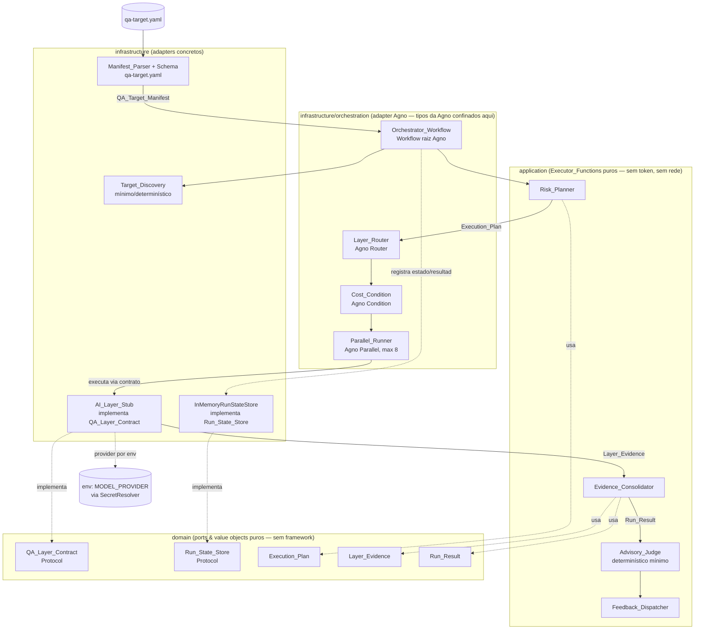

# Documento de Design

## Overview

Este design descreve o **esqueleto do orquestrador Workflow-first** da QA Platform: o
**núcleo de orquestração** que executa os passos de QA em uma ordem definida e
repetível, conforme o **ADR-001 (Workflow-first)**. O orquestrador raiz é um
**`Workflow` da Agno v2** confinado à camada de **infraestrutura** (adapter de
orquestração); os tipos da Agno **não vazam** para o domínio.

Esta feature constrói **sobre o bootstrap** já concluído em `code/` (pacote
`qa_platform`), reusando integralmente suas quatro camadas ports & adapters
(`domain`/`application`/`infrastructure`/`interface`), o pipe de config/secrets por
env com falha rápida, a observabilidade, a segurança de borda, o **import-linter** e
os testes com **Hypothesis**. Nenhuma ferramenta real de avaliação (DeepEval,
Promptfoo) é integrada nesta fase — apenas o **contrato de camada** e uma **camada de
IA mínima/stub** que prova a extensibilidade.

Princípio-guia (ADR-001): **determinístico por fora (o `Workflow` orquestra passos em
ordem definida), inteligente por dentro (Agents/Teams ficam confinados aos passos que
exigem julgamento — não usados nesta fase).**

O design entrega:

- Um **contrato de camada de QA** (`QA_Layer_Contract`) e um **contrato de
  persistência** (`Run_State_Store`) como **ports** puros no `domain`, junto com os
  value objects `Execution_Plan`, `Layer_Evidence` e `Run_Result` (frozen dataclasses,
  sem tipos de framework).
- Os **Executor_Functions determinísticos** na `application` (planejamento por risco,
  consolidação de evidências, disparo de feedback) — sem token e sem rede.
- O **Orchestrator_Workflow** como adapter Agno na `infrastructure/orchestration/`,
  mapeando `Router`/`Parallel`/`Condition` para roteamento, execução concorrente e
  condição de custo — todos determinísticos.
- Uma **AI_Layer_Stub** na `infrastructure/layers/` que implementa o
  `QA_Layer_Contract`, confinando qualquer tipo de framework de agentes à infra.
- O **schema e o parser/validador** do `qa-target.yaml` na `infrastructure`,
  produzindo/validando o `QA_Target_Manifest`.
- Um **adapter in-memory** do `Run_State_Store` na `infrastructure`.
- A extensão do **import-linter** para garantir que Agno e o parser YAML **não vazem**
  para `domain` nem `interface`.

### Decisões de design e justificativas

| Decisão | Justificativa | Requisitos |
|---------|---------------|------------|
| Orquestrador raiz é um `Workflow` da Agno (não `Team`) | QA exige reprodutibilidade: mesmo manifest → mesmo plano; roteamento por LLM (líder de `Team`) gasta token e adiciona variância (ADR-001) | 1.1, 1.2, 1.6 |
| `Workflow` e adapters de orquestração ficam na **infraestrutura** | Confina os tipos da Agno; o `domain` permanece independente de framework (ports & adapters) | 12.1, 12.2 |
| `Router` decide as camadas pelo `Execution_Plan` derivado do manifest | Roteamento determinístico e barato; adicionar camada é registrar um novo adapter, sem tocar no núcleo | 3.1, 3.4, 3.5 |
| `Condition` pula trabalho caro; concorrência das camadas via executor próprio (caminho B, ADR-002) | Economia de custo quando o manifest não justifica o trabalho caro; o executor `run_layers` garante limite 8 + timeout 300s que o `Parallel` nativo não expõe diretamente | 4.1, 4.4, 5.1 |
| Workflow executa pela engine da Agno com `Step(executor=fn)` reais (não `no-op`) | A engine conduz a ordem; `StepOutput.content` trafega VOs de domínio entre steps sem serialização | 1.1 |
| Passos determinísticos como `Step(executor=fn)` puros | Planejamento/consolidação/feedback sem token e sem rede → testáveis e reprodutíveis | 2.1 |
| `QA_Layer_Contract` e `Run_State_Store` como `Protocol` no `domain` | Ponto de extensão estável; o núcleo depende do port, não do concreto (open/closed, DIP) | 6.1, 6.2, 6.3, 11.1 |
| Value objects (`Execution_Plan`, `Layer_Evidence`, `Run_Result`) como frozen dataclasses puras | Imutáveis, comparáveis por valor (determinismo/round-trip), sem tipos de framework | 6.5, 6.6, 12.1 |
| `Layer_Evidence` sem campo de veredito pass/fail | Preserva o princípio **advisory**: a camada produz evidência, não sentença | 6.6, 10.1 |
| Advisory_Judge determinístico mínimo (sem LLM nesta fase) | Correlaciona/prioriza por severidade sem sentenciar; reprodutível e sem custo | 10.1, 10.3, 10.4 |
| AI_Layer_Stub confina framework de agentes à infra | Prova a extensibilidade sem integrar ferramentas reais; nenhum tipo de framework no `domain` | 7.1, 7.2, 7.3 |
| Provider de modelo resolvido por env (reusa `SecretResolver`) | Nunca hardcoded; fail-fast quando a env está ausente (padrão do bootstrap) | 12.5, 12.6 |
| Adapter in-memory do `Run_State_Store` nesta fase; `RunStateStore` é a fonte de verdade do histórico (sem `db=` da Agno) | Satisfaz o contrato sem persistência externa; mantém o `RunResult` do domínio como histórico oficial, independente do esquema da Agno (ADR-001); adapter durável entra em marco futuro | 11.7 |
| Adapter in-memory do `Run_State_Store` nesta fase | Satisfaz o contrato sem persistência externa; o adapter concreto entra em marco futuro | 11.7 |
| import-linter estendido para Agno + parser YAML | Garante fisicamente que framework de orquestração e YAML não vazam do domínio/interface | 12.1, 12.2, 12.3, 12.4 |

## Architecture

### Visão de alto nível

O `Workflow` da Agno (infra) orquestra os passos na ordem do ADR-001. Os passos
determinísticos são `Executor_Functions` puros (application). O `Router` seleciona
camadas pelo `Execution_Plan`; o `Parallel` executa as camadas concorrentemente; a
`Condition` decide pular trabalho caro. As camadas implementam o `QA_Layer_Contract`
(domínio) — nesta fase, apenas a `AI_Layer_Stub`. A dependência aponta sempre para
dentro: `infrastructure → application → domain`.



### Camadas (ports & adapters)

```
domain          Contratos (ports) e value objects puros de QA: QA_Layer_Contract,
                Run_State_Store, Execution_Plan, Layer_Evidence, Run_Result,
                LayerId/Severity e erros de domínio. Sem Agno, sem parser YAML,
                sem infraestrutura, sem importar outras camadas.
application     Executor_Functions determinísticos: Risk_Planner (manifest →
                Execution_Plan), Evidence_Consolidator (evidências → Run_Result),
                Advisory_Judge (Run_Result → priorização), Feedback_Dispatcher.
                Puros: sem token, sem rede; dependem apenas do domain.
infrastructure  Orchestrator_Workflow (Workflow Agno) + Router/Parallel/Condition;
                AI_Layer_Stub; InMemoryRunStateStore; Manifest_Parser + schema do
                qa-target.yaml; Target_Discovery mínimo. Os tipos da Agno e do
                parser YAML vivem SÓ aqui.
interface       (Reuso do bootstrap.) Ponto de entrada que aciona o workflow via
                composition_root; nenhum tipo de Agno/YAML na interface.
```

Regra de ouro: `domain` não importa Agno, parser YAML, nem infraestrutura; o
`Workflow` e seus primitivos são adapters. Isso é verificado automaticamente por
**import-linter** (Requisitos 12.1–12.4).

### Estrutura de diretórios concreta (estende a existente)

Os arquivos **novos** desta feature estão marcados com `# novo`; os demais já existem
do bootstrap. O backend vive em `code/`, pacote `qa_platform`.

```
code/
├── importlinter.ini                 # estendido: Agno + parser YAML confinados
├── schemas/
│   └── qa-target.schema.json        # novo — schema do QA_Target_Manifest
├── examples/
│   └── qa-target.example.yaml       # novo — manifesto de exemplo
├── src/
│   └── qa_platform/
│       ├── domain/
│       │   ├── health.py            # (existente)
│       │   ├── exceptions.py        # estendido: erros de domínio de orquestração
│       │   ├── ids.py               # novo — RunId, LayerId (value objects)
│       │   ├── severity.py          # novo — Severity (enum/ordem)
│       │   ├── manifest.py          # novo — QA_Target_Manifest (VO puro)
│       │   ├── execution_plan.py    # novo — Execution_Plan, PlannedLayer (VO)
│       │   ├── evidence.py          # novo — Layer_Evidence (VO, sem veredito)
│       │   ├── run_result.py        # novo — Run_Result, RunState (VO)
│       │   └── ports/
│       │       ├── __init__.py      # novo
│       │       ├── qa_layer.py      # novo — QA_Layer_Contract (Protocol)
│       │       └── run_state_store.py  # novo — Run_State_Store (Protocol)
│       ├── application/
│       │   ├── get_health_status.py # (existente)
│       │   ├── risk_planner.py      # novo — Executor_Function (manifest → plano)
│       │   ├── evidence_consolidator.py  # novo — Executor_Function
│       │   ├── advisory_judge.py    # novo — priorização determinística mínima
│       │   └── feedback_dispatcher.py    # novo — Executor_Function (contrato de disparo)
│       ├── infrastructure/
│       │   ├── config.py            # (existente) — reuso p/ provider por env
│       │   ├── secrets/             # (existente) — SecretResolver reusado
│       │   ├── observability/       # (existente)
│       │   ├── security/            # (existente)
│       │   ├── orchestration/
│       │   │   ├── __init__.py      # novo
│       │   │   ├── workflow.py      # novo — Orchestrator_Workflow (Agno Workflow)
│       │   │   ├── router.py        # novo — Layer_Router (Agno Router determinístico)
│       │   │   ├── parallel.py      # novo — Parallel_Runner (Agno Parallel, max 8, timeout)
│       │   │   ├── cost_condition.py# novo — Cost_Condition (Agno Condition)
│       │   │   └── registry.py      # novo — LayerRegistry (id → QA_Layer)
│       │   ├── layers/
│       │   │   ├── __init__.py      # novo
│       │   │   └── ai_layer_stub.py # novo — AI_Layer_Stub (implementa QA_Layer_Contract)
│       │   ├── manifest/
│       │   │   ├── __init__.py      # novo
│       │   │   ├── schema.py        # novo — schema + validador do QA_Target_Manifest
│       │   │   ├── parser.py        # novo — Manifest_Parser (qa-target.yaml → VO)
│       │   │   └── target_discovery.py  # novo — Target_Discovery mínimo/determinístico
│       │   └── persistence/
│       │       ├── __init__.py      # novo
│       │       └── in_memory_run_store.py  # novo — InMemoryRunStateStore
│       └── composition_root.py      # estendido: monta workflow + store + camadas
└── tests/
    ├── domain/
    │   ├── test_execution_plan.py       # novo
    │   ├── test_evidence.py             # novo — Layer_Evidence sem veredito
    │   └── test_run_result.py           # novo
    ├── application/
    │   ├── test_risk_planner.py         # novo — Property 1, 2, 3
    │   ├── test_evidence_consolidator.py# novo — Property 4
    │   └── test_advisory_judge.py       # novo — Property 12
    ├── infrastructure/
    │   ├── orchestration/
    │   │   ├── test_router.py           # novo — Property 5, 6
    │   │   ├── test_cost_condition.py   # novo — Property 7
    │   │   ├── test_parallel.py         # novo — integração (concorrência, max 8, timeout)
    │   │   └── test_workflow.py         # novo — integração (ordem, run_id, falha, sem LLM)
    │   ├── layers/
    │   │   └── test_ai_layer_stub.py    # novo — Property 8 + exemplos
    │   ├── manifest/
    │   │   ├── test_schema.py           # novo — Property 9
    │   │   ├── test_parser.py           # novo — exemplos/round-trip parse
    │   │   ├── test_registry_match.py   # novo — Property 10
    │   │   └── test_target_discovery.py # novo — Property 11 + exemplos
    │   └── persistence/
    │       └── test_in_memory_run_store.py  # novo — Property 13, 14, 15
    └── architecture/
        └── test_layer_boundaries.py     # estendido: Agno + YAML fora do domain/interface
```

## Components and Interfaces

Os snippets abaixo são **ilustrativos** (não são a implementação final); fixam o
contrato de cada componente e as fronteiras de camada.

### 1. Domain — Value objects e identidades

```python
# domain/ids.py
from dataclasses import dataclass

@dataclass(frozen=True)
class LayerId:
    value: str  # identidade única e não-vazia de uma QA_Layer (Req 6.1, 7.1)
    def __post_init__(self) -> None:
        if not self.value or not self.value.strip():
            raise ValueError("LayerId não pode ser vazio")

@dataclass(frozen=True)
class RunId:
    value: str  # identificador único de uma execução (Req 1.3)
    def __post_init__(self) -> None:
        if not self.value or not self.value.strip():
            raise ValueError("RunId inválido: ausente ou vazio")  # Req 11.6
```

```python
# domain/severity.py
from enum import IntEnum

class Severity(IntEnum):
    """Ordem total para priorização determinística (maior = mais severo)."""
    INFO = 0
    LOW = 1
    MEDIUM = 2
    HIGH = 3
    CRITICAL = 4
```

```python
# domain/execution_plan.py
from dataclasses import dataclass
from qa_platform.domain.ids import LayerId

@dataclass(frozen=True)
class PlannedLayer:
    layer_id: LayerId
    priority: int          # inteiro em [1, 100] (Req 2.2)
    reduced_mode: bool = False  # marcado pela Cost_Condition (Req 5.2)

@dataclass(frozen=True)
class ExecutionPlan:
    layers: tuple[PlannedLayer, ...]  # ordenado de forma estável (Req 3.6)
    # tuple => imutável e comparável por valor (determinismo byte-a-byte, Req 1.2)
```

```python
# domain/evidence.py
from dataclasses import dataclass, field
from qa_platform.domain.ids import LayerId
from qa_platform.domain.severity import Severity

@dataclass(frozen=True)
class Finding:
    code: str
    severity: Severity
    detail: str

@dataclass(frozen=True)
class LayerEvidence:
    """Evidência estruturada de uma QA_Layer. SEM veredito pass/fail (Req 6.6)."""
    layer_id: LayerId                       # identidade de origem (Req 2.4)
    metrics: dict[str, float] = field(default_factory=dict)
    findings: tuple[Finding, ...] = ()
    reduced_mode: bool = False
    # Nota: nenhum campo 'passed'/'failed'/'verdict' — a camada não sentencia.
```

```python
# domain/run_result.py
from dataclasses import dataclass
from qa_platform.domain.ids import RunId, LayerId
from qa_platform.domain.evidence import LayerEvidence
from qa_platform.domain.execution_plan import ExecutionPlan

@dataclass(frozen=True)
class SkippedWork:
    layer_id: LayerId
    reason: str            # motivo do salto (Req 5.2, 5.5)

@dataclass(frozen=True)
class RunResult:
    run_id: RunId
    plan: ExecutionPlan
    evidences: tuple[LayerEvidence, ...]     # evidências consolidadas (Req 2.4)
    prioritized: tuple[LayerEvidence, ...] = ()   # ordenação do Advisory_Judge (Req 10.1)
    skipped: tuple[SkippedWork, ...] = ()
    failures: tuple[str, ...] = ()           # nomes de camadas que falharam
```

### 1b. Domain — `exceptions` (estende a hierarquia do bootstrap)

```python
# domain/exceptions.py  (adições)
class OrchestrationDomainError(DomainError):
    """Base dos erros de domínio da orquestração de QA."""

class InvalidManifestError(OrchestrationDomainError):
    """Manifest inválido: nomeia os campos problemáticos (Req 2.3, 8.3)."""
    def __init__(self, invalid_fields: dict[str, str]) -> None:
        self.invalid_fields = dict(invalid_fields)  # {campo: motivo}
        super().__init__("; ".join(f"{k}: {v}" for k, v in sorted(invalid_fields.items())))

class UnknownLayerError(OrchestrationDomainError):
    """Referências de camada não registradas/não correspondidas (Req 3.3, 8.5)."""
    def __init__(self, layer_ids: list[str]) -> None:
        self.layer_ids = sorted(set(layer_ids))
        super().__init__(f"Camadas não registradas: {', '.join(self.layer_ids)}")

class RunIdConflictError(OrchestrationDomainError):
    """Run_Id já persistido (Req 11.3)."""
    def __init__(self, run_id: str) -> None:
        self.run_id = run_id
        super().__init__(f"Run_Id já persistido: {run_id}")

class RunNotFoundError(OrchestrationDomainError):
    """Run_Id inexistente (Req 11.5)."""
    def __init__(self, run_id: str) -> None:
        self.run_id = run_id
        super().__init__(f"Run_Id não encontrado: {run_id}")

class LayerContractViolation(OrchestrationDomainError):
    """Camada retornou valor não conforme ao QA_Layer_Contract (Req 6.4)."""

class TargetResolutionError(OrchestrationDomainError):
    """Referência de alvo ausente/irresolvível (Req 9.5)."""
```

### 2. Domain — Ports (contratos puros)

```python
# domain/ports/qa_layer.py
from typing import Protocol, runtime_checkable
from qa_platform.domain.ids import LayerId
from qa_platform.domain.manifest import QATargetManifest
from qa_platform.domain.execution_plan import ExecutionPlan
from qa_platform.domain.evidence import LayerEvidence

@runtime_checkable
class QALayerContract(Protocol):
    """Port de camada de QA. Ponto de extensão do Layer_Router (Req 6.1–6.3).

    Puro: nenhuma dependência de Agno/DeepEval/Promptfoo ou infraestrutura.
    A saída é SEMPRE um único LayerEvidence — nunca um veredito pass/fail.
    """
    @property
    def layer_id(self) -> LayerId: ...  # identidade única e não-vazia

    def execute(self, plan: ExecutionPlan, manifest: QATargetManifest) -> LayerEvidence: ...
```

```python
# domain/ports/run_state_store.py
from typing import Protocol
from qa_platform.domain.ids import RunId
from qa_platform.domain.run_result import RunResult, RunState

class RunStateStore(Protocol):
    """Port de persistência de estado/resultado de run (Req 11.1)."""
    def start(self, run_id: RunId, state: RunState) -> None: ...
    def record_failure(self, run_id: RunId, step: str, cause: str) -> None: ...
    def save_result(self, run_id: RunId, result: RunResult) -> None: ...   # conflito se já existe (Req 11.3)
    def get(self, run_id: RunId) -> RunResult: ...                          # RunNotFoundError se ausente (Req 11.5)
```

### 3. Application — Risk_Planner (Executor_Function)

Puro e determinístico: mesmo manifest → mesmo plano. Deriva prioridade em [1,100] dos
parâmetros de risco; rejeita manifest inválido nomeando o campo.

```python
# application/risk_planner.py
from qa_platform.domain.manifest import QATargetManifest
from qa_platform.domain.execution_plan import ExecutionPlan, PlannedLayer
from qa_platform.domain.exceptions import InvalidManifestError

def plan_by_risk(manifest: QATargetManifest) -> ExecutionPlan:
    """Executor_Function: sem LLM, sem rede (Req 2.1). Determinístico (Req 1.2, 2.5)."""
    if not manifest.risk_parameters:
        raise InvalidManifestError({"risk": "parâmetros de risco ausentes"})  # Req 2.3

    planned: list[PlannedLayer] = []
    for layer_id in manifest.applicable_layers:
        score = _risk_score(manifest, layer_id)       # função pura dos parâmetros
        priority = max(1, min(100, score))            # invariante [1,100] (Req 2.2)
        planned.append(PlannedLayer(layer_id=layer_id, priority=priority))

    # Ordenação estável e total (por prioridade desc, depois layer_id) => determinismo (Req 3.6)
    planned.sort(key=lambda p: (-p.priority, p.layer_id.value))
    return ExecutionPlan(layers=tuple(planned))
```

### 4. Application — Evidence_Consolidator (Executor_Function)

Agrega as `Layer_Evidence` num `Run_Result` preservando a identidade de origem e
sendo **invariante à ordem** de fornecimento.

```python
# application/evidence_consolidator.py
from collections.abc import Iterable
from qa_platform.domain.ids import RunId
from qa_platform.domain.evidence import LayerEvidence
from qa_platform.domain.execution_plan import ExecutionPlan
from qa_platform.domain.run_result import RunResult

def consolidate(run_id: RunId, plan: ExecutionPlan,
                evidences: Iterable[LayerEvidence]) -> RunResult:
    """Executor_Function puro (Req 2.1). Preserva origem (Req 2.4);
    independente da ordem de fornecimento (Req 2.6)."""
    # Ordena por layer_id para tornar a agregação invariante à ordem de entrada.
    ordered = tuple(sorted(evidences, key=lambda e: e.layer_id.value))
    return RunResult(run_id=run_id, plan=plan, evidences=ordered)
```

### 5. Application — Advisory_Judge (determinístico mínimo)

Correlaciona e prioriza por severidade **sem** emitir veredito; preserva todas as
evidências; determinístico. Sem LLM nesta fase (Req 10.3).

```python
# application/advisory_judge.py
from qa_platform.domain.run_result import RunResult
from qa_platform.domain.severity import Severity

def _max_severity(evidence) -> Severity:
    return max((f.severity for f in evidence.findings), default=Severity.INFO)

def prioritize(result: RunResult) -> RunResult:
    """Ordena evidências por severidade (desc), sem veredito (Req 10.1).
    Preserva contagem e identidade de origem (Req 10.2). Determinístico (Req 10.4).
    Run_Result sem evidências => priorização vazia, sem erro (Req 10.5)."""
    prioritized = tuple(sorted(
        result.evidences,
        key=lambda e: (-int(_max_severity(e)), e.layer_id.value),  # ordem total estável
    ))
    # Substitui apenas 'prioritized'; nenhuma evidência de origem é descartada.
    return RunResult(
        run_id=result.run_id, plan=result.plan,
        evidences=result.evidences, prioritized=prioritized,
        skipped=result.skipped, failures=result.failures,
    )
```

### 6. Application — Feedback_Dispatcher (Executor_Function)

Dispara o resultado por um **contrato plugável**, sem integrações externas reais nesta
fase. Puro em relação a rede/token (o sink concreto é injetado).

```python
# application/feedback_dispatcher.py
from typing import Protocol
from qa_platform.domain.run_result import RunResult

class FeedbackSink(Protocol):
    def emit(self, result: RunResult) -> None: ...

def dispatch(result: RunResult, sink: FeedbackSink) -> None:
    """Executor_Function (Req 2.1): apenas encaminha ao sink plugável.
    Nesta fase o sink default é in-memory/log (sem integração externa)."""
    sink.emit(result)
```

### 7. Infrastructure — Layer_Router (Agno `Router`, determinístico)

Seleciona exatamente as camadas do `Execution_Plan`, com dedupe e ordem estável; erro
nomeando camadas não registradas; plano vazio → seleção vazia. Os tipos da Agno vivem
aqui.

```python
# infrastructure/orchestration/router.py
from agno.workflow import Router, Step  # tipo da Agno CONFINADO à infraestrutura
from qa_platform.domain.execution_plan import ExecutionPlan
from qa_platform.domain.ids import LayerId
from qa_platform.domain.exceptions import UnknownLayerError
from qa_platform.infrastructure.orchestration.registry import LayerRegistry

def select_layers(plan: ExecutionPlan, registry: LayerRegistry) -> list[LayerId]:
    """Seleção determinística (Req 3.1, 3.6): exatamente as camadas do plano,
    dedupe (Req 3.8), plano vazio => vazio (Req 3.7). Sem LLM (Req 3.4)."""
    seen: set[str] = set()
    selected: list[LayerId] = []
    unknown: list[str] = []
    for planned in plan.layers:                     # já ordenado de forma estável
        lid = planned.layer_id
        if lid.value in seen:
            continue                                # dedupe (Req 3.8)
        if not registry.is_registered(lid):
            unknown.append(lid.value)               # coleta não registradas (Req 3.3)
            continue
        seen.add(lid.value)
        selected.append(lid)
    if unknown:
        raise UnknownLayerError(unknown)            # sem selecionar nada (Req 3.3)
    return selected

def build_router(registry: LayerRegistry) -> Router:
    # O selector do Router chama select_layers; choices = Steps das camadas registradas.
    ...
```

### 8. Infrastructure — Parallel_Runner (Agno `Parallel`, máx 8, timeout 300s)

Executa camadas independentes concorrentemente (limite 8), coleta todas as evidências,
trata erro/timeout por camada nomeando a afetada e retornando o parcial.

```python
# infrastructure/orchestration/parallel.py
from concurrent.futures import ThreadPoolExecutor, TimeoutError as FTimeout, as_completed
from qa_platform.domain.evidence import LayerEvidence

MAX_CONCURRENCY = 8      # Req 4.1
LAYER_TIMEOUT_S = 300    # Req 4.4

def run_layers(selected, registry, plan, manifest) -> tuple[list[LayerEvidence], list[str]]:
    """Roda camadas concorrentemente (Req 4.1). Coleta todas antes de retornar (Req 4.2).
    Erro/timeout => nomeia a camada e retorna o parcial (Req 4.3, 4.4)."""
    evidences: list[LayerEvidence] = []
    failures: list[str] = []
    with ThreadPoolExecutor(max_workers=MAX_CONCURRENCY) as pool:
        futures = {pool.submit(registry.get(lid).execute, plan, manifest): lid for lid in selected}
        for fut in as_completed(futures):
            lid = futures[fut]
            try:
                evidences.append(fut.result(timeout=LAYER_TIMEOUT_S))
            except FTimeout:
                failures.append(f"{lid.value}: timeout>{LAYER_TIMEOUT_S}s")   # Req 4.4
            except Exception as exc:                                          # noqa: BLE001
                failures.append(f"{lid.value}: {type(exc).__name__}")         # Req 4.3
    return evidences, failures
```

### 9. Infrastructure — Cost_Condition (Agno `Condition`)

Decide pular trabalho caro só com base no manifest, de forma determinística; ausência
de parâmetros → pular com motivo.

```python
# infrastructure/orchestration/cost_condition.py
from qa_platform.domain.manifest import QATargetManifest
from qa_platform.domain.ids import LayerId

def should_skip_expensive(manifest: QATargetManifest, layer_id: LayerId) -> tuple[bool, str]:
    """Decisão determinística baseada SÓ no manifest (Req 5.3, 5.4).
    Retorna (skip, motivo). Parâmetros ausentes => pular (Req 5.5)."""
    params = manifest.cost_parameters_for(layer_id)
    if params is None:
        return True, "parâmetros ausentes"                    # Req 5.5
    if not params.justifies_expensive_work():
        return True, "trabalho caro não justificado pelo risco"  # Req 5.1
    return False, ""
```

### 10. Infrastructure — Orchestrator_Workflow (Agno `Workflow`)

O adapter raiz **executa de fato através da engine da Agno v2**: monta um `Workflow`
cujos `Step` têm executores reais (não `no-op`), e a engine da Agno é quem conduz a
ordem dos steps. As responsabilidades transversais que a engine **não** cobre
(atribuição de `Run_Id`, `store.start` antes do 1º step, `record_failure` por step,
`save_result` ao final) ficam num wrapper fino em volta de `workflow.run(...)`.
Controle de fluxo determinístico, sem LLM.

#### Contrato real da Agno v2 (confirmado na versão instalada, 2.5.x)

- Um `Step` recebe `executor: Callable[[StepInput], StepOutput]`.
- Os dados fluem entre steps por `StepInput.previous_step_content` (saída do step
  anterior) e `StepInput.previous_step_outputs`. **O `content` do `StepOutput` pode
  carregar objetos Python arbitrários** — inclusive value objects de domínio como
  `ExecutionPlan` e `RunResult` —, então não é preciso serializar para string entre
  steps.
- `Router(choices=..., selector=fn)`, `Parallel(*steps)`, `Condition(evaluator=fn,
  steps=..., else_steps=...)` e `Loop(steps=..., end_condition=fn)` entram diretamente
  na lista `steps=[...]` do `Workflow` como "steps compostos".
- O `manifest` e o `plan` que não fluem naturalmente pela cadeia são fixados por
  **closure** no wiring (padrão já usado em `router.py`/`cost_condition.py`).

#### Decisão de concorrência — caminho B (ver ADR-002)

O `Parallel` **nativo** da Agno não expõe, de forma direta, o **limite de 8 camadas
simultâneas (Req 4.1)** nem o **timeout de 300s por camada (Req 4.4)**. Para não
enfraquecer requisitos verificáveis, adota-se o **caminho B**: a execução concorrente
das camadas é um **único `Step`** cujo `executor` é o `run_layers` (que já implementa
o `ThreadPoolExecutor` com limite 8 + timeout monotônico). O `Workflow` continua
"Workflow-first" — a engine da Agno orquestra a sequência; a política de concorrência
das camadas é do projeto. O `build_parallel` (Parallel nativo) permanece disponível,
mas **não** é o executor das camadas nesta fase. Registrado no **ADR-002**.

#### Persistência — `RunStateStore` é a fonte de verdade (sem `db=` da Agno)

O histórico de runs é do **domínio**: o `RunStateStore` (port) e seu adapter guardam o
`RunResult` no formato do projeto. O parâmetro `db=` do `Workflow` da Agno **não** é
usado como histórico oficial — isso manteria o domínio independente de framework
(ADR-001) e o `RunResult` como fonte de verdade para histórico/comparação entre runs.

```python
# infrastructure/orchestration/workflow.py
from agno.workflow import Workflow, Step, Router  # tipos da Agno confinados à infra
from agno.workflow.types import StepInput, StepOutput
from qa_platform.application.risk_planner import plan_by_risk
from qa_platform.application.evidence_consolidator import consolidate
from qa_platform.application.advisory_judge import prioritize
from qa_platform.application.feedback_dispatcher import dispatch
from qa_platform.domain.ports.run_state_store import RunStateStore
# ... (target_discovery, router.select_layers, parallel.run_layers, cost_condition, schema)

def build_orchestrator(
    manifest, store: RunStateStore, registry, feedback_sink
) -> Workflow:
    """Monta o Workflow raiz com executores REAIS na ordem do ADR-001 (Req 1.1).

    O manifest é fixado por closure (não flui pela cadeia). A engine da Agno conduz
    a ordem; o wrapper run_orchestration cuida de Run_Id/store. Sem LLM (Req 1.6)."""

    def _risk_planner(si: StepInput) -> StepOutput:
        # plano de execução como content (VO de domínio trafega direto)
        return StepOutput(content=plan_by_risk(manifest))

    def _run_layers(si: StepInput) -> StepOutput:
        plan = si.previous_step_content            # ExecutionPlan do step anterior
        selected = select_layers(plan, registry)   # seleção determinística (Router)
        to_run = [lid for lid in selected
                  if not should_skip_expensive(manifest, lid)[0]]   # Cost_Condition
        evidences, failures = run_layers(to_run, registry, plan, manifest)  # B: max 8/300s
        return StepOutput(content=(plan, evidences, failures))

    def _consolidate(si: StepInput) -> StepOutput:
        plan, evidences, _ = si.previous_step_content
        return StepOutput(content=consolidate(run_id, plan, evidences))

    def _advisory_judge(si: StepInput) -> StepOutput:
        return StepOutput(content=prioritize(si.previous_step_content))

    def _feedback(si: StepInput) -> StepOutput:
        dispatch(si.previous_step_content, feedback_sink)
        return StepOutput(content=si.previous_step_content)

    return Workflow(
        name="qa-orchestrator",
        steps=[
            Step(name="target_discovery", executor=_target_discovery),  # Req 9.x
            Step(name="risk_planner", executor=_risk_planner),          # Req 2.x
            # Router (selector=select_layers) escolhe camadas; Cost_Condition pula caro;
            # a execução concorrente é o run_layers (caminho B, Req 4.1/4.4).
            Step(name="parallel_layers", executor=_run_layers),         # Req 3.x/4.x/5.x
            Step(name="consolidate", executor=_consolidate),            # Req 2.4
            Step(name="advisory_judge", executor=_advisory_judge),      # Req 10.x
            Step(name="feedback", executor=_feedback),                  # Req 2.1
        ],
    )
```

Fluxo de execução (responsabilidade do `run_orchestration`, que aciona o `Workflow`):
1. Validar o `QA_Target_Manifest` contra o schema **antes** do primeiro step; se não
   conforme, encerra nomeando cada campo problemático (Req 8.2, 8.3, 8.5).
2. Atribuir `Run_Id` único e chamar `store.start(...)`; se a persistência inicial
   falhar, abortar **sem** iniciar nenhum step (Req 1.3, 1.4).
3. Acionar `workflow.run(...)`; a engine da Agno executa os steps na ordem definida. Se
   um step falhar, interromper os subsequentes, `store.record_failure(...)` e propagar
   erro identificando o step, preservando os concluídos (Req 1.5). Os hooks de step da
   Agno (`on_error`, `skip_on_failure`) podem apoiar esse isolamento.
4. Ao concluir, `store.save_result(run_id, result)` (Req 11.2).

> **Nota sobre `Router`/`Parallel`/`Condition` nativos.** `build_router` (Router com
> `selector=select_layers`), `build_parallel` (Parallel nativo) e `build_cost_condition`
> (Condition com evaluator determinístico) permanecem no código como adapters válidos e
> testáveis, e mapeiam 1:1 os primitivos do ADR-001. Nesta fase, porém, o executor único
> `_run_layers` (caminho B) é quem roda as camadas, para garantir Req 4.1/4.4. A
> migração para `Parallel` nativo (quando/ se o limite+timeout forem expressos no nível
> do primitivo) fica registrada como follow-up no ADR-002. O `Loop` do ADR-001
> (exploração adaptativa dentro de uma camada) **não** entra no escopo do skeleton — é
> item de marco futuro, explicitado aqui para rastreabilidade.

### 11. Infrastructure — AI_Layer_Stub

Implementa o `QA_Layer_Contract` com identidade única/imutável; retorna `Layer_Evidence`
determinística; confina qualquer tipo de framework de agentes aqui; provider por env.

```python
# infrastructure/layers/ai_layer_stub.py
from qa_platform.domain.ids import LayerId
from qa_platform.domain.evidence import LayerEvidence
from qa_platform.domain.execution_plan import ExecutionPlan
from qa_platform.domain.manifest import QATargetManifest
from qa_platform.infrastructure.config import resolve_model_provider  # reusa SecretResolver

class AILayerStub:
    """QA_Layer mínima. Identidade única/imutável (Req 7.1). Sem ferramentas externas
    (Req 7.2). Determinística (Req 7.4). Tipos de framework de agentes confinados aqui
    (Req 7.3)."""
    _LAYER_ID = LayerId("ai")

    def __init__(self) -> None:
        # Provider resolvido por env; sem hardcode; fail-fast se ausente (Req 12.5, 12.6).
        self._provider = resolve_model_provider()  # MODEL_PROVIDER via SecretResolver

    @property
    def layer_id(self) -> LayerId:
        return self._LAYER_ID

    def execute(self, plan: ExecutionPlan, manifest: QATargetManifest) -> LayerEvidence:
        if manifest is None or plan is None:
            raise ValueError("entrada inválida: plano/manifest ausente")   # Req 7.5
        # Evidência determinística derivada do plano/manifest; sem chamar LLM/tools reais.
        return LayerEvidence(
            layer_id=self._LAYER_ID,
            metrics={"planned_layers": float(len(plan.layers))},
            findings=(),
        )
```

### 12. Infrastructure — Manifest (schema, parser, discovery)

- **`schema.py`**: define os campos do `QA_Target_Manifest` (alvo, camadas aplicáveis,
  parâmetros de risco), obrigatoriedade, tipo e valores/limites válidos (Req 8.1);
  valida e agrega **todos** os campos problemáticos (Req 8.3).
- **`parser.py`**: lê `qa-target.yaml` e produz o value object puro do domínio (o tipo
  do parser YAML não vaza para fora da infra).
- **`target_discovery.py`**: produz um rascunho de manifest conforme o schema, marcando
  campos obrigatórios não derivados como **pendentes** (Req 9.2); determinístico e sem
  LLM/rede (Req 9.3, 9.4); referência irresolvível → `TargetResolutionError` (Req 9.5).
- **`registry.py`**: mapeia `LayerId → QA_Layer`; valida ids do manifest contra as
  identidades registradas, nomeando cada id não correspondido (Req 8.4, 8.5).

### 13. Infrastructure — InMemoryRunStateStore

Implementa o `Run_State_Store` sem persistência externa: round-trip persistir→recuperar,
não sobrescreve id duplicado, sinaliza ausência, rejeita id inválido.

```python
# infrastructure/persistence/in_memory_run_store.py
from qa_platform.domain.ids import RunId
from qa_platform.domain.run_result import RunResult, RunState
from qa_platform.domain.exceptions import RunIdConflictError, RunNotFoundError

class InMemoryRunStateStore:
    """Adapter in-memory do Run_State_Store (Req 11.7)."""
    def __init__(self) -> None:
        self._states: dict[str, RunState] = {}
        self._results: dict[str, RunResult] = {}

    def start(self, run_id: RunId, state: RunState) -> None:
        self._states[run_id.value] = state          # RunId já valida vazio (Req 11.6)

    def record_failure(self, run_id: RunId, step: str, cause: str) -> None:
        self._states[run_id.value] = self._states[run_id.value].with_failure(step, cause)

    def save_result(self, run_id: RunId, result: RunResult) -> None:
        if run_id.value in self._results:
            raise RunIdConflictError(run_id.value)   # não sobrescreve (Req 11.3)
        self._results[run_id.value] = result         # round-trip (Req 11.2, 11.4)

    def get(self, run_id: RunId) -> RunResult:
        try:
            return self._results[run_id.value]
        except KeyError:
            raise RunNotFoundError(run_id.value)      # ausência (Req 11.5)
```

## Data Models

### QA_Target_Manifest (domain / schema `qa-target.yaml`)

| Campo | Obrigatório | Tipo | Valores/limites | Uso |
|-------|-------------|------|-----------------|-----|
| `target.ref` | Sim | `str` | não-vazio | Identifica o alvo (Req 8.1, 9.1) |
| `target.version` | Sim | `str` | não-vazio | Base de reprodutibilidade (Req 1.2) |
| `applicable_layers` | Sim | `list[str]` | ids ∈ identidades de `QA_Layer_Contract` | Camadas aplicáveis (Req 8.4) |
| `risk_parameters` | Sim | `mapping` | não-vazio | Insumo do Risk_Planner (Req 2.2, 2.3) |
| `risk_parameters.<layer>.severity` | Sim* | `str` | `info\|low\|medium\|high\|critical` | Deriva prioridade (Req 2.2) |
| `cost_parameters.<layer>` | Não | `mapping` | limites por camada | Insumo da Cost_Condition (Req 5.x) |

\* obrigatório por camada listada em `applicable_layers`.

### Execution_Plan (domain)

| Campo | Tipo | Descrição |
|-------|------|-----------|
| `layers` | `tuple[PlannedLayer,...]` | Camadas a executar, ordem estável (Req 3.6) |
| `PlannedLayer.layer_id` | `LayerId` | Identidade da camada |
| `PlannedLayer.priority` | `int` | Prioridade em `[1,100]` (Req 2.2) |
| `PlannedLayer.reduced_mode` | `bool` | Marcado pela Cost_Condition (Req 5.2) |

### Layer_Evidence (domain)

| Campo | Tipo | Descrição |
|-------|------|-----------|
| `layer_id` | `LayerId` | Identidade de origem (Req 2.4) |
| `metrics` | `dict[str,float]` | Métricas estruturadas (Req 6.5) |
| `findings` | `tuple[Finding,...]` | Achados com severidade (Req 6.5) |
| `reduced_mode` | `bool` | Execução em modo reduzido (Req 5.2) |
| — | — | **Sem** campo de veredito pass/fail (Req 6.6) |

### Run_Result (domain)

| Campo | Tipo | Descrição |
|-------|------|-----------|
| `run_id` | `RunId` | Identificador da execução (Req 1.3) |
| `plan` | `ExecutionPlan` | Plano executado |
| `evidences` | `tuple[LayerEvidence,...]` | Evidências consolidadas (Req 2.4) |
| `prioritized` | `tuple[LayerEvidence,...]` | Ordenação do Advisory_Judge (Req 10.1) |
| `skipped` | `tuple[SkippedWork,...]` | Trabalho caro pulado (Req 5.2, 5.5) |
| `failures` | `tuple[str,...]` | Camadas que falharam (Req 4.3, 6.4) |

### Config (infrastructure) — provider de modelo por env

| Variável | Obrigatória | Default | Uso |
|----------|-------------|---------|-----|
| `MODEL_PROVIDER` | Sim* | — | Provider de qualquer camada que use LLM; resolvido por `SecretResolver`; sem hardcode; fail-fast se ausente (Req 12.5, 12.6) |

\* obrigatória apenas na inicialização de uma camada que use LLM. A `AI_Layer_Stub`
resolve o provider por env na sua construção; nenhum provider padrão é fixado no
código.

## Correctness Properties

*Uma propriedade é uma característica ou comportamento que deve valer para todas as
execuções válidas do sistema — essencialmente, uma afirmação formal sobre o que o
sistema deve fazer. Propriedades servem de ponte entre especificações legíveis por
humanos e garantias de correção verificáveis por máquina.*

As propriedades abaixo cobrem exclusivamente a **lógica pura determinística** (planejamento,
consolidação, seleção, priorização, decisão de custo, validação, persistência in-memory e
determinismo da stub). Concorrência real (Parallel_Runner), o `Workflow` da Agno, o parser
YAML, as fronteiras de arquitetura e os requisitos de "ausência de LLM" ficam em testes
por exemplo/integração (ver Testing Strategy).

### Property 1: Determinismo do Risk_Planner

*Para qualquer* `QA_Target_Manifest` válido, planejar duas vezes com `plan_by_risk`
deve produzir `Execution_Plan`s iguais em valor — mesma lista de camadas, mesmas
prioridades e mesma ordenação (logo, serialização idêntica).

**Validates: Requirements 1.2, 2.5, 8.6**

### Property 2: Prioridades no intervalo válido e cobertura das camadas

*Para qualquer* `QA_Target_Manifest` válido, o `Execution_Plan` produzido deve conter
exatamente as camadas aplicáveis do manifest, cada uma com uma `priority` inteira no
intervalo `[1, 100]`.

**Validates: Requirements 2.2**

### Property 3: Rejeição de manifest inválido pelo Risk_Planner

*Para qualquer* `QA_Target_Manifest` sem parâmetros de risco (ou com risco inválido), o
`Risk_Planner` deve rejeitar a entrada levantando `InvalidManifestError` sem produzir
`Execution_Plan`, e a mensagem/dados do erro devem identificar o campo inválido ou
ausente.

**Validates: Requirements 2.3**

### Property 4: Consolidação preserva origem e é invariante à ordem

*Para qualquer* conjunto de `Layer_Evidence` e qualquer permutação da ordem de
fornecimento, `consolidate` deve produzir `Run_Result`s iguais em valor, preservando a
identidade de origem de cada evidência (mesma contagem e mesmas `layer_id`).

**Validates: Requirements 2.4, 2.6**

### Property 5: Seleção do Layer_Router é exata, deduplicada, ordenada e determinística

*Para qualquer* `Execution_Plan` cujas referências estejam todas registradas, o
`Layer_Router` deve selecionar exatamente o conjunto de camadas do plano — cada camada
uma única vez (dedupe), na mesma ordem estável a cada invocação, e um plano vazio deve
produzir seleção vazia.

**Validates: Requirements 3.1, 3.2, 3.6, 3.7, 3.8**

### Property 6: Erro do Layer_Router para camada não registrada

*Para qualquer* `Execution_Plan` que referencie ao menos uma camada não registrada, o
`Layer_Router` deve levantar `UnknownLayerError` nomeando cada camada não registrada,
sem selecionar nenhuma camada e preservando o estado do registry inalterado.

**Validates: Requirements 3.3**

### Property 7: Decisão determinística da Cost_Condition baseada só no manifest

*Para qualquer* `QA_Target_Manifest` e camada, `should_skip_expensive` deve produzir a
mesma decisão `(skip, motivo)` em avaliações repetidas com parâmetros idênticos; e,
quando o manifest não justifica o trabalho caro ou não contém os parâmetros
necessários, a decisão deve ser pular, com um motivo não-vazio.

**Validates: Requirements 5.1, 5.4, 5.5**

### Property 8: Determinismo da AI_Layer_Stub

*Para qualquer* par `(Execution_Plan, QA_Target_Manifest)` válido, executar a
`AI_Layer_Stub` duas vezes deve produzir `Layer_Evidence` com campos iguais em valor
(identidade da camada, métricas e achados).

**Validates: Requirements 7.4**

### Property 9: Validação de schema nomeia todos os campos inválidos

*Para qualquer* `QA_Target_Manifest` com um subconjunto não-vazio de campos ausentes,
com tipo inválido ou com valor fora dos limites, o validador de schema deve rejeitar o
manifest e o erro deve nomear **cada** campo problemático desse subconjunto com o motivo
da não conformidade.

**Validates: Requirements 8.3**

### Property 10: Correspondência de ids de camada nomeia cada id não correspondido

*Para qualquer* `QA_Target_Manifest` que contenha um subconjunto não-vazio de
identificadores de camada sem correspondência nas identidades registradas, a validação
de correspondência deve encerrar levantando `UnknownLayerError` que nomeia **cada** id
não correspondido, sem executar nenhuma camada.

**Validates: Requirements 8.5**

### Property 11: Determinismo do Target_Discovery

*Para qualquer* referência de alvo resolvível, executar o `Target_Discovery` duas vezes
deve produzir o mesmo rascunho de `QA_Target_Manifest` (iguais em valor), em conformidade
com o schema.

**Validates: Requirements 9.4**

### Property 12: Priorização do Advisory_Judge — determinística, por severidade, preservadora e sem veredito

*Para qualquer* `Run_Result` consolidado, `prioritize` deve produzir uma priorização
que (a) ordena as evidências por severidade de forma estável, (b) preserva todas as
evidências de origem com a mesma contagem e as mesmas identidades, (c) não contém
nenhum veredito pass/fail, (d) é idêntica em execuções repetidas, e (e) resulta em
priorização vazia quando não há evidências, sem sinalizar erro.

**Validates: Requirements 10.1, 10.2, 10.4, 10.5**

### Property 13: Round-trip persistir → recuperar no Run_State_Store

*Para qualquer* `Run_Id` válido e `Run_Result`, após `save_result(run_id, result)` uma
chamada subsequente `get(run_id)` deve retornar um `Run_Result` igual em valor ao que
foi persistido.

**Validates: Requirements 11.2, 11.4, 11.7**

### Property 14: Run_Id duplicado não sobrescreve e sinaliza conflito

*Para qualquer* `Run_Id` já persistido, uma segunda chamada `save_result` com o mesmo
`Run_Id` deve levantar `RunIdConflictError` identificando o `Run_Id`, e uma chamada
`get` posterior deve retornar o `Run_Result` originalmente persistido, inalterado.

**Validates: Requirements 11.3**

### Property 15: Run_Id inexistente sinaliza ausência

*Para qualquer* `Run_Id` válido nunca persistido, `get(run_id)` deve levantar
`RunNotFoundError` identificando o `Run_Id`, sem retornar o `Run_Result` de outra
execução.

**Validates: Requirements 11.5**

## Error Handling

| Cenário | Camada | Comportamento | Requisitos |
|---------|--------|---------------|------------|
| Manifest não conforme ao schema | infrastructure (`manifest/schema`) | Encerra antes do 1º step; erro nomeia **cada** campo problemático e o motivo | 8.2, 8.3 |
| Id de camada sem correspondência | infrastructure (`manifest/registry`) | `UnknownLayerError` nomeando cada id; nenhuma camada executa | 8.5 |
| Risk_Planner recebe manifest sem risco | application (`risk_planner`) | `InvalidManifestError` nomeando o campo; sem `Execution_Plan` | 2.3 |
| Plano referencia camada não registrada | infrastructure (`router`) | `UnknownLayerError` nomeando a camada; seleção vazia; registry inalterado | 3.3 |
| Falha ao persistir estado inicial | infrastructure (`workflow` + store) | Aborta sem iniciar nenhum step; propaga erro de registro inicial | 1.4 |
| Step falha no meio da execução | infrastructure (`workflow`) | Interrompe subsequentes; `record_failure` (step+causa); propaga erro identificando o step; preserva concluídos | 1.5 |
| Camada falha no Parallel_Runner | infrastructure (`parallel`) | Registra falha nomeando a camada; aguarda as demais; retorna evidências concluídas + falha | 4.3 |
| Camada excede 300s | infrastructure (`parallel`) | Trata como timeout; nomeia a camada; retorna concluídas + indicação de timeout | 4.4 |
| Camada retorna valor não conforme ao contrato | infrastructure/domain | `LayerContractViolation` nomeando a camada e a razão; marca falha; preserva demais; prossegue | 6.4 |
| Cost_Condition sem parâmetros no manifest | infrastructure (`cost_condition`) | Sinaliza pular; registra motivo "parâmetros ausentes" no `Run_Result` | 5.5 |
| AI_Layer_Stub com entrada inválida | infrastructure (`ai_layer_stub`) | Não retorna evidência; sinaliza erro de entrada inválida | 7.5 |
| Falha durante execução da AI_Layer_Stub | infrastructure (`ai_layer_stub`) | Sinaliza erro de execução; sem evidência parcial | 7.6 |
| Referência de alvo irresolvível | infrastructure (`target_discovery`) | `TargetResolutionError` nomeando a referência; sem rascunho | 9.5 |
| Run_Id duplicado ao salvar | infrastructure (`in_memory_run_store`) | `RunIdConflictError` nomeando o id; **não** sobrescreve | 11.3 |
| Run_Id inexistente ao buscar | infrastructure (`in_memory_run_store`) | `RunNotFoundError` nomeando o id; não retorna outro | 11.5 |
| Run_Id ausente/nulo/vazio | domain (`RunId`) | Rejeita com erro de `Run_Id` inválido; sem persistir/retornar | 11.6 |
| `MODEL_PROVIDER` ausente/vazia | infrastructure (`config`/camada LLM) | Interrompe init nomeando a env; sem provider padrão fixado | 12.6 |

Princípios:
- Erros de domínio (`domain/exceptions.py`) são **puros**: nomeiam campos/ids/steps,
  **nunca** valores de segredo; a interface os traduz para HTTP (reuso do bootstrap).
- O controle de fluxo (ordem e seleção de steps) é determinístico e **não** consulta
  LLM (Req 1.6, 3.4, 5.3); os testes verificam a ausência com um cliente proibido.
- Falhas de camada são isoladas: o Parallel_Runner e o Orchestrator preservam as
  evidências das camadas concluídas (Req 4.3, 6.4).

## Testing Strategy

### Abordagem dupla

- **Testes de propriedade (PBT)**: as 15 propriedades acima, sobre a lógica pura
  determinística.
- **Testes unitários / por exemplo**: contratos (Protocols), casos de erro específicos,
  formato de saída, ausência de LLM/rede, extensibilidade do registry.
- **Testes de integração**: concorrência real (Parallel_Runner), o `Workflow` da Agno
  (ordem, run_id, falha, controle sem LLM), parser YAML e import-linter.

### Onde PBT se aplica (e onde não)

PBT é adequado à **lógica pura** que varia com o input e tem afirmações "for all"
significativas com custo baixo por iteração: `Risk_Planner`, `Evidence_Consolidator`,
`Layer_Router` (seleção pura sobre o plano + registry em memória), `Cost_Condition`,
`Advisory_Judge`, validador de schema, correspondência de ids, `Target_Discovery`
determinístico, `AILayerStub` determinística e `InMemoryRunStateStore`.

PBT **não** se aplica a:
- **Concorrência real** (`Parallel_Runner`, máx 8, timeout 300s): comportamento de
  threads/tempo; testes por exemplo/integração com camadas fake e clock/timeout
  controlados. A independência de ordem é validada na **lógica pura** pela Property 4
  (Evidence_Consolidator).
- **`Workflow` da Agno** (ordem dos steps, `Run_Id`, aborto por falha de store,
  interrupção em step com erro): orquestração e efeitos; testes por exemplo com
  Workflow instrumentado e stores/steps fake.
- **Ausência de LLM** (Req 1.6, 3.4, 5.3) e **ausência de rede/token** (Req 2.1):
  requisitos de "não fazer"; testes por exemplo com cliente LLM proibido (falha se
  invocado) e sockets bloqueados.
- **Parser YAML** (`qa-target.yaml`): comportamento de biblioteca + I/O; teste por
  exemplo com manifests fixos (incluindo um round-trip parse→VO sobre exemplos).
- **Fronteiras de arquitetura** (Req 6.2, 7.3, 11.1, 12.1–12.4): verificadas por
  **import-linter**, não por PBT.
- **Config por env** (Req 12.5, 12.6): reuso do `SecretResolver`; testes por exemplo
  (provider por env; fail-fast quando ausente).

### Biblioteca e configuração de PBT

- Biblioteca: **Hypothesis** (padrão do portfólio; já em uso no bootstrap). Não
  implementar PBT do zero.
- Cada teste de propriedade roda no mínimo **100 iterações**
  (`@settings(max_examples=100)`).
- Cada teste de propriedade referencia sua propriedade de design via comentário no
  formato: `# Feature: workflow-orchestrator-skeleton, Property {n}: {texto}`.
- Cada propriedade de correção é implementada por **um único** teste de propriedade.

Mapa propriedade → teste → geradores:

| Propriedade | Alvo | Geradores |
|-------------|------|-----------|
| Property 1 | `plan_by_risk` | manifests válidos (camadas + parâmetros de risco) |
| Property 2 | `plan_by_risk` | manifests válidos com N camadas |
| Property 3 | `plan_by_risk` | manifests sem risco / risco inválido |
| Property 4 | `consolidate` | listas de `Layer_Evidence` + permutação da ordem |
| Property 5 | `select_layers` | planos com refs registradas (incl. vazio e duplicadas) |
| Property 6 | `select_layers` | planos com ≥1 ref não registrada |
| Property 7 | `should_skip_expensive` | manifests com/sem parâmetros de custo |
| Property 8 | `AILayerStub.execute` | pares `(plan, manifest)` válidos |
| Property 9 | validador de schema | manifests com subconjunto de campos inválidos |
| Property 10 | correspondência de ids | manifests com ids desconhecidos + registry |
| Property 11 | `target_discovery` | referências de alvo resolvíveis |
| Property 12 | `prioritize` | `Run_Result` com evidências variadas (incl. vazio) |
| Property 13 | `InMemoryRunStateStore` | `(RunId, RunResult)` |
| Property 14 | `InMemoryRunStateStore` | `RunId` + dois `RunResult` distintos |
| Property 15 | `InMemoryRunStateStore` | `RunId` nunca persistido |

### Testes unitários / por exemplo (foco)

- **Contratos**: `QA_Layer_Contract` e `Run_State_Store` são Protocols; a `AI_Layer_Stub`
  e o `InMemoryRunStateStore` são conformes (`runtime_checkable`).
- **`Layer_Evidence` sem veredito**: nenhum campo/atributo pass/fail exposto (Req 6.6).
- **Registry/extensibilidade**: registrar uma `QA_Layer` de teste nova torna-a elegível
  para seleção sem alterar o código dos Executor_Functions nem do Workflow (Req 3.5).
- **AI_Layer_Stub**: retorna evidência com identidade + referência ao plano, sem chamar
  ferramentas externas (Req 7.2); entrada malformada → erro sem evidência (Req 7.5);
  falha interna → erro sem evidência parcial (Req 7.6).
- **Cost_Condition/Run_Result**: trabalho pulado registra modo reduzido com id e motivo
  (Req 5.2).
- **Target_Discovery**: rascunho conforme schema marca pendências (Req 9.2); sem
  LLM/rede (Req 9.3); referência irresolvível → erro (Req 9.5).
- **Config por env**: provider resolvido por `MODEL_PROVIDER`; env ausente → fail-fast
  nomeando a env (Req 12.5, 12.6).

### Testes de integração

- **Parallel_Runner** (`test_parallel.py`): camadas fake registram concorrência e
  respeitam o limite de 8 (Req 4.1); todas as evidências coletadas antes do retorno
  (Req 4.2); camada que falha é nomeada e as demais concluem (Req 4.3); camada lenta com
  clock/timeout fake → timeout nomeado (Req 4.4).
- **Orchestrator_Workflow** (`test_workflow.py`): executa os steps na ordem do ADR-001
  (Req 1.1); atribui `Run_Id` e registra estado inicial antes do 1º step (Req 1.3);
  falha de store inicial aborta sem steps (Req 1.4); step com erro interrompe
  subsequentes e registra (Req 1.5); um cliente LLM proibido não é invocado no controle
  de fluxo (Req 1.6).
- **Manifest/parser** (`test_parser.py`): `qa-target.example.yaml` faz parse para o VO;
  round-trip parse→VO estável sobre exemplos; validação ocorre antes do 1º step (Req 8.2).
- **Arquitetura** (`test_layer_boundaries.py`, import-linter estendido): garante que
  `agno`, o parser YAML (`yaml`/`ruamel`) e a infraestrutura **não** são importados por
  `domain` nem `interface`, e que os value objects/ports do domínio permanecem puros
  (Req 6.2, 7.3, 11.1, 12.1–12.4). Inclui um cenário negativo que confirma que a
  verificação **falha** nomeando o módulo/import proibido (Req 12.3).

### Extensão do import-linter

O `importlinter.ini` ganha `agno`, `yaml`/`ruamel.yaml` na lista de módulos proibidos do
contrato `domain-puro` e um novo contrato confinando `agno` a
`qa_platform.infrastructure.orchestration.*` e `qa_platform.infrastructure.layers.*`
(Req 12.2), do mesmo modo que o `boto3` é confinado ao adapter de Secrets Manager no
bootstrap.

## Rastreabilidade Requisitos → Design

| Requisito | Onde é atendido |
|-----------|-----------------|
| 1. Fluxo Orquestrador Raiz Determinístico | `infrastructure/orchestration/workflow.py` (ordem, run_id, aborto, falha, sem LLM); `Run_State_Store`; Property 1 |
| 2. Passos Determinísticos (Executor_Functions) | `application/risk_planner.py`, `evidence_consolidator.py`, `feedback_dispatcher.py`; Properties 1, 2, 3, 4 |
| 3. Roteamento por Risco | `infrastructure/orchestration/router.py`, `registry.py`; Properties 5, 6 |
| 4. Execução Concorrente | `infrastructure/orchestration/parallel.py`; integração `test_parallel.py` |
| 5. Condição de Custo | `infrastructure/orchestration/cost_condition.py`; `Run_Result.skipped`; Property 7 |
| 6. Contrato de Camada (ponto de extensão) | `domain/ports/qa_layer.py`, `domain/evidence.py` (sem veredito); import-linter; Property 8 (via stub) |
| 7. Camada de IA Mínima (Stub) | `infrastructure/layers/ai_layer_stub.py`; Property 8 + exemplos |
| 8. Schema do Manifesto de Alvo | `infrastructure/manifest/schema.py`, `parser.py`, `schemas/qa-target.schema.json`; Properties 9, 10 |
| 9. Descoberta de Alvo (mínima) | `infrastructure/manifest/target_discovery.py`; Property 11 + exemplos |
| 10. Advisory Judge (mínimo) | `application/advisory_judge.py`; Property 12 |
| 11. Persistência de Estado de Run | `domain/ports/run_state_store.py`, `infrastructure/persistence/in_memory_run_store.py`; Properties 13, 14, 15 |
| 12. Fronteiras de Arquitetura | `domain/*` puro; `infrastructure/orchestration/*` e `layers/*` confinam Agno; `importlinter.ini` estendido; `tests/architecture/`; config por env (`MODEL_PROVIDER`) |
