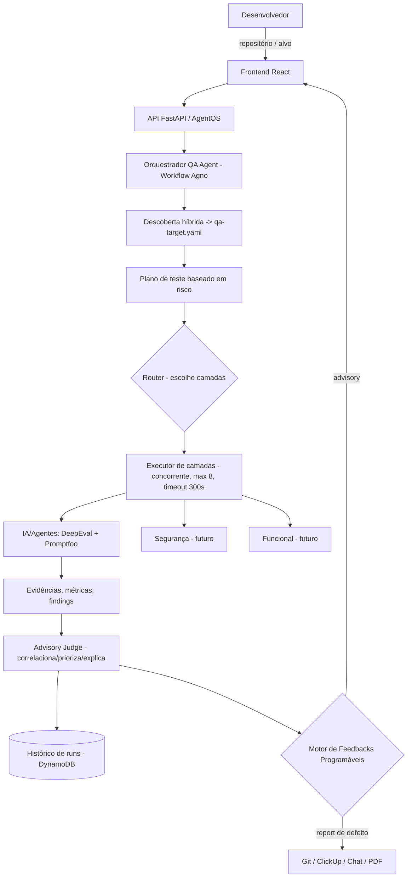

# Sprint 1 — Arquitetura de Alto Nível & Modelo de Extensibilidade

- **Sprint:** 1 (Idealização)
- **Tema:** Arquitetura de alto nível e modelo de extensibilidade (plugins)
- **Status:** Fechada
- **Decisões:** ADR-001, ADR-002, ADR-003 (todas **Aceitas** e implementadas)

> Entregável formal da Sprint 1. Diferente de uma arquitetura apenas conceitual,
> esta já foi **materializada e verificada** no esqueleto executável em `code/`
> (suíte verde). Este documento descreve a arquitetura-alvo, o modelo de
> extensibilidade e consolida as três ADRs, apontando o que está implementado e
> o que permanece conceitual para sprints seguintes.

## 1. Princípio Arquitetural Central

**Determinístico por fora, inteligente por dentro.**

O orquestrador raiz é um **`Workflow` da Agno v2** (ordem definida, repetível,
auditável), não um `Team` (líder LLM que delega em runtime). QA exige
reprodutibilidade: o mesmo repositório no mesmo commit deve gerar o mesmo plano
de execução e evidências comparáveis, sustentando histórico e comparação entre
runs. Agents/Teams ficam confinados aos passos que exigem julgamento — não usados
nesta fase inicial. (ADR-001.)

## 2. Camadas (Ports & Adapters + SOLID)

Backend em `code/src/qa_platform/`, quatro camadas com dependência sempre
apontando para dentro (`infrastructure → application → domain`):

| Camada | Responsabilidade | Regra de dependência |
|--------|------------------|----------------------|
| **domain** | Conceitos de QA: Run, Target, Evidence, Finding, Severity; ports (contratos) e value objects puros | Não importa framework, parser YAML, infra nem outras camadas |
| **application** | Casos de uso determinísticos (planejar por risco, consolidar, priorizar, disparar feedback) | Depende só do domain; sem token, sem rede |
| **infrastructure** | Adapters: Workflow Agno, camadas de teste, parser de manifesto, persistência, secrets, observabilidade | Tipos de Agno/DeepEval/Promptfoo/boto3 vivem só aqui |
| **interface** | API FastAPI/AgentOS + composition root (wiring) | Não conhece tipos de framework de orquestração |

Fronteira garantida **fisicamente** por import-linter: `agno`, o parser YAML e
`boto3` são proibidos em `domain`/`interface` e confinados aos adapters concretos.

## 3. Visão de Alto Nível



## 4. Fluxo do Orquestrador (Workflow-first)

Ordem conduzida pela engine da Agno, com executores reais em cada `Step`:

```text
Target_Discovery → Risk_Planner → Router → [Cost_Condition → Executor de camadas]
                 → Evidence_Consolidator → Advisory_Judge → Feedback_Dispatcher
```

- **Router** escolhe quais camadas rodar conforme o `Execution_Plan` derivado do
  `qa-target.yaml`. Adicionar uma camada é registrar um adapter — sem tocar no
  núcleo.
- **Cost_Condition** pula trabalho caro de forma determinística (só com base no
  manifest).
- **Executor de camadas** roda camadas concorrentemente com limite de 8 e timeout
  de 300s por camada, coletando o parcial e nomeando falhas (ADR-002).
- **Advisory_Judge** correlaciona e prioriza por severidade, **sem** emitir
  veredito pass/fail.
- Responsabilidades transversais (atribuir `Run_Id`, registrar estado inicial,
  isolar falha de step, persistir resultado) ficam num wrapper fino em volta de
  `workflow.run(...)`.

## 5. Modelo de Extensibilidade (requisito de primeira classe)

Extensibilidade é o coração do produto. Dois eixos de plugin:

### 5.1 Plugins de camada de teste (targets)

- Contrato: `QALayerContract` (Protocol puro no `domain`) — propriedade
  `layer_id` + `execute(plan, manifest) -> LayerEvidence`.
- Registro: `LayerRegistry` (infra) mapeia `LayerId → camada`; o Router valida os
  ids do manifest contra o registro e nomeia cada id não correspondido.
- **Como adicionar uma camada nova:** implementar o contrato, registrar no
  `LayerRegistry`. Nenhuma mudança nos Executor_Functions nem no Workflow.
- **Status:** contrato + registry implementados; a `AILayerStub` prova a
  extensibilidade. Integração real de DeepEval/Promptfoo é escopo das Sprints 3+.

### 5.2 Plugins de feedback/integração

- Contrato: `FeedbackSink` (Protocol) — `emit(result)`. O `Feedback_Dispatcher`
  apenas encaminha ao sink plugável.
- **Como adicionar uma integração nova:** implementar o sink (Git issue, ClickUp,
  chat, PDF/HTML). Contrato estável, não invasivo.
- **Status:** contrato + dispatcher implementados (sink default in-memory/log). O
  contrato de plugin detalhado e as integrações reais são escopo da Sprint 4.

## 6. Value Objects e Contratos do Domínio

- **Identidades:** `RunId`, `LayerId` (rejeitam vazio/whitespace).
- **`Severity`** — ordem total (`INFO < LOW < MEDIUM < HIGH < CRITICAL`) para
  priorização determinística.
- **`QATargetManifest`** — contrato de alvo (ref/version, camadas aplicáveis,
  parâmetros de risco e custo).
- **`ExecutionPlan` / `PlannedLayer`** — plano imutável e comparável por valor.
- **`LayerEvidence` / `Finding`** — evidência estruturada, **sem** campo de
  veredito (preserva o princípio advisory).
- **`RunResult`** — agregação final; inclui `target_ref`/`target_version` para
  laudos atribuíveis e comparáveis por alvo. **É a fonte de verdade do histórico**
  (o `db=` da Agno não é usado como histórico — ADR-001/ADR-003).
- **Ports:** `QALayerContract`, `RunStateStore`.

## 7. Decisões de Arquitetura (ADRs)

| ADR | Decisão | Status | Materialização |
|-----|---------|--------|----------------|
| **ADR-001** | Orquestração **Workflow-first** (Workflow da Agno como raiz; Agents/Teams só dentro de steps) | Aceita | Implementada na spec `workflow-orchestrator-skeleton` |
| **ADR-002** | Concorrência das camadas via **executor próprio** (caminho B: `run_layers`, máx 8 / timeout 300s), não o `Parallel` nativo | Aceita | Implementada na mesma spec (`parallel.py`, `workflow.py`) |
| **ADR-003** | Persistência do histórico em **DynamoDB** + fallback in-memory, seleção por env, fail-fast | Aceita | Implementada na spec `durable-run-state-store` |

Racional condensado:

- **ADR-001:** reprodutibilidade, custo previsível e auditabilidade; roteamento
  por LLM adiciona variância e custo incompatíveis com histórico/comparação.
- **ADR-002:** o `Parallel` nativo não expõe diretamente limite de concorrência
  (8) nem timeout por ramo (300s); um executor próprio torna os Req 4.1/4.4
  diretos e testáveis, mantendo o Workflow-first.
- **ADR-003:** DynamoDB é serverless, já disponível no LocalStack local, e sua
  escrita condicional implementa a semântica de conflito do port; o domínio
  permanece puro (boto3 confinado ao adapter, import tardio).

## 8. Persistência e Infraestrutura

- **Histórico de runs:** `RunStateStore` (port). Adapters: `DynamoDBRunStateStore`
  (durável) e `InMemoryRunStateStore` (fallback), selecionados por
  `RUN_STORE_BACKEND`. Registro persistido como Pydantic `BaseModel` na infra,
  com `schema_version` e serializer isolado (round-trip sem perda).
- **IaC:** tabela DynamoDB provisionada via SAM (`template.yaml`, menor
  privilégio) e criada de forma idempotente no init do LocalStack para dev.
- **Config/secrets:** pipe env → Secrets Manager com fail-fast (reuso do
  bootstrap). Provider de modelo resolvido por env, nunca hardcoded.
- **Observabilidade:** logging JSON estruturado e tracing OTel (no-op quando
  desligado), do bootstrap.

## 9. Estado de Implementação (verificado)

Materializado em três specs, com suíte de testes verde (130 testes, incluindo
property-based com Hypothesis, testes de concorrência real e fronteiras via
import-linter):

- `executable-environment-bootstrap` — esqueleto rodável/implantável (FastAPI +
  Lambda/Mangum, health, config/secrets, segurança de borda, observabilidade).
- `workflow-orchestrator-skeleton` — núcleo de orquestração (ADR-001 + ADR-002):
  Workflow real da Agno, Router/Condition/executor de camadas, Advisory_Judge,
  contrato de camada + registry, manifesto + parser + discovery mínimo.
- `durable-run-state-store` — persistência durável (ADR-003).

**Conceitual / próximas sprints:** descoberta híbrida real (inspeção de repo,
detecção de Agno/LangGraph, extração de tools/prompts) — hoje um stub
determinístico; integração real de DeepEval/Promptfoo; contrato detalhado e
integrações reais de feedback; frontend React; listagem consultável de histórico.

## 10. Critérios de Aceite da Sprint 1

- [x] Padrão de orquestração decidido e justificado (ADR-001).
- [x] Concorrência das camadas decidida (ADR-002).
- [x] Backend de persistência decidido (ADR-003).
- [x] Modelo de extensibilidade definido para camadas e feedback (contratos +
      registry).
- [x] Fronteiras de camada garantidas por ferramenta (import-linter).
- [x] Arquitetura materializada e verificada no esqueleto executável.

## 11. Nota de Processo (retroativa)

Formalizado após a execução, para fechar o rito de idealização. Diferente do
plano original (idealização "não produz código; specs só na Sprint 7"), o projeto
adotou um fluxo pragmático: **idealização + esqueleto executável em paralelo**. A
arquitetura desta sprint não é só proposta — está construída e testada. Essa
divergência de processo é intencional e está registrada aqui e nas ADRs.

## Referências

- `qa-platform/PROJECT.md` — seções 8 e 8.1 (arquitetura e Workflow-first).
- `qa-platform/docs/ideation/00-master-vision.md` — visão de produto (Sprint 0).
- `qa-platform/docs/ideation/decisions/ADR-001-orquestracao-workflow-first.md`
- `qa-platform/docs/ideation/decisions/ADR-002-concorrencia-camadas-executor-proprio.md`
- `qa-platform/docs/ideation/decisions/ADR-003-persistencia-durable-dynamodb.md`
- Specs em `.kiro/specs/{executable-environment-bootstrap,workflow-orchestrator-skeleton,durable-run-state-store}/`.
